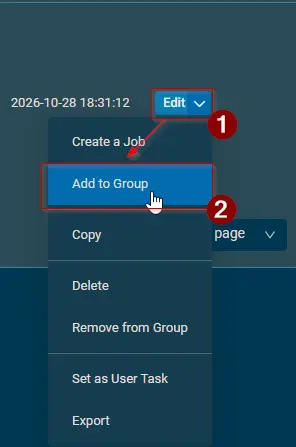

## Overview

`<What the component does, in one or two plain sentences.>`

`<How often to run it, and what happens on devices it does not apply to.>`

## Dependencies

> 📝 **Document Author Workflow (Read Before Proceeding)**
> 
> **Do not upload `.cpt` files directly to this public documentation repository.** 
> To keep our public documentation clean and our components secure, all `.cpt` files must be hosted in our central private repository.
> 
> 1. **Author & Export:** Build and export your component from the Datto RMM interface as a `.cpt` file.
> 2. **Commit to Repository:** Push the finalized `.cpt` file to the **[`datto-rmm` repository](https://github.com/ProVal-Tech/datto-rmm)**.
> 3. **Directory Structure & Naming:** Save the file inside the `components/` directory. The filename **must** be in strict `kebab-case` and exactly match the slug/filename of this markdown document (without the `.md` extension). 
>    * *Example Path:* `components/<this-document-slug>.cpt`
> 4. **Link in Document:** Replace the placeholder links in the "Implementation" and "Attachments" sections below with the permanent GitHub URL pointing to your committed `.cpt` file.
> 5. **Screenshots:** Save this document's own screenshots in `static/img/docs/<New GUID>/`. The Implementation section needs `image1.webp` (the `PVAL` group selection) and the Sample Run section needs `sample-run.webp`.

## Implementation

1. Download the component [<Component Name>](https://github.com/ProVal-Tech/datto-rmm/blob/main/components/<filename>.cpt) from the attachments.  
2. After downloading the file, click on the `Import` button in the Datto RMM interface.  
3. Select the component just downloaded and add it to the Datto RMM interface.  
    
4. After Importing the component to the Datto RMM, make sure to add the component to the `PVAL` Group always.  
    - Steps to Add the component under `PVAL` Group.  
    i. Click on `Drop Down Icon`.  
    ii. Click on `Add to Group`.  
      
    iii. Select the group as `PVAL`  
    

For detailed instructions on importing a Datto component, see [Workflow for Implementing Engineers](https://github.com/ProVal-Tech/datto-rmm#-workflow-for-implementing-engineers).

## Sample Run

## Examples

### Scenario 1: Standard Deployment

Run with all variables left at their defaults.

Expected output:

- `<What the user or device sees.>`
- `<What the component reports.>`

### Scenario 2: `<Variable Name>`

Run with user parameter `<Variable Name> = <Value>`.

Expected output:

- `<What changes compared with the defaults.>`

## Datto Variables

| Variable Name | Type | Default | Description |
| ------------- | ---- | ------- | ----------- |
| `<Variable Name>` | `<String / Boolean / Selection>` | `<Default>` | `<What it does, and what 0 or blank means.>` |

## Output

- Activity Log
- Script logs on the device:
  - `C:\ProgramData\_Automation\Script\<Agnostic Script Name>\<Agnostic Script Name>-log.txt`
  - `C:\ProgramData\_Automation\Script\<Agnostic Script Name>\<Agnostic Script Name>-error.txt`

## Attachments

- [<Component Name>](https://github.com/ProVal-Tech/datto-rmm/blob/main/components/<filename>.cpt)

## Changelog

### 20xx-xx-xx

- Initial version of the document
