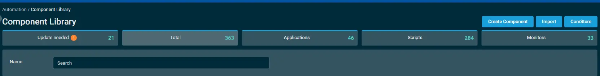
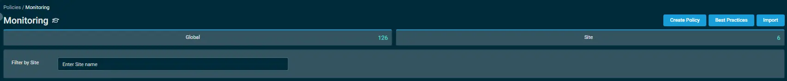
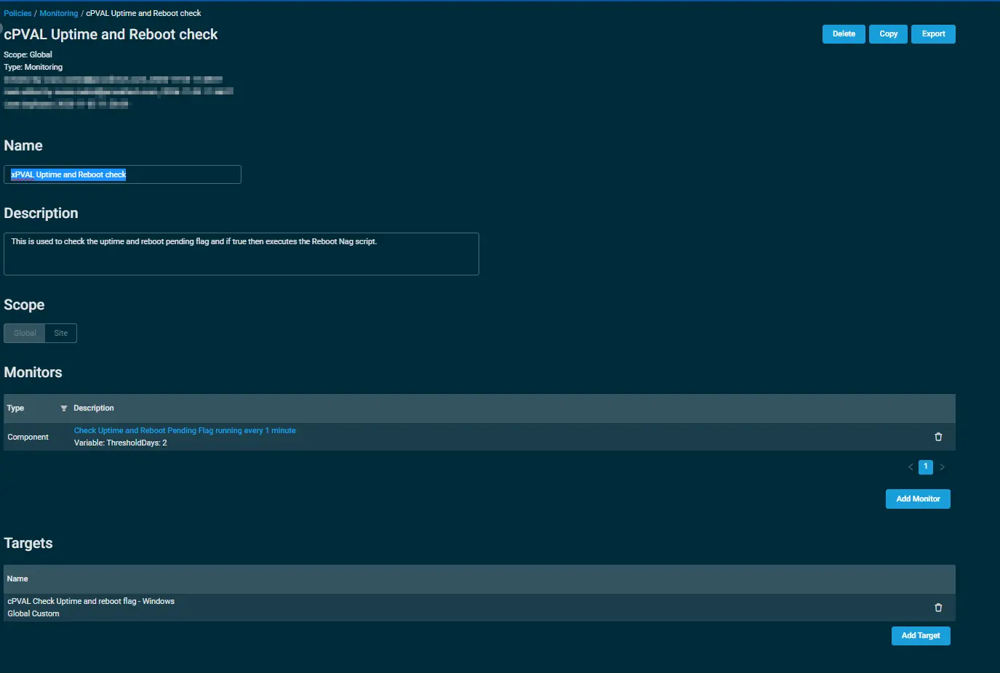
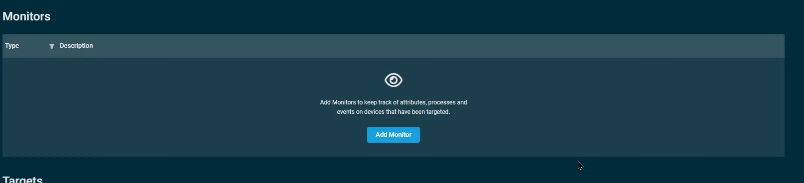
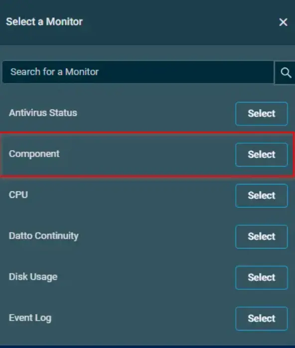
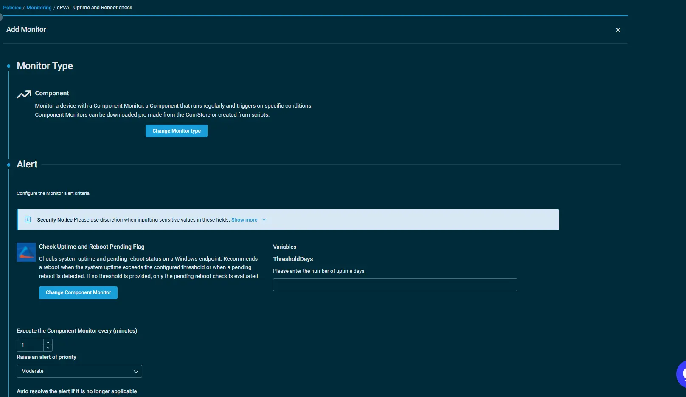
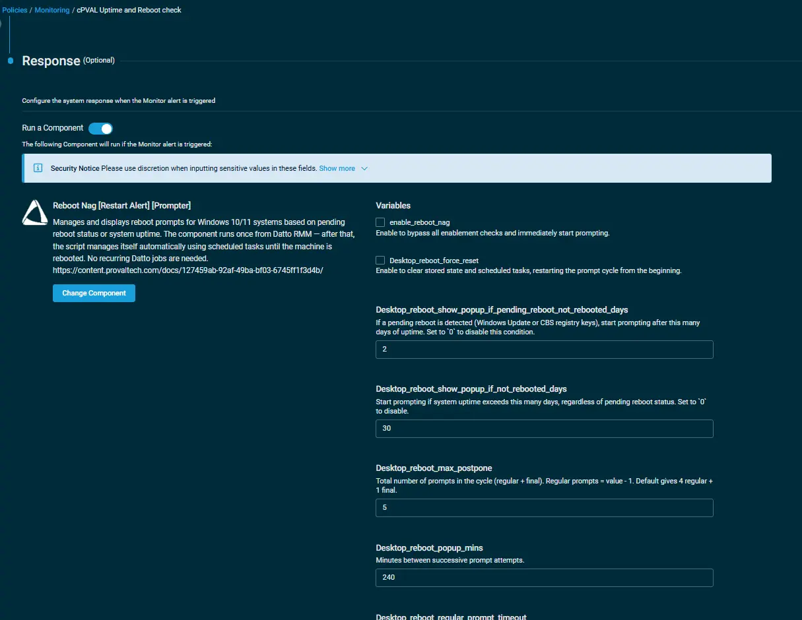
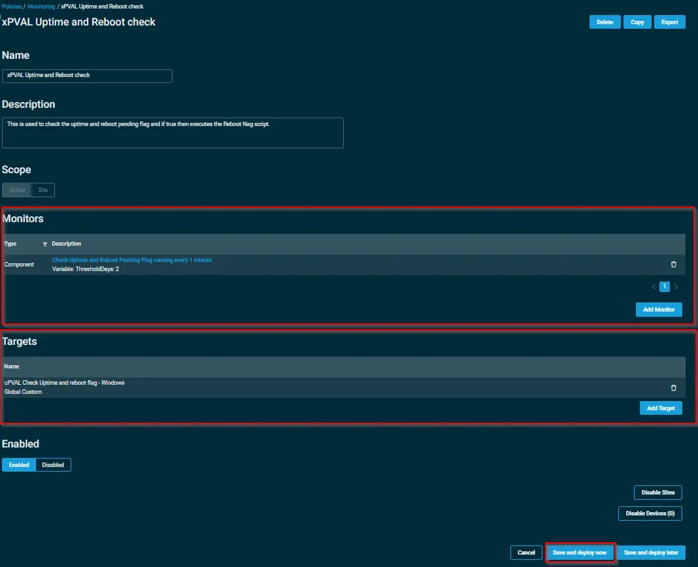

## Overview

Checks system uptime and pending reboot status on a Windows endpoint. Recommends a reboot when the system uptime exceeds the configured threshold or when a pending reboot is detected. If no threshold is provided, only the pending reboot check is evaluated.

## Import

1. Download the component [Check Uptime and Reboot Pending Flag](https://github.com/ProVal-Tech/datto-rmm/blob/main/components/check-uptime-and-reboot-pending-flag.cpt) from the attachments.

2. After downloading the file, click on the `Import` button in the Datto RMM interface.

3. Select the component just downloaded and add it to the Datto RMM interface.  
    

For detailed instructions on importing a Datto component, see [Workflow for Implementing Engineers](https://github.com/ProVal-Tech/datto-rmm#-workflow-for-implementing-engineers).

To implement the `Check Uptime and Reboot Pending Flag` over a policy, follow these steps:  

## Implementation

1. Under the `Policies > Monitoring` section, click on create policy.  
  

    - State the name of the policy `xPVAL Uptime and Reboot check` 
    - Provide the description.  
    - State the Scope of the policy.  
      

    - Within the Monitors section, click on `Add Monitor`.  
         
   
    - Under the `Monitor Type`, click on `Select` and then select the `Component`option.  
    .

    ### Add Alert

    -  Inorder to configure your `component` via alerting, follow the below steps:  
        - Click on `Select a Component Monitor` and then select the component `Check Uptime and Reboot Pending Flag` from the search bar.
        - Set the `ThresholdDays` Value as per requirement. 
        - Set the interval to `execute the component monitor`.  
        

    ### Response
      - Click Run a component `Reboot Nag [Restart Alert] [Prompter]`.
      - Update the variables of reboot Nag.
      
      - Click Save

3. Click on `Add Target` to provide the targeted machines.  
   
5. Click on `Save and Deploy Now` to save the policy.

## Datto Variables

| Variable Name | Type | Default | Description |
| ------------- | ---- | ------- | ----------- |
| `ThresholdDays` | `String` | -- | `Please enter the number of uptime days.` |

## Output

- Alert Tab

## Attachments

- [Check Uptime and Reboot Pending Flag](https://github.com/ProVal-Tech/datto-rmm/blob/main/components/check-uptime-and-reboot-pending-flag.cpt)

## Changelog

### 2026-11-09

- Initial version of the document
