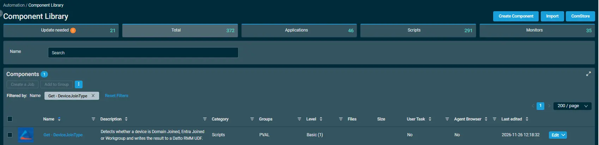
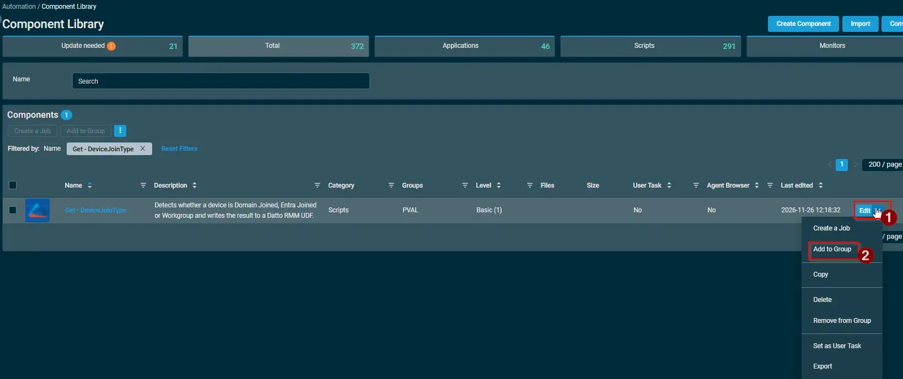
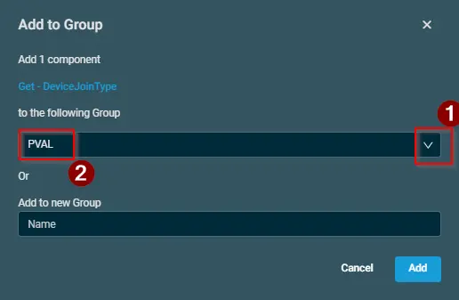
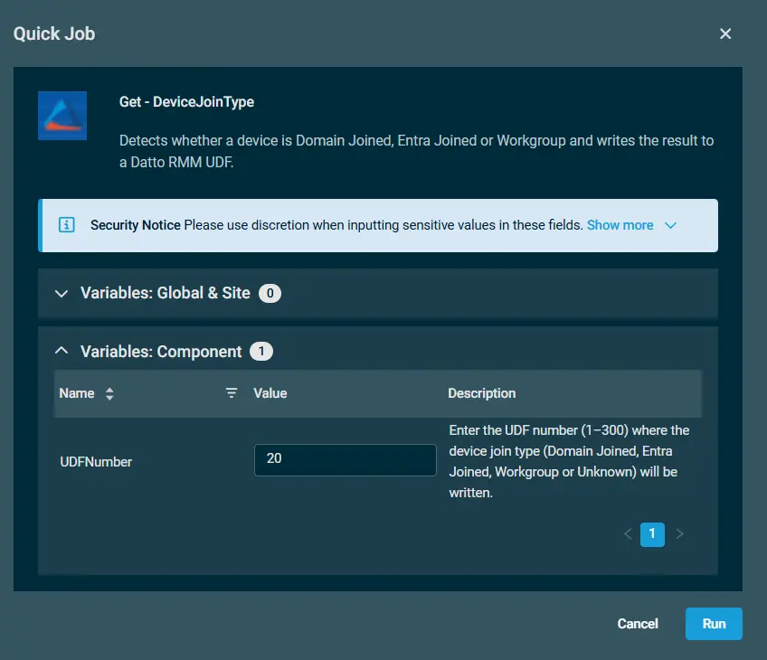

## Overview

Datto RMM shows the WMI Domain/Workgroup value, so devices joined only to Entra ID (Azure AD) show up as `WORKGROUP`. This component checks the device's actual join state and writes one of `Domain Joined`, `Entra Joined`, `Workgroup` or `Unknown` to the UDF you choose.

Run it on demand, or on a daily or weekly schedule so the UDF stays current. It is a PowerShell component for Windows devices only. If a device has no join data that can be read, the UDF is set to `Unknown`.

The AD domain name appears in the job output only. It is not written to the UDF.

## Implementation

1. Download the component [Get - DeviceJoinType](https://github.com/ProVal-Tech/datto-rmm/blob/main/components/get-devicejointype.cpt) from the attachments.  
2. After downloading the file, click on the `Import` button in the Datto RMM interface.  
3. Select the component just downloaded and add it to the Datto RMM interface.  
    
4. After Importing the component to the Datto RMM, make sure to add the component to the `PVAL` Group always.  
    - Steps to Add the component under `PVAL` Group.  
    i. Click on `Drop Down Icon`.  
    ii. Click on `Add to Group`.  
      
    iii. Select the group as `PVAL`  
    

For detailed instructions on importing a Datto component, see [Workflow for Implementing Engineers](https://github.com/ProVal-Tech/datto-rmm#-workflow-for-implementing-engineers).

## Sample Run

When running the component as a quick job or via automation, it asks for `UDFNumber` variable to write the Output. Enter a number between 1 and 300. The join type is written to that UDF.

## Examples

### Scenario 1: Standard Deployment

Run with the `UDFNumber` variable set to the UDF slot you want to use. `UDFNumber` has no default, so it must always be supplied.

Expected output:

- Nothing is shown to the user on the device.
- The UDF set in `UDFNumber` is updated with the device's join type, for example `Domain Joined`.
- The job output lists the computer name, result, AD and Entra join state, AD domain name (if domain joined) and the data sources used, then ends with `UDF <UDFNumber> written : Domain Joined`. Exit code `0`.

### Scenario 2: Entra ID Joined (Cloud-Only) Device

Run with the `UDFNumber` variable set on a device joined only to Entra ID. Datto shows this device as `WORKGROUP`.

Expected output:

- The UDF set in `UDFNumber` is updated with `Entra Joined` instead of the `WORKGROUP` value Datto reports.
- Job output shows `AD Domain Joined : False` and `Entra ID Joined : True`.

### Scenario 3: Hybrid Entra ID Joined Device

Run with the `UDFNumber` variable set on a device joined to both on-prem AD and Entra ID.

Expected output:

- The UDF set in `UDFNumber` is updated with `Domain Joined`.
- Job output includes `Note : Hybrid Entra ID joined (reported as Domain Joined)` along with the AD domain name.

### Scenario 4: `UDFNumber` Missing or Invalid

Run with `UDFNumber` left blank, or set to a value outside 1-300 (for example `0` or `abc`).

Expected output:

- No UDF is written.
- Job output shows `[ERROR] UDFNumber was not supplied...` or `[ERROR] UDFNumber must be an integer between 1 and 300...`. Exit code `2`.

## Datto Variables

| Variable Name | Type | Default | Description |
| ------------- | ---- | ------- | ----------- |
| `UDFNumber` | `String` | --- | Enter the UDF number (1–300) where the device join type (Domain Joined, Entra Joined, Workgroup or Unknown) will be written. |

## Output

- Activity Log
- UDF (the slot set in `UDFNumber`)
- Exit codes:
  - `0`: Success, UDF written
  - `1`: UDF write failed
  - `2`: `UDFNumber` missing or invalid

## Attachments

- [Get - DeviceJoinType](https://github.com/ProVal-Tech/datto-rmm/blob/main/components/get-devicejointype.cpt)

## Changelog

### 2026-11-26

- Initial version of the document