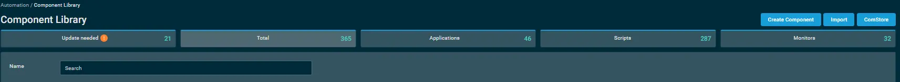
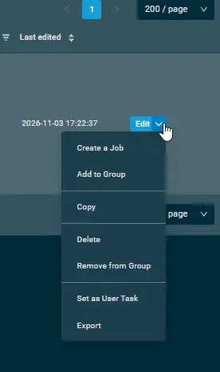
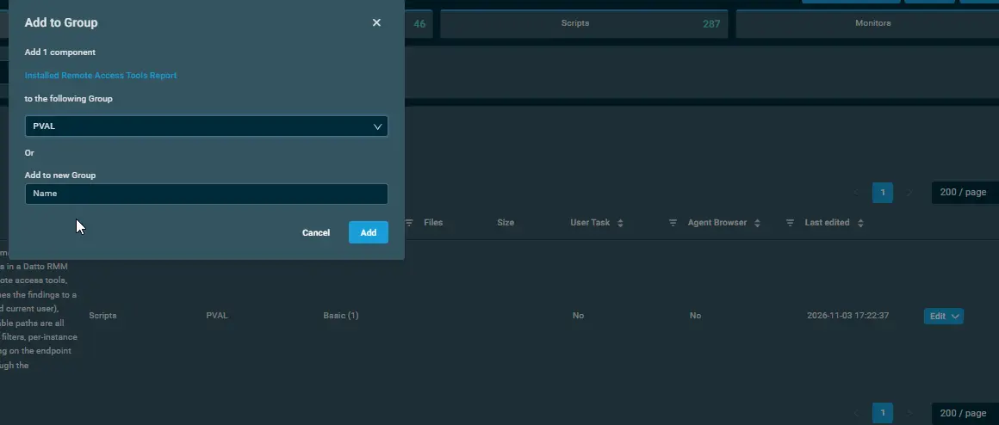
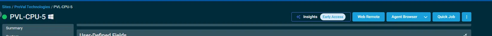
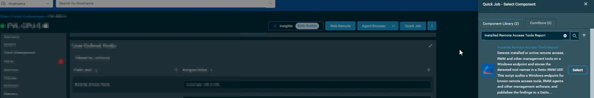
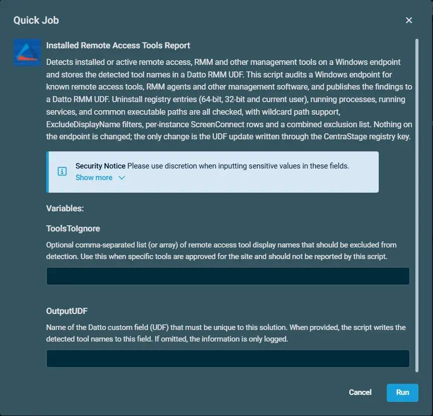
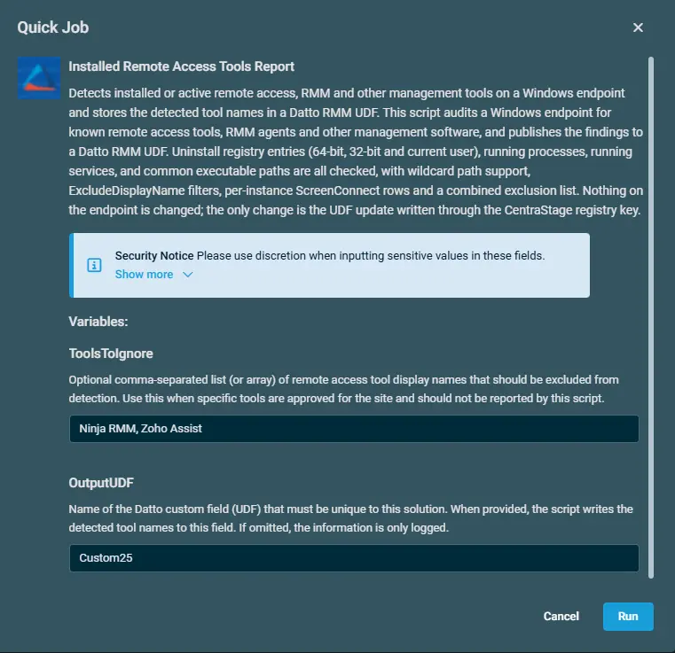
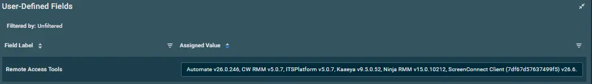

## Overview

The script inventories the endpoint for a curated list of remote access utilities by inspecting uninstall keys, running processes, installed services, and known executable paths. It also scans current-user registry entries to identify additional installed applications.

The script reports detected tool names and installed versions. Optional exclusions can be provided through the Datto component parameter `ToolsToIgnore`. When the `OutputUDF` parameter is supplied, detected tool names and versions are saved to the specified Datto UDF. All findings are also written to the Datto activity log for auditing purposes.

### Supported Tool Display Names

Use the exact spelling when excluding tools:

- `AeroAdmin`
- `Ammyy Admin`
- `AnyDesk`
- `Atera`
- `Automate`
- `Auvik`
- `BeyondTrust`
- `Chrome Remote Desktop`
- `Continuum`
- `CW RMM`
- `DameWare`
- `DWService`
- `GoToAssist`
- `GoToMyPC`
- `ITSPlatform`
- `Kaseya`
- `LiteManager`
- `LogMeIn`
- `Malwarebytes`
- `ManageEngine`
- `N-Able N-Central`
- `N-Able N-Sight`
- `Naverisk`
- `Ninja RMM`
- `NoMachine`
- `Parsec`
- `PRTG`
- `Rapid7 Insight Agent`
- `Remote Utilities`
- `RemotePC`
- `ScreenConnect`
- `SolarWinds`
- `Splashtop`
- `Supremo`
- `Syncro`
- `TeamViewer`
- `TightVNC`
- `UltraVNC`
- `VNC`
- `VNC Connect (RealVNC)`
- `VSA`
- `Zoho Assist`

## Implementation

1. Download the component [Installed Remote Access Tools Report](https://github.com/ProVal-Tech/datto-rmm/blob/main/components/installed-remote-access-tools-report.cpt) from the attachments.

2. After downloading the file, click on the `Import` button in the Datto RMM interface.

3. Select the component just downloaded and add it to the Datto RMM interface.

   

4. After importing the component into Datto RMM, make sure to add it to the `PVAL` Group.

   - Steps to add the component under the `PVAL` Group:
     1. Click on the `Drop Down Icon`.
     2. Click on `Add to Group`.

        

     3. Select the group as `PVAL`.

        

For detailed instructions on importing a Datto component, see [Workflow for Implementing Engineers](https://github.com/ProVal-Tech/datto-rmm#-workflow-for-implementing-engineers).

## Sample Run

To execute the component over a specific machine, follow these steps:

1. Select the machine you want to run the component on from Datto RMM.

2. Click on the `Quick Job` button.

   

3. Search for the component `Installed Remote Access Tools Report` and click on `Select`.

   

4. Configure the component parameters as required.

   - **Example 1:** Fetching information about all installed remote access tools except `Datto RMM`. Data will not be stored to a UDF.

     

   - **Example 2:** Fetching information about all installed remote access tools except `Datto RMM`, `Ninja RMM`, and `Zoho Assist`. Detected tool names and versions will be stored in User Data Field 25.

     

## Datto Variables

| Variable Name | Example | Type | Default | Mandatory | Description |
| ------------- | ------- | ---- | ------- | --------- | ----------- |
| `ToolsToIgnore` | `Datto RMM, Chrome Remote Desktop, AnyDesk` | String | `Datto RMM` | False | Optional comma-separated list (or array) of remote access tool display names that should be excluded from detection. Use this when specific tools are approved for the site and should not be reported by this script. |
| `OutputUDF` | `Custom25` | String | -- | False | Name of the Datto custom field (UDF) that must be unique to this solution. When provided, the script writes the detected tool names and installed versions to this field. If omitted, the information is only logged. |

**Note:** The UDF variable number may vary depending on the organization. In our Datto instance, the UDF number is 25; however, this number may differ in other RMM environments. Please also rename that UDF to `Remote Access Tools`.

## Output

- **UDF**

  

- **StdOut**

  ```text
  Installed Remote Access Tools Report

  [INFO] Checking 42 tool(s) against 19 uninstall entries, 188 processes and 289 services.

  Detected 8 remote access tool(s). Full details:

  Name               : Automate
  ProductName        : ConnectWise Automate Remote Agent
  Installed          : Yes
  CurrentlyRunning   : No
  HasRunningService  : No
  Version            : 26.0.246
  InstallDate        : 20261029
  InstallLocation    :
  UninstallString    :
  ExePath            : C:\Windows\LTSvc\LTSvc.exe
  DataCollectionDate : 2026-11-03 20:05:25

  Name               : CW RMM
  ProductName        : ITSPlatform
  Installed          : Yes
  CurrentlyRunning   : No
  HasRunningService  : Yes
  Version            : 5.0.7
  InstallDate        : 20261012
  InstallLocation    : C:\Program Files (x86)\
  UninstallString    : MsiExec.exe /X{18f39771-f9d8-4cfd-9654-f6c67c8ad9f4}
  ExePath            : C:\Program Files (x86)\ITSPlatform
  DataCollectionDate : 2026-11-03 20:05:25

  Name               : ITSPlatform
  ProductName        : ITSPlatform
  Installed          : Yes
  CurrentlyRunning   : No
  HasRunningService  : Yes
  Version            : 5.0.7
  InstallDate        : 20261012
  InstallLocation    : C:\Program Files (x86)\
  UninstallString    : MsiExec.exe /X{18f39771-f9d8-4cfd-9654-f6c67c8ad9f4}
  ExePath            : C:\Program Files (x86)\ITSPlatform
  DataCollectionDate : 2026-11-03 20:05:25

  Name               : Kaseya
  ProductName        : Kaseya Agent (pvl-cpu-5.development.proval - 5.161.193.122)
  Installed          : Yes
  CurrentlyRunning   : Yes
  HasRunningService  : Yes
  Version            : 9.5.0.52
  InstallDate        : 20261020
  InstallLocation    : C:\Program Files (x86)\Kaseya\PROTE172114012704392
  UninstallString    : "C:\Program Files (x86)\Kaseya\PROTE172114012704392\KASetup.exe" /r /g PROTE172114012704392 /l "%TEMP%\kasetup.log"
  ExePath            : C:\Program Files (x86)\Kaseya\PROTE172114012704392
  DataCollectionDate : 2026-11-03 20:05:25

  Name               : Ninja RMM
  ProductName        : NinjaRMMAgent
  Installed          : Yes
  CurrentlyRunning   : Yes
  HasRunningService  : Yes
  Version            : 15.0.10212
  InstallDate        : 20261023
  InstallLocation    :
  UninstallString    : MsiExec.exe /X{817AF559-0C8C-4539-94D8-3096AF4B08D9}
  ExePath            : C:\Program Files (x86)\NinjaOne\NinjaRMMAgent.exe
  DataCollectionDate : 2026-11-03 20:05:25

  Name               : ScreenConnect Client (7df67d57637499f5)
  ProductName        : ScreenConnect Client (7df67d57637499f5)
  Installed          : Yes
  CurrentlyRunning   : Yes
  HasRunningService  : Yes
  Version            : 26.6.6.9747
  InstallDate        : 20261023
  InstallLocation    :
  UninstallString    : MsiExec.exe /X{F426648D-72EE-146C-6A6D-1ED9139FC365}
  ExePath            :
  DataCollectionDate : 2026-11-03 20:05:25

  Name               : ScreenConnect Client (c6bd08847e48343e)
  ProductName        : ScreenConnect Client (c6bd08847e48343e)
  Installed          : Yes
  CurrentlyRunning   : Yes
  HasRunningService  : Yes
  Version            : 26.6.6.9747
  InstallDate        : 20261012
  InstallLocation    :
  UninstallString    : MsiExec.exe /X{078072F6-3A6F-36A7-4664-51F0D1CED092}
  ExePath            :
  DataCollectionDate : 2026-11-03 20:05:25

  Name               : VSA
  ProductName        : Kaseya Agent (pvl-cpu-5.development.proval - 5.161.193.122)
  Installed          : Yes
  CurrentlyRunning   : Yes
  HasRunningService  : Yes
  Version            : 9.5.0.52
  InstallDate        : 20261020
  InstallLocation    : C:\Program Files (x86)\Kaseya\PROTE172114012704392
  UninstallString    : "C:\Program Files (x86)\Kaseya\PROTE172114012704392\KASetup.exe" /r /g PROTE172114012704392 /l "%TEMP%\kasetup.log"
  ExePath            : C:\Program Files (x86)\Kaseya\PROTE172114012704392
  DataCollectionDate : 2026-11-03 20:05:25

  Custom25 : Automate v26.0.246, CW RMM v5.0.7, ITSPlatform v5.0.7, Kaseya v9.5.0.52, Ninja RMM v15.0.10212, ScreenConnect Client (7df67d57637499f5) v26.6.6.9747, ScreenConnect Client (c6bd08847e48343e) v26.6.6.9747, VSA v9.5.0.52

  Success: Completed audit. Detected 8 remote access tool(s): Automate, CW RMM, ITSPlatform, Kaseya, Ninja RMM, ScreenConnect Client (7df67d57637499f5), ScreenConnect Client (c6bd08847e48343e), VSA
  ```

- **StdErr**

## Attachments

- [Installed Remote Access Tools Report](https://github.com/ProVal-Tech/datto-rmm/blob/main/components/installed-remote-access-tools-report.cpt)

## Changelog

### 2026-11-03

- Added more remote access tools to the detection catalogue and current-user registry scanning.
- UDF output now includes the tool name and installed version.
- Simplified the UDF update method and ensured the script always completes successfully so the UDF syncs.

### 2025-11-20

- Initial version of the document