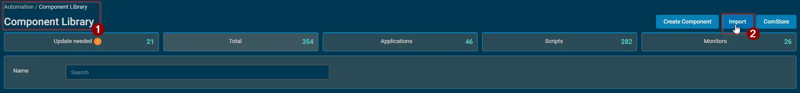
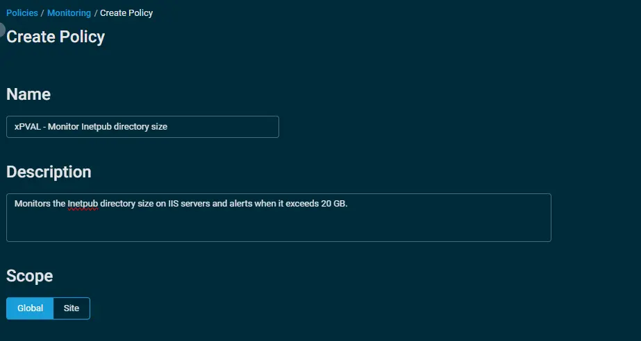
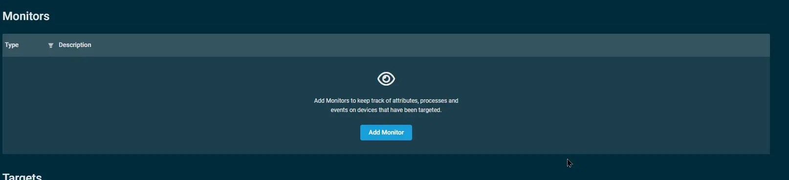
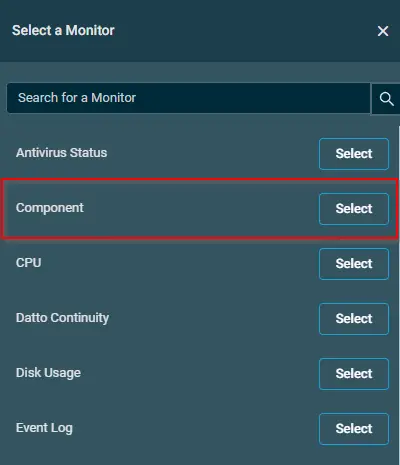
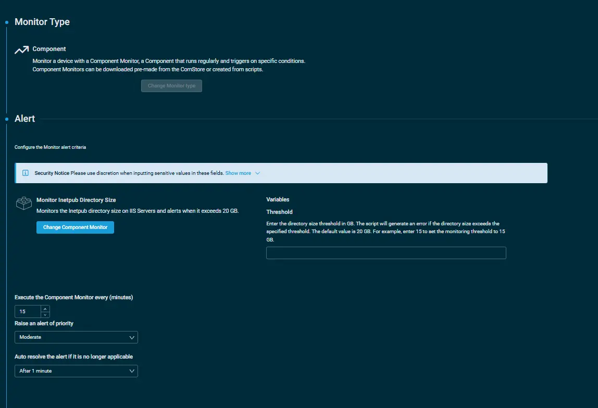
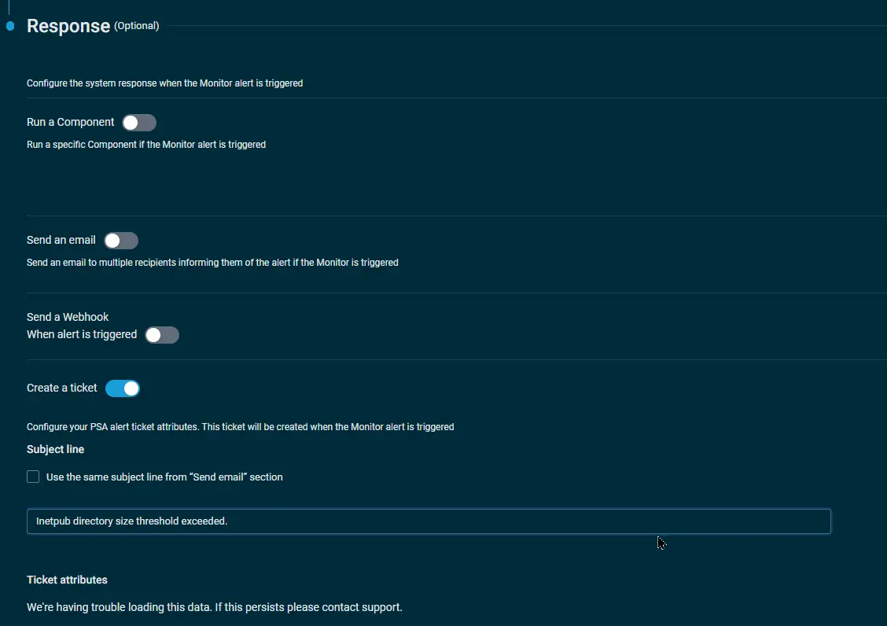
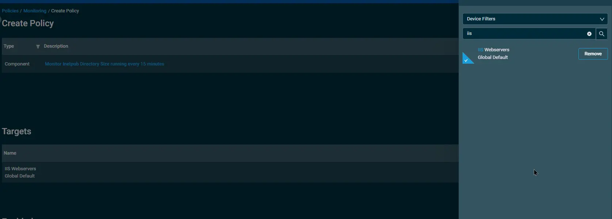

## Overview  
Monitors the Inetpub directory size on IIS Servers and alerts when it exceeds 20 GB.

## Implementation  

1. Download the component [Monitor Inetpub Directory Size](https://github.com/ProVal-Tech/datto-rmm/blob/main/components/monitor-inetpub-directory-size.cpt) from the attachments.

2. After downloading the attached file, click on the `Import` button
3. Select the component just downloaded and add it to the Datto RMM interface.  
  

## Sample Run

To implement the `component` over a policy, follow these steps:  

1. Under the `Policies> Monitoring` section, click on create policy.  

    - State the name of the policy `xPVAL - Monitor Inetpub directory size` 
    - Provide the description.  
    - State the Scope of the policy.  
      

    - Within the Monitors section, click on `Add Monitor`.  
         

    - Under the `Monitor Type`, click on `Select` and then select the `Component`option.  
.  

    -  Inorder to configure your `component` via alerting, follow the below steps:  
        - Click on `Select a Component Monitor` and then select  
           the component `Monitor Inetpub Directory Size` from the search bar.  
        -  Set the interval to `execute the component monitor`.  
        - Select the `priority to raise an alert`.  
        - Select the time to `auto resolve the alert`.
        - Select `Create Ticket` Option
        - Set Subject line to `Inetpub directory size threshold exceeded`
         
              
        - Click on `Add Monitor`.  

3. Click on `Add Target` to provide the targeted machines.  
4. Select `IIS Webservers` from the Device Filters.
   
5. Click on `Save and Deploy Now` to save the policy.

## Output  
- stdOut  
- stdError  

## Attachments  

[Monitor Inetpub Directory Size](https://github.com/ProVal-Tech/datto-rmm/blob/main/components/monitor-inetpub-directory-size.cpt)

## Changelog

### 2026-10-13

- Initial version of the document
