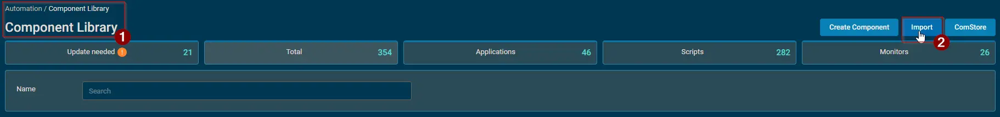
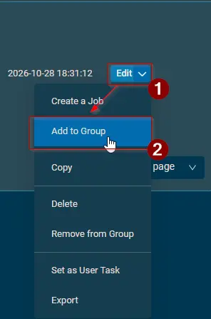
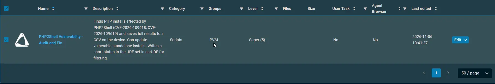
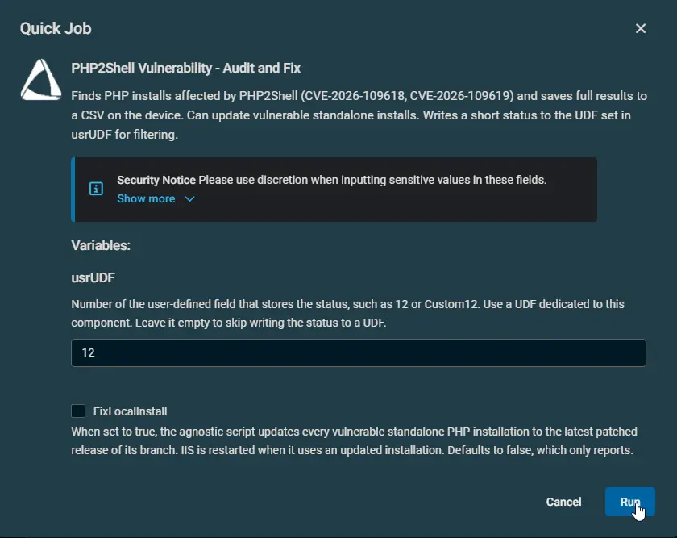

## Overview

This is a Datto implementation of the agnostic [Detect-PHP2ShellVulnerability](/docs/f72fd964-8053-48be-9245-7383b3a4db17) script.

The component finds every PHP installation on a Windows device and checks whether it is affected by PHP2Shell (CVE-2026-109618 and CVE-2026-109619). The full result of each installation is saved to a CSV file on the device, and a short status can be written to a user-defined field (UDF) so affected devices are easy to filter. With `FixLocalInstall`, the component also updates vulnerable standalone PHP installations to a patched release.

PHP2Shell is fixed in PHP 8.5.12, 8.4.27, 8.3.36 and 8.2.35. PHP 8.1 and older are end-of-life and have no fix.

Run the component as a scheduled job so the UDF stays current. Devices without PHP are left unchanged and get the status `Not Found`.

:::note  
Only standalone PHP installations are updated. PHP that comes with a stack (XAMPP, WampServer, Laragon and so on) or with another vendor's application is reported but never changed. Update it through that product. End-of-life branches are also reported only.  
:::

:::warning  
While a standalone installation is updated, IIS, services and processes that use it are stopped and started again. Run `FixLocalInstall` during a maintenance window on web servers.  
:::

## Dependencies

- [Detect-PHP2ShellVulnerability](/docs/f72fd964-8053-48be-9245-7383b3a4db17)

## Implementation

1. Download the component [PHP2Shell Vulnerability - Audit and Fix](https://github.com/ProVal-Tech/datto-rmm/blob/main/components/php2shell-vulnerability-audit-and-fix.cpt) from the attachments.  
2. After downloading the file, click on the `Import` button in the Datto RMM interface.  
3. Select the component just downloaded and add it to the Datto RMM interface.  
    
4. After Importing the component to the Datto RMM, make sure to add the component to the `PVAL` Group always.  
    - Steps to Add the component under `PVAL` Group.  
    i. Click on `Drop Down Icon`.  
    ii. Click on `Add to Group`.  
      
    iii. Select the group as `PVAL`  
    

For detailed instructions on importing a Datto component, see [Workflow for Implementing Engineers](https://github.com/ProVal-Tech/datto-rmm#-workflow-for-implementing-engineers).

## Sample Run

## Examples

### Scenario 1: Standard Deployment

Run with all variables left at their defaults.

Expected output:

- Every PHP installation is checked, and nothing on the device is changed.
- The result of each installation is saved to the CSV file, and a summary is shown in the Activity Log.
- No UDF is updated.

### Scenario 2: usrUDF

Run with user parameter `usrUDF = 12`.

Expected output:

- The same check as the standard deployment.
- The device status, such as `Vulnerable` or `All Good`, is written to UDF 12. See [UDF Status](#udf-status).

### Scenario 3: FixLocalInstall

Run with user parameters `FixLocalInstall = True` and `usrUDF = 12`.

Expected output:

- Each vulnerable standalone PHP installation is updated to the latest patched release of its branch. The installation folder is backed up to a zip file first, and `php.ini` and third-party extensions are kept.
- An installation managed by winget at machine level is updated through winget. If winget doesn't bring it to a patched version, the files are replaced directly.
- If an update fails, the original files are restored from the backup and the status is `Update Failed`.
- The CSV file shows what was done with each installation, and UDF 12 shows the status after the update.

## Datto Variables

| Variable Name | Type | Default | Description |
| ------------- | ---- | ------- | ----------- |
| `FixLocalInstall` | Boolean | `False` | Updates every vulnerable standalone PHP installation to the latest patched release of its branch. `False` only reports. |
| `usrUDF` | String |  | Number of the UDF that stores the status, such as `12`. Use a UDF dedicated to this component. Blank skips the UDF. |

## UDF Status

The UDF holds one short status so devices can be filtered in views and used as targeting criteria. The details for each installation are in the CSV file.

| Status | Meaning |
| ------ | ------- |
| `Not Found` | No PHP installation was found. |
| `All Good` | Every PHP installation is patched. |
| `Vulnerable` | At least one installation is vulnerable or on an end-of-life branch. |
| `Unknown Version` | The version of at least one installation couldn't be read. The rest are patched. |
| `Update Failed` | `FixLocalInstall` couldn't update at least one installation. |
| `Script Failed` | The check couldn't finish. |

No status contains another, so a view filter such as `UDF 12 contains Vulnerable` matches only that status. `contains Failed` matches both failure statuses.

## Results by Device

| Device | Result |
|--------|--------|
| No PHP installation | Success. No CSV file. UDF set to `Not Found`. |
| All installations patched | Success. UDF set to `All Good`. |
| Vulnerable or end-of-life installation found | Success. UDF set to `Vulnerable`. |
| Version of an installation couldn't be read | Success. UDF set to `Unknown Version`. |
| All vulnerable standalone installations updated | Success. UDF set to `All Good`, or `Vulnerable` if stack, vendor or end-of-life installations remain. |
| An update failed | Failure. The CSV file and the UDF (`Update Failed`) are written first. The Activity Log shows the error log. |
| The check couldn't finish | Failure. UDF set to `Script Failed`. The Activity Log shows the reason. |
| `usrUDF` isn't a valid number | Failure. No changes. |
| Component or script failed its signature check | Failure. No changes. The UDF keeps its previous value. |
| Script could not be downloaded and no copy is on the device | Failure. No changes. The UDF keeps its previous value. |
| Script blocked by a security application | Failure. The Activity Log states that a security application seems to have interrupted the script. |

## Output

- Activity Log
- UDF set in `usrUDF`
- CSV file on the device:
  - `C:\ProgramData\_Automation\Script\Detect-PHP2ShellVulnerability\Detect-PHP2ShellVulnerability.csv`
- Script logs on the device:
  - `C:\ProgramData\_Automation\Script\Detect-PHP2ShellVulnerability\Detect-PHP2ShellVulnerability-log.txt`
  - `C:\ProgramData\_Automation\Script\Detect-PHP2ShellVulnerability\Detect-PHP2ShellVulnerability-error.txt`
- Backups made by `FixLocalInstall`:
  - `C:\ProgramData\_Automation\Script\Detect-PHP2ShellVulnerability\Backup\`

### CSV File

The CSV file is replaced on every run, so it always reflects the latest run. It has one row per PHP installation.

| Column | Description |
| ------ | ----------- |
| `Path` | Folder of the PHP installation. |
| `Name` | Owning product: `PHP`, the stack name, the application that bundles PHP, or `Unknown application`. |
| `Publisher` | Publisher of the owning product, when known. |
| `IsNative` | `True` for a standalone PHP installation, otherwise `False`. |
| `InstallType` | `Standalone`, `Stack` or `Vendor`. |
| `ManagedBy` | `Winget`, `Winget (user scope)` or `None`. |
| `PackageId` | Winget package ID of a winget installation. |
| `ExecutablePath` | `php.exe`, `php-cgi.exe` or the engine DLL the version was read from. |
| `Version` | PHP version. After a successful update, the new version. |
| `Architecture` | `x64`, `x86`, `arm64` or `Unknown`. |
| `ThreadSafety` | `TS`, `NTS` or `Unknown`. |
| `InIis` | `True` when IIS uses the folder, otherwise `False`. |
| `Running` | `True` when PHP from the folder is running, otherwise `False`. |
| `Status` | `Patched`, `Vulnerable`, `EndOfLife` or `Unknown`. |
| `RequiredVersion` | First fixed release for the installation's branch. |
| `Action` | What was done with the installation, such as `None`, the update details, or why it was skipped or failed. |
| `ScriptRunTime` | Time the component ran (`yyyy-MM-dd HH:mm:ss`). |

## Attachments

- [PHP2Shell Vulnerability - Audit and Fix](https://github.com/ProVal-Tech/datto-rmm/blob/main/components/php2shell-vulnerability-audit-and-fix.cpt)

## Changelog

### 2026-11-06

- Initial version of the document
