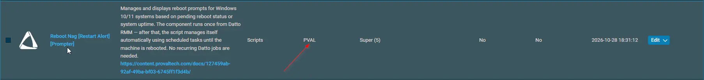
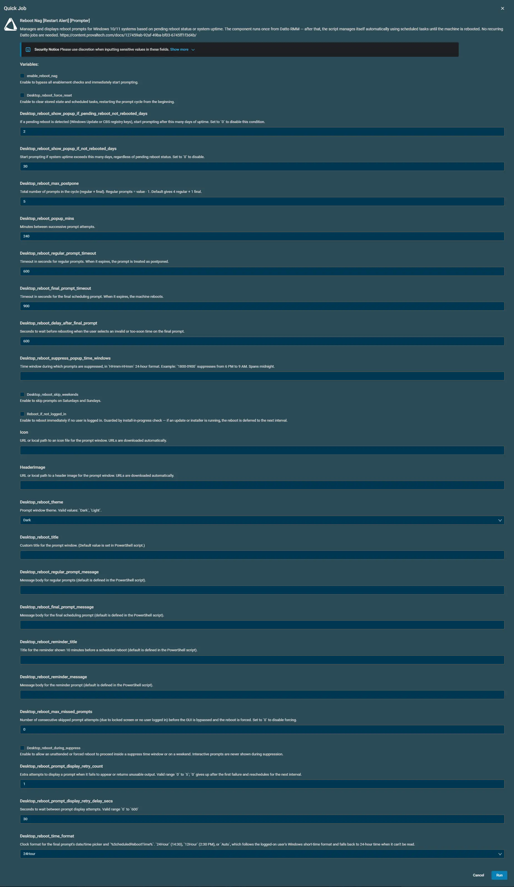
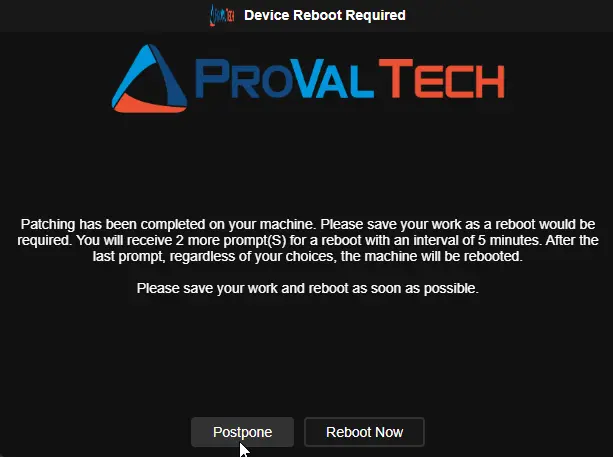
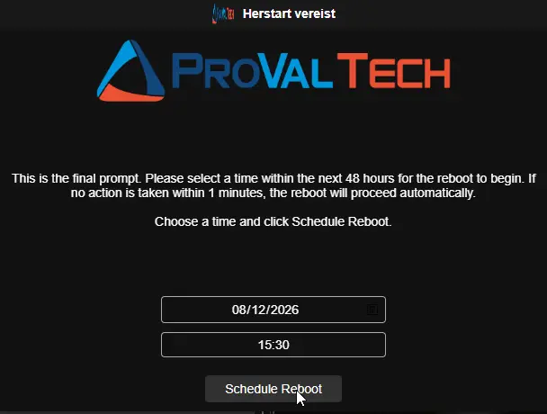
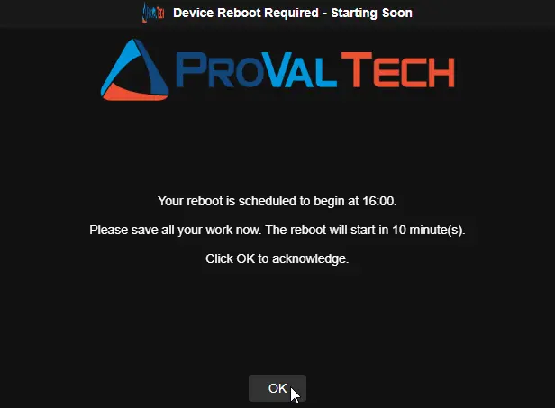
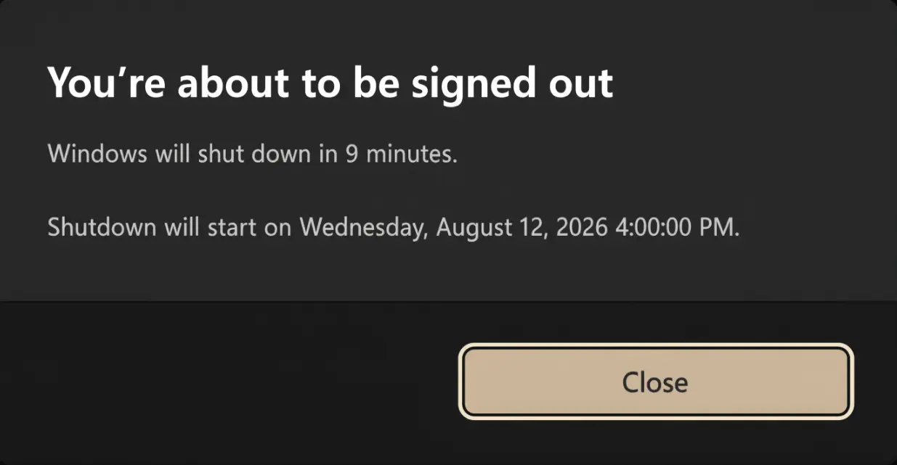
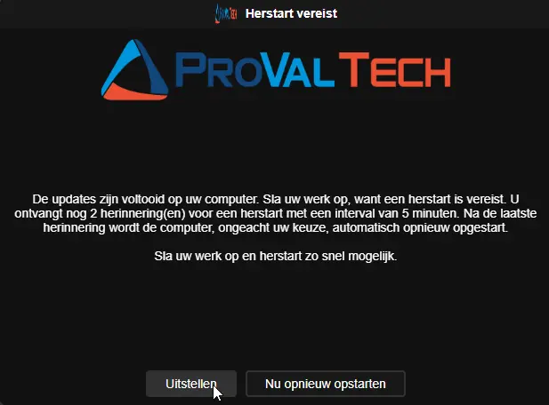
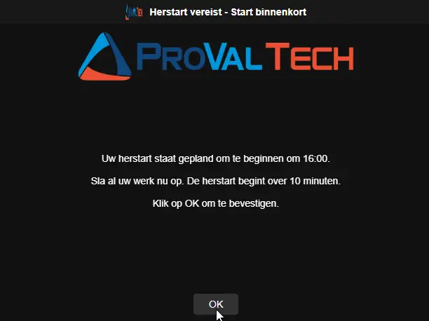
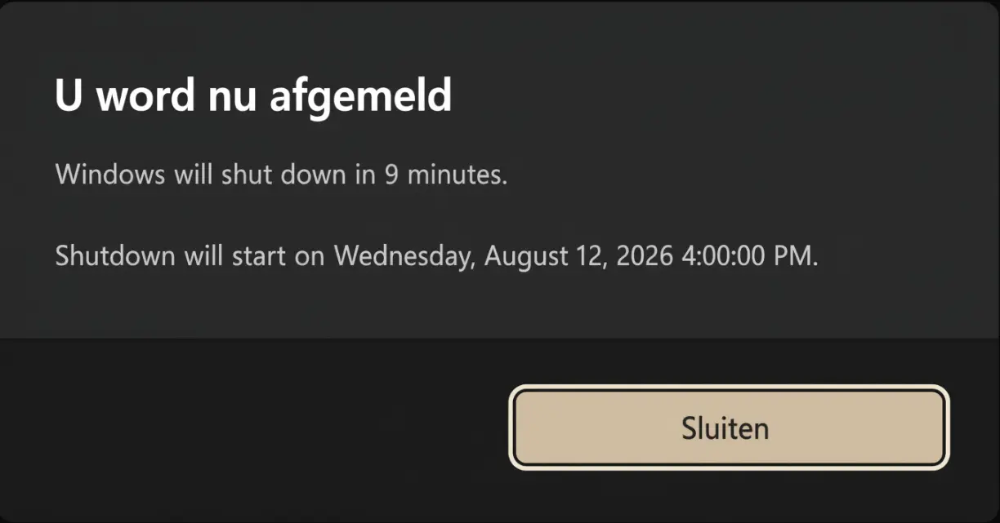
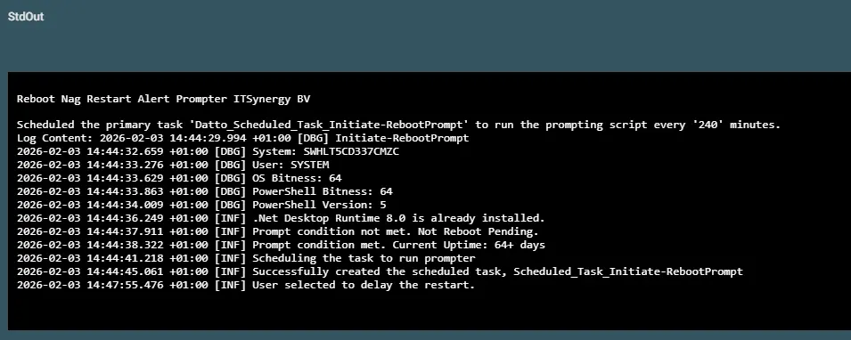

## Overview

This is a Datto implementation of the agnostic [Invoke-RebootWithPrompt](/docs/1ff05046-df36-4692-80a7-36458aa43392) script.

The component prompts users to restart Windows 10 and Windows 11 devices that have a pending reboot or have been running for too long. Users can postpone the restart a set number of times, then pick a time for it on the final prompt.

Run the component once per device. Scheduled tasks on the device handle everything after that until the device restarts, so no recurring Datto job is needed. Devices that don't meet the prompt conditions are left unchanged.

Prompts support custom branding, Dutch wording for `nl-NL` and `nl-BE` users, and live values in custom messages. Times are shown on a 24-hour clock by default.

:::note
Running the component again while a prompt cycle is active changes nothing. Set `Desktop_reboot_force_reset` to `True` to start the cycle over.
:::

:::warning
When the final prompt is ignored, the device restarts without further confirmation once `Desktop_reboot_delay_after_final_prompt` has passed. Unsaved work is lost if the user doesn't act on the reminder.
:::

## Dependencies

- [Invoke-RebootWithPrompt](/docs/1ff05046-df36-4692-80a7-36458aa43392)
- [OmniPrompt](/docs/8ead1ffd-dade-4e17-9958-3313da9a7aa8)
- [SilentLauncher](/docs/b0b9f423-eee3-4148-b8a0-e99400c45698)

## Implementation

1. Download the component [Reboot Nag [Restart Alert] [Prompter]](https://github.com/ProVal-Tech/datto-rmm/blob/main/components/reboot-nag-restart-alert-prompter.cpt) from the attachments.  
2. After downloading the file, click on the `Import` button in the Datto RMM interface.  
3. Select the component just downloaded and add it to the Datto RMM interface.  
    
4. After Importing the component to the Datto RMM, make sure to add the component to the `PVAL` Group always.  
    - Steps to Add the component under `PVAL` Group.  
    i. Click on `Drop Down Icon`.  
    ii. Click on `Add to Group`.  
      
    iii. Select the group as `PVAL`  
    

For detailed instructions on importing a Datto component, see [Workflow for Implementing Engineers](https://github.com/ProVal-Tech/datto-rmm#-workflow-for-implementing-engineers).

## Sample Run



## Examples

### Scenario 1: Standard Deployment

Run with all variables left at their defaults.

Expected output:

- Devices with a pending reboot and 2+ days of uptime, or 30+ days of uptime, are prompted. Other devices are left unchanged.
- The user gets four regular prompts, four hours apart, then picks a restart time on the fifth (final) prompt.
- A reminder appears 10 minutes before the chosen time, and the device restarts at that time.

### Scenario 2: enable_reboot_nag

Run with user parameter `enable_reboot_nag = True`.

Expected output:

- The enablement conditions are skipped, so prompting starts right away, whatever the uptime or pending reboot status.
- The default prompt cycle follows.

### Scenario 3: Desktop_reboot_force_reset

Run with user parameter `Desktop_reboot_force_reset = True`.

Expected output:

- Existing scheduled tasks and stored prompt state are removed.
- The prompt cycle starts again from the first prompt, using the values from this run.

### Scenario 4: Enablement Conditions

Run with user parameters `Desktop_reboot_show_popup_if_pending_reboot_not_rebooted_days = 1` and `Desktop_reboot_show_popup_if_not_rebooted_days = 0`.

Expected output:

- Devices with a pending reboot and 1+ day of uptime are prompted.
- The uptime-only condition is off, so devices without a pending reboot are never prompted, however long they've been running.

### Scenario 5: Short Prompt Cycle

Run with user parameters `Desktop_reboot_max_postpone = 3`, `Desktop_reboot_popup_mins = 60`, `Desktop_reboot_regular_prompt_timeout = 300`, `Desktop_reboot_final_prompt_timeout = 600`, and `Desktop_reboot_delay_after_final_prompt = 300`.

Expected output:

- 10:00 AM and 11:00 AM: regular prompts. Each closes after 5 minutes and counts as a postpone.
- 12:00 PM: the final prompt appears.
- If the final prompt is ignored, a reminder appears at 12:10 PM and the device restarts at 12:15 PM.

### Scenario 6: Desktop_reboot_skip_weekends and Desktop_reboot_suppress_popup_time_windows

Run with user parameters `Desktop_reboot_skip_weekends = True` and `Desktop_reboot_suppress_popup_time_windows = 1800-0800`.

Expected output:

- Prompts only appear between 8 AM and 6 PM, Monday to Friday. A prompt due at 7 PM Friday waits until Monday morning.
- A restart time the user already picked is still honored, even inside those hours.

### Scenario 7: Reboot_if_not_logged_in

Run with user parameter `Reboot_if_not_logged_in = True`.

Expected output:

- If nobody is logged in, the device restarts without a prompt.
- If Windows Update, an MSI installer, winget, or a BITS transfer is running, the restart waits until the next interval.
- If a user is logged in, the normal prompt cycle is used.

### Scenario 8: Desktop_reboot_max_missed_prompts and Desktop_reboot_during_suppress

Run with user parameters `Desktop_reboot_max_missed_prompts = 3` and `Desktop_reboot_during_suppress = True`.

Expected output:

- After three prompts in a row are skipped (locked screen, or nobody logged in), the device restarts without a prompt.
- That restart can run inside a suppress window or on a weekend. Prompts are still never shown during those times.

### Scenario 9: Desktop_reboot_prompt_display_retry_count and Desktop_reboot_prompt_display_retry_delay_secs

Run with user parameters `Desktop_reboot_prompt_display_retry_count = 2` and `Desktop_reboot_prompt_display_retry_delay_secs = 60`.

Expected output:

- A prompt that fails to appear is tried twice more, one minute apart.
- If all three attempts fail, no postponement is used and the component tries again at the next interval.

### Scenario 10: Desktop_reboot_time_format

Run with user parameter `Desktop_reboot_time_format = 12Hour`.

Expected output:

- The final prompt's date/time picker uses 12-hour time with AM and PM.
- The reminder shows the restart time the same way, for example 2:30 PM.
- `Auto` follows each user's own Windows time setting instead.

### Scenario 11: Icon, HeaderImage, and Desktop_reboot_theme

Run with user parameters `Icon = https://example.com/icon.png`, `HeaderImage = C:\Company\Assets\header.png`, and `Desktop_reboot_theme = Light`.

Expected output:

- Every prompt shows the icon and header image on a light window.
- URLs are downloaded to the device first, and a verified local copy is used, so the logged-in user never needs access to the original files.

### Scenario 12: Custom Messages

Run with user parameters `Desktop_reboot_title = IT Maintenance - Restart Required` and `Desktop_reboot_regular_prompt_message = Hi %UserName%, your PC %ComputerName% needs a restart.\n\nYou have %PromptsLeft% reminders left.\nNext reminder in %PromptIntervalHours% hours.`

Expected output:

- The regular prompts carry the custom title and show:

> Hi jsmith, your PC PC-OFFICE-01 needs a restart.
>
> You have 3 reminders left.  
> Next reminder in 4 hours.

- The final prompt and the reminder keep their built-in wording. See [Customize the Prompt Text](#customize-the-prompt-text).

## How It Works

### When the Component Runs

1. The component checks whether the device needs a restart: a pending reboot plus the uptime threshold, uptime alone, or `enable_reboot_nag`.
2. If not, it ends with no changes.
3. If so, it downloads the [Invoke-RebootWithPrompt](/docs/1ff05046-df36-4692-80a7-36458aa43392) script, checks its signature, and hands over.
4. The script creates its own one-time scheduled tasks for every prompt, postponement, and reminder until the device restarts.

### Default Prompt Flow

| Prompt | Type | User Options | If Ignored |
|--------|------|--------------|------------|
| 1st – 4th | Regular | `Postpone` or `Reboot Now` | Counts as a postpone; the next prompt follows 4 hours later. |
| 5th | Final | Date/time picker and `Schedule Reboot` | After 15 minutes a reminder appears, and the device restarts 10 minutes later. |

On the final prompt:

- **Time 10+ minutes away:** a reminder appears 10 minutes before, and the device restarts at that time.
- **Time less than 10 minutes away:** the reminder appears right away, and the device restarts at that time.
- **Invalid or past time:** the device restarts right away.

### Automatic Behaviors

| Situation | What Happens |
|-----------|--------------|
| User restarts on their own | At the next scheduled run, the restart is detected. All tasks and state are removed, and no more prompts appear. |
| User restarts during the shutdown countdown | Windows cancels the pending restart. Nothing is left to trigger a second restart. |
| Restart time picked on the final prompt | Runs at that time, even during suppress windows, on weekends, or on a locked device. The reminder only shows when a user is active at an unlocked desktop. |
| Device is locked | The prompt is skipped and tried again at the next interval. Counts toward `Desktop_reboot_max_missed_prompts`. |
| Nobody logged in | The prompt is skipped, unless `Reboot_if_not_logged_in` is `True`. |
| Nobody logged in and an installation is running | The restart waits until the next interval. |
| Weekend or suppress window | The prompt is skipped. Unattended or forced restarts go ahead only if `Desktop_reboot_during_suppress` is `True`. |
| Prompt fails to display | See [Prompt Display Retry](#prompt-display-retry). |
| No internet | The cycle continues with the files already on the device, or tries again at the next interval. |

## Prompt Display Retry

A prompt that fails to display is retried up to `Desktop_reboot_prompt_display_retry_count` extra times, `Desktop_reboot_prompt_display_retry_delay_secs` seconds apart. A failed attempt never uses up a postponement or counts as a missed prompt. If every attempt fails, the component tries again at the next interval with all progress kept.

## Customize the Prompt Text

Leave the message variables blank and users see the built-in wording in their own language (English or Dutch). Enter your own text and it is used instead, exactly as written.

The language is set when the component runs, from the display language of the logged-in user, or the last logged-in user if nobody is logged in.

### Default Messages

`\n` produces a line break. Names in percent signs are replaced with live values before the prompt appears.

#### Titles

| Variable | English | Dutch |
| --- | --- | --- |
| `Desktop_reboot_title` | Device Reboot Required | Herstart vereist |
| `Desktop_reboot_reminder_title` | Device Reboot Required - Starting Soon | Herstart vereist - Start binnenkort |

#### Messages

**Regular prompt** — `Desktop_reboot_regular_prompt_message`

*English*

```text
Patching has been completed on your machine. Please save your work as a reboot would be required. You will receive %PromptsLeft% more prompt(S) for a reboot with an interval of %PromptIntervalMinutes% minutes. After the last prompt, regardless of your choices, the machine will be rebooted.\n\nPlease save your work and reboot as soon as possible.
```

*Dutch*

```text
De updates zijn voltooid op uw computer. Sla uw werk op, want een herstart is vereist. U ontvangt nog %PromptsLeft% herinnering(en) voor een herstart met een interval van %PromptIntervalMinutes% minuten. Na de laatste herinnering wordt de computer, ongeacht uw keuze, automatisch opnieuw opgestart.\n\nSla uw werk op en herstart zo snel mogelijk.
```

**Final prompt** — `Desktop_reboot_final_prompt_message`

*English*

```text
This is the final prompt. Please select a time within the next 48 hours for the reboot to begin. If no action is taken within %FinalTimeoutMinutes% minutes, the reboot will proceed automatically.\n\nChoose a time and click Schedule Reboot.
```

*Dutch*

```text
Dit is de laatste herinnering. Selecteer een tijdstip binnen de komende 48 uur waarop de herstart moet plaatsvinden. Als er geen actie wordt ondernomen binnen %FinalTimeoutMinutes% minuten, wordt de herstart automatisch uitgevoerd.\n\nKies een tijdstip en klik op Herstart plannen.
```

**Reminder prompt** — `Desktop_reboot_reminder_message`

*English*

```text
Your reboot is scheduled to begin at %ScheduledRebootTime%.\n\nPlease save all your work now. The reboot will start in %MinutesUntilReboot% minute(s).\n\nClick OK to acknowledge.
```

*Dutch*

```text
Uw herstart staat gepland om te beginnen om %ScheduledRebootTime%.\n\nSla al uw werk nu op. De herstart begint over %MinutesUntilReboot% minuten.\n\nKlik op OK om te bevestigen.
```

### Insert Live Values

Type any of these names, including the percent signs, into a message. The real value is filled in before the prompt appears.

| Name | Shows | Example |
| --- | --- | --- |
| `%PromptsToSend%` | Total prompts the user will receive | `5` |
| `%PromptsSent%` | Prompts shown so far | `2` |
| `%PromptsLeft%` | Prompts still to come before the final one | `3` |
| `%PromptIntervalMinutes%` / `%PromptIntervalHours%` | Time between prompts | `240` / `4` |
| `%RegularTimeoutSeconds%` / `%RegularTimeoutMinutes%` | Regular prompt timeout | `600` / `10` |
| `%FinalTimeoutSeconds%` / `%FinalTimeoutMinutes%` | Final prompt timeout | `900` / `15` |
| `%DelayAfterFinalSeconds%` / `%DelayAfterFinalMinutes%` | Wait between an ignored final prompt and the restart | `600` / `10` |
| `%ScheduledRebootTime%` | Restart time, in the `Desktop_reboot_time_format` clock (reminder only) | `14:30` |
| `%MinutesUntilReboot%` | Minutes until the restart (reminder only) | `10` |
| `%ComputerName%` | Machine name | `PC-OFFICE-01` |
| `%UserName%` | Logged-in username | `jsmith` |

### Things to Know

- Names are not case-sensitive. A name that doesn't apply to a prompt, such as `%ScheduledRebootTime%` on a regular prompt, is left empty.
- Custom text is not translated. Dutch users see it as written.
- Button labels always follow the user's language and can't be changed: `Postpone` / `Uitstellen`, `Reboot Now` / `Nu opnieuw opstarten`, `Schedule Reboot` / `Herstart plannen`.
- The text, images, theme, and time format are saved on the first run and reused for the whole cycle. Run the component with `Desktop_reboot_force_reset = True` to apply new values to a cycle already running.

### Sample Prompts - English

**Regular prompt:**

  


**Final prompt:**



**Reminder prompt:**



**Windows shutdown warning:**



### Sample Prompts - Dutch

**Regular prompt:**

  


**Final prompt:**


**Reminder prompt:**



**Windows shutdown warning:**



:::note
The Windows warning says "shut down", which is standard Windows wording. The device restarts rather than powering off.
:::

## Datto Variables

### Enablement and Overrides

| Variable Name | Type | Default | Description |
| ------------- | ---- | ------- | ----------- |
| `enable_reboot_nag` | Boolean | `False` | Skips the enablement conditions and starts prompting right away. |
| `Desktop_reboot_force_reset` | Boolean | `False` | Clears stored state and scheduled tasks, restarting the prompt cycle from the beginning. |

### Enablement Conditions

| Variable Name | Type | Default | Description |
| ------------- | ---- | ------- | ----------- |
| `Desktop_reboot_show_popup_if_pending_reboot_not_rebooted_days` | String | `2` | Uptime days after which a device with a pending reboot (Windows Update or Component Based Servicing) is prompted. `0` turns this condition off. |
| `Desktop_reboot_show_popup_if_not_rebooted_days` | String | `30` | Uptime days after which any device is prompted, pending reboot or not. `0` turns this condition off. |

### Prompt Scheduling

| Variable Name | Type | Default | Description |
| ------------- | ---- | ------- | ----------- |
| `Desktop_reboot_max_postpone` | String | `5` | Total prompts in the cycle, including the final prompt. The default gives 4 regular prompts and 1 final prompt. |
| `Desktop_reboot_popup_mins` | String | `240` | Minutes between prompts. |
| `Desktop_reboot_regular_prompt_timeout` | String | `600` | Seconds before a regular prompt closes. A closed prompt counts as a postpone. |
| `Desktop_reboot_final_prompt_timeout` | String | `900` | Seconds before the final prompt closes. A reminder then appears and the device restarts after `Desktop_reboot_delay_after_final_prompt`. |
| `Desktop_reboot_delay_after_final_prompt` | String | `600` | Seconds between an ignored final prompt and the restart. The reminder shows the restart time during this period. `0` restarts as soon as the final prompt closes. |

### Behavior Switches

| Variable Name | Type | Default | Description |
| ------------- | ---- | ------- | ----------- |
| `Desktop_reboot_suppress_popup_time_windows` | String |  | Time range with no prompts, in 24-hour `HHmm-HHmm` format. Can span midnight, for example `1800-0900`. |
| `Desktop_reboot_skip_weekends` | Boolean | `False` | Skips prompts on Saturdays and Sundays. |
| `Reboot_if_not_logged_in` | Boolean | `False` | Restarts the device without a prompt if nobody is logged in. Waits until the next interval if an installation is running. |
| `Desktop_reboot_max_missed_prompts` | String | `0` | Skipped prompts in a row (locked screen, or nobody logged in) before the device restarts without a prompt. A prompt that failed to display doesn't count. `0` turns this off. |
| `Desktop_reboot_during_suppress` | Boolean | `False` | Lets an unattended or forced restart run inside a suppress window or on a weekend. Prompts are still never shown during those times. |

### Prompt Display and Time Format

| Variable Name | Type | Default | Description |
| ------------- | ---- | ------- | ----------- |
| `Desktop_reboot_prompt_display_retry_count` | String | `1` | Extra attempts to display a prompt that fails to appear. `0` to `5`; `0` gives each prompt a single attempt. |
| `Desktop_reboot_prompt_display_retry_delay_secs` | String | `30` | Seconds between prompt display attempts. `0` to `600`. |
| `Desktop_reboot_time_format` | Selection | `24Hour` | Clock for the final prompt's date/time picker and `%ScheduledRebootTime%`: `24Hour` (14:30), `12Hour` (2:30 PM), or `Auto` (the user's own Windows setting, 24-hour if it can't be read). |

Values outside the valid range use the default.

### Branding

| Variable Name | Type | Default | Description |
| ------------- | ---- | ------- | ----------- |
| `Icon` | String |  | URL or local path for the prompt window icon. URLs are downloaded to the device first. |
| `HeaderImage` | String |  | URL or local path for the prompt header image. URLs are downloaded to the device first. |
| `Desktop_reboot_theme` | Selection | `Dark` | Prompt window theme. `Dark` or `Light`. |

### Custom Messages

| Variable Name | Type | Default | Description |
| ------------- | ---- | ------- | ----------- |
| `Desktop_reboot_title` | String |  | Title for the regular and final prompts. Blank uses the built-in title. |
| `Desktop_reboot_regular_prompt_message` | String |  | Body of the regular prompts. Blank uses the built-in wording. |
| `Desktop_reboot_final_prompt_message` | String |  | Body of the final prompt. Blank uses the built-in wording. |
| `Desktop_reboot_reminder_title` | String |  | Title of the reminder shown before the restart. Blank uses the built-in title. |
| `Desktop_reboot_reminder_message` | String |  | Body of the reminder. Blank uses the built-in wording. |

## Results by Device

| Device | Result |
|--------|--------|
| Prompt conditions not met | Success. No changes. The Activity Log shows `Reboot prompting conditions not met. Exiting without running agnostic script.` |
| Prompt cycle started or continued | Success. The Activity Log shows the script log. |
| Prompt cycle already running | Success. No changes. |
| Component or script failed its signature check | Failure. No changes. |
| Script could not be downloaded and no copy is on the device | Failure. No changes. |
| Script blocked by a security application | Failure. The Activity Log states that a security application seems to have interrupted the script. |
| Script reported an error | Failure. The Activity Log shows the error log. |

## Output

- Activity Log  
  
- Script logs on the device:
  - `C:\ProgramData\_Automation\Script\Invoke-RebootWithPrompt\Invoke-RebootWithPrompt-log.txt`
  - `C:\ProgramData\_Automation\Script\Invoke-RebootWithPrompt\Invoke-RebootWithPrompt-error.txt`

### Files and Scheduled Tasks on the Device

| Item | Location |
|------|----------|
| OmniPrompt | `C:\ProgramData\_Automation\App\OmniPrompt\OmniPrompt.exe` |
| SilentLauncher | `C:\ProgramData\_Automation\App\SilentLauncher\SilentLauncher.exe` |
| Script | `C:\ProgramData\_Automation\Script\Invoke-RebootWithPrompt\Invoke-RebootWithPrompt.ps1` |
| Scheduled task (main) | `Scheduled_Task_Invoke-RebootPrompt` |
| Scheduled task (reschedule) | `Scheduled_Task_Invoke-RebootPrompt_Reschedule` |
| Scheduled task (reminder) | `Scheduled_Task_Invoke-RebootPrompt_Reminder` |

The scheduled tasks are removed when the cycle ends.

## Attachments

- [Reboot Nag [Restart Alert] [Prompter]](https://github.com/ProVal-Tech/datto-rmm/blob/main/components/reboot-nag-restart-alert-prompter.cpt)

## Changelog

### 2026-10-28

- Added `Desktop_reboot_time_format` to choose the clock format of the final prompt's date/time picker and `%ScheduledRebootTime%`: `24Hour` (default), `12Hour`, or `Auto`.
- Added `Desktop_reboot_prompt_display_retry_count` and `Desktop_reboot_prompt_display_retry_delay_secs` to retry a prompt that fails to display. Failed attempts never use a postponement or count as missed prompts.
- **Behavior change:** when the final prompt times out, a reminder is now shown and the machine reboots `Desktop_reboot_delay_after_final_prompt` seconds later (default 600 seconds; `0` reboots immediately) instead of rebooting right away.
- A reboot scheduled on the final prompt now always proceeds at the selected time, even during suppress windows or weekends.
- SilentLauncher now deploys to `C:\ProgramData\_Automation\App\SilentLauncher\`.
- Updated for the latest [Invoke-RebootWithPrompt](/docs/1ff05046-df36-4692-80a7-36458aa43392) release.
- Restructured the document to the latest Datto RMM template: `PVAL` group step in Implementation, single-screenshot Sample Run, Examples for every variable, prompt text customization, Results by Device, and Output.

### 2026-08-13

- Updated the implementation with the latest template.
- Replaced the .NET-based prompter with **OmniPrompt**, a native binary that requires no desktop runtime.
- Replaced legacy wrappers with **SilentLauncher** to eliminate console window flashing and bypass EDR/AV blocks.
- Added `Desktop_reboot_max_missed_prompts` to force a reboot if a machine repeatedly misses prompts.
- Added `Desktop_reboot_during_suppress` to allow unattended or forced reboots to bypass suppress windows and weekends.

### 2026-06-17

- Fixed double-reboot bug: script now tracks `LastPromptSentTime` and compares against `LastBootUpTime` to detect reboots that occurred after the most recent prompt (including reminder and final prompts)
- Replaced `Start-Sleep` + `Restart-Computer` in the reminder path with `shutdown /r /f /t 540` — Windows auto-cancels the pending shutdown if the user reboots manually, eliminating duplicate reboots
- Reminder task now waits 60 seconds for the prompt to display before issuing the shutdown command
- Corrected `Desktop_reboot_max_postpone` semantics: value is the total prompt count (regular + final), not just the regular count
- Added post-reboot detection: script now checks system uptime on rescheduled runs and cleans up automatically if the machine was already rebooted (no more unnecessary prompts after a manual reboot)
- Added install-in-progress guard: when no user is logged in and auto-reboot is enabled, the script checks for active installations (Windows Update, MSI, BITS, winget, etc.) and defers the reboot if one is found
- Added named substitution variables (`%PromptsLeft%`, `%PromptIntervalMinutes%`, `%ComputerName%`, etc.) for custom messages
- Added `\n` support for line breaks in all message strings
- Added `Desktop_reboot_delay_after_final_prompt` variable (seconds to wait before rebooting after invalid/too-soon time selection)
- Added `Desktop_reboot_title`, `Desktop_reboot_regular_prompt_message`, `Desktop_reboot_final_prompt_message`, `Desktop_reboot_reminder_title`, and `Desktop_reboot_reminder_message` variables for full message customization
- Added `enable_reboot_nag` variable to bypass all conditions and immediately start prompting
- Added `Desktop_reboot_force_reset` variable to clear state and restart the prompt cycle
- Upgraded from .NET 8 to .NET Desktop Runtime 10
- Replaced Strapper-based language detection in the wrapper with direct HKU registry lookup
- Moved enablement check before heavy operations (download, signature validation) for faster exit when conditions are not met
- Updated the script to use the agnostic script [Invoke-RebootWithPrompt](/docs/1ff05046-df36-4692-80a7-36458aa43392)

### 2026-03-23

- Code Signed the PowerShell script.
- Converted `Icon` and `HeaderImage` to run-time variables.
- Updated .Net8 Desktop Runtime installation logic to install the latest available version.

### 2026-03-17

- Initial version of the document
