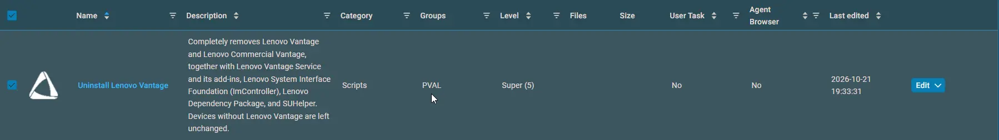
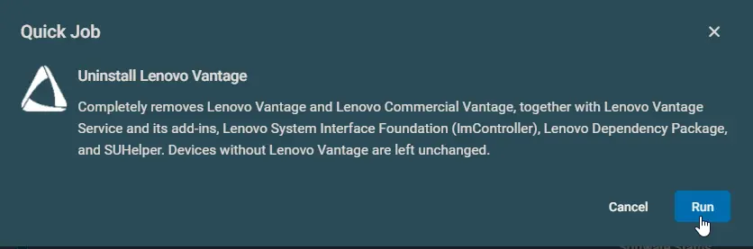

## Summary

Completely removes Lenovo Vantage and Lenovo Commercial Vantage, together with Lenovo Vantage Service and its add-ins, Lenovo System Interface Foundation (ImController), Lenovo Dependency Package, and SUHelper. Devices without Lenovo Vantage are left unchanged.

It works by running the [Uninstall-LenovoVantage](/docs/a8465449-afa0-47a2-8190-5783ce02d713) script.

:::note  
The component never restarts the device. If part of the removal needs a restart to finish, the run still succeeds and the Activity Log states that a reboot is required. Restart the device when it suits the user.  
:::

:::warning  
The component does not prevent Lenovo Vantage from coming back. Users can reinstall it from the Microsoft Store, and Windows Update can install the ImController driver again. Block Lenovo Vantage in your app management policy if it must stay off.  
:::

## Dependencies

- [PowerShell: Uninstall-LenovoVantage](/docs/a8465449-afa0-47a2-8190-5783ce02d713)

## Implementation

1. Download the component [Uninstall Lenovo Vantage](https://github.com/ProVal-Tech/datto-rmm/blob/main/components/uninstall-lenovo-vantage.cpt) from the attachments.  
2. After downloading the file, click on the `Import` button in the Datto RMM interface.  
3. Select the component just downloaded and add it to the Datto RMM interface.  
    
4. After Importing the component to the Datto RMM, make sure to add the component to the `PVAL` Group always.  
    - Steps to Add the component under `PVAL` Group.  
    i. Click on `Drop Down Icon`.  
    ii. Click on `Add to Group`.  
      
    iii. Select the group as `PVAL`  
    

For detailed instructions on importing a Datto component, see [Workflow for Implementing Engineers](https://github.com/ProVal-Tech/datto-rmm#-workflow-for-implementing-engineers).

## Sample Run

## Scenarios

- **Device with Lenovo Vantage or Commercial Vantage:** Every Lenovo Vantage component is removed and the run succeeds.
- **Removal needs a restart to finish:** The run succeeds and the Activity Log states that a reboot is required. The component does not restart the device.
- **Device without Lenovo Vantage:** The run succeeds with no changes, so the component is safe to run on every Lenovo device in a site.
- **Device not made by Lenovo, or not on Windows 10 or Windows 11:** The run fails before anything is downloaded or changed.
- **A Lenovo uninstaller stops responding:** Each Lenovo uninstaller gets up to 180 seconds. After that the uninstaller is stopped and the component removes what is left itself, so a run can take several minutes.

## Results by Device

| Device | Result |
|--------|--------|
| No Lenovo Vantage components found | Success. No changes. |
| Lenovo Vantage removed | Success. |
| Lenovo Vantage removed, restart needed to finish | Success. The Activity Log states that a reboot is required. |
| A component could not be removed | Failure. Restart the device and run the component again. |
| Component started in 32-bit PowerShell | Failure. No changes. |
| Not a Lenovo device | Failure. No changes. |
| Windows version other than Windows 10 or Windows 11 | Failure. No changes. |

## Output

- Activity Log
- Script logs on the device:
  - `C:\ProgramData\_Automation\Script\Uninstall-LenovoVantage\Uninstall-LenovoVantage-log.txt`
  - `C:\ProgramData\_Automation\Script\Uninstall-LenovoVantage\Uninstall-LenovoVantage-error.txt`

## Attachments

- [Uninstall Lenovo Vantage](https://github.com/ProVal-Tech/datto-rmm/blob/main/components/uninstall-lenovo-vantage.cpt)

## Changelog

### 2026-10-21

- Initial version of the document.
