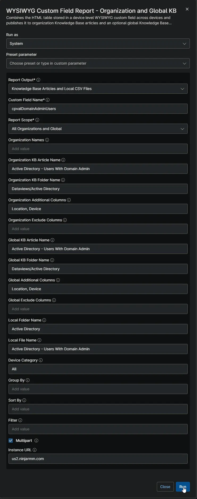
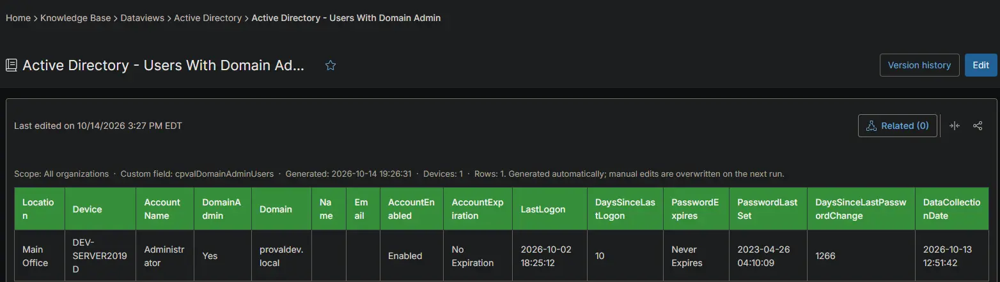
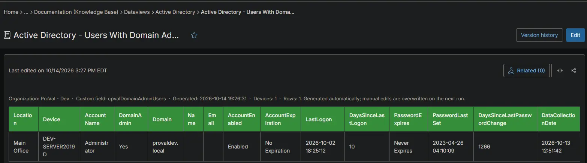
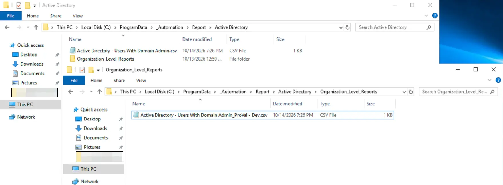

## Summary

Lists every user account with Domain Admin rights for each client, including accounts that get the rights through nested groups. Use it to review who can administer each domain and to find disabled, stale or never-used admin accounts. The [Active Directory - Users with Domain Admin Audit](/docs/f990a8c2-84fe-4f1a-8687-dcc412dfd520) automation collects the data on each primary domain controller.

## Requirements

:::note  
The Knowledge Base articles need the **NinjaOne Documentation** app enabled in NinjaOne, as shown below. If your NinjaOne does not have it, set **Report Output** to **Local CSV Files** in the report automation. The report then creates only the CSV files, on the device that runs it.  
:::

## Where to Find the Report

| Report | Knowledge Base Article | CSV File |
| ------ | ---------------------- | -------- |
| Global | **Global Knowledge Base** > `Dataviews` > `Active Directory` > `Active Directory - Users With Domain Admin` | `C:\ProgramData\_Automation\Report\Active Directory\Active Directory - Users With Domain Admin.csv` |
| Organization | **Organization Knowledge Base** > `Dataviews` > `Active Directory` > `Active Directory - Users With Domain Admin` | `C:\ProgramData\_Automation\Report\Active Directory\Organization_Level_Reports\Active Directory - Users With Domain Admin_<Organization>.csv` |

:::note  
The articles and CSV files are replaced every time the report runs. CSV files are saved on the device that runs the report automation. An article that grows too large is split into `- Part 1`, `- Part 2` and so on. Only primary domain controllers appear in this report.  
:::

## Report Columns

| Column Name | Appears In | Description |
| ----------- | ---------- | ----------- |
| Organization | Global only | The organization the device belongs to. |
| Location | Both | The location the device belongs to. |
| Device | Both | The device name. |
| AccountName | Both | The sign-in name of the account. |
| DomainAdmin | Both | Always `Yes`. Every listed account has Domain Admin rights. |
| Domain | Both | The name of the Active Directory domain. |
| Name | Both | The display name of the account. |
| Email | Both | The email address of the account. |
| AccountEnabled | Both | `Enabled` or `Disabled`. |
| AccountExpiration | Both | The date the account expires, or `No Expiration`. |
| LastLogon | Both | The most recent sign-in, or `Never`. |
| DaysSinceLastLogon | Both | Days since the last sign-in. Blank when the account never signed in. |
| PasswordExpires | Both | `Never Expires`, `Must Change at Next Logon`, `Expires: <date>` or `Expired: <date>`. |
| PasswordLastSet | Both | The date the password was last changed, or `Never`. |
| DaysSinceLastPasswordChange | Both | Days since the password was last changed. |
| DataCollectionDate | Both | When the domain controller collected the data. |

## Report Settings

Values used in the [WYSIWYG Custom Field Report - Organization and Global KB](/docs/67df14cd-3c20-4a40-bb7a-80caae242687) automation to build this report.

| Script Variable | Value |
| --------------- | ----- |
| Report Output | Knowledge Base Articles and Local CSV Files |
| Custom Field Name | `cpvalDomainAdminUsers` |
| Report Scope | All Organizations and Global |
| Organization KB Article Name | Active Directory - Users With Domain Admin |
| Organization KB Folder Name | Dataviews/Active Directory |
| Organization Additional Columns | Location, Device |
| Global KB Article Name | Active Directory - Users With Domain Admin |
| Global KB Folder Name | Dataviews/Active Directory |
| Global Additional Columns | Organization, Location, Device |
| Local Folder Name | Active Directory |
| Local File Name | Active Directory - Users With Domain Admin |
| Device Category | All |
| Multipart | True |
| Instance Url | The NinjaOne instance of the partner, for example `us2.ninjarmm.com` |

## Dependencies

* [Automation: WYSIWYG Custom Field Report - Organization and Global KB](/docs/67df14cd-3c20-4a40-bb7a-80caae242687)
* [Automation: Active Directory - Users with Domain Admin Audit](/docs/f990a8c2-84fe-4f1a-8687-dcc412dfd520)
* [Custom Field: cPVAL Domain Admin Users](/docs/dca9853f-1914-4f06-a700-a3a9926a123f)
* [Solution: Active Directory - Users with Domain Admin Audit](/docs/66340c96-0b27-472f-add9-609e38df48c1)

## Global Article Sample Screenshot

## Organization Article Sample Screenshot

## CSV Folder Sample Screenshot

The global CSV file, and the `Organization_Level_Reports` folder with one CSV file per organization.

## Changelog

### 2026-10-14

- Initial version of the document
