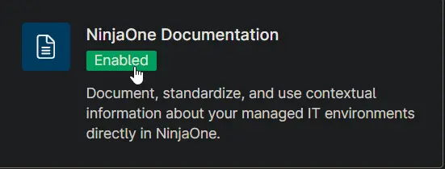
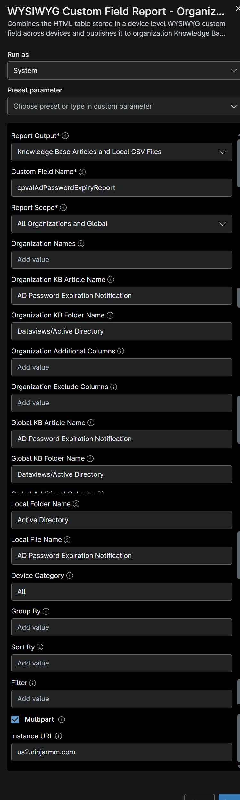
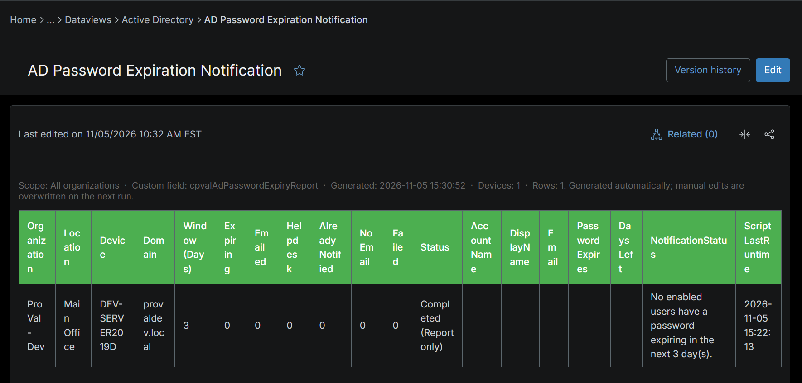
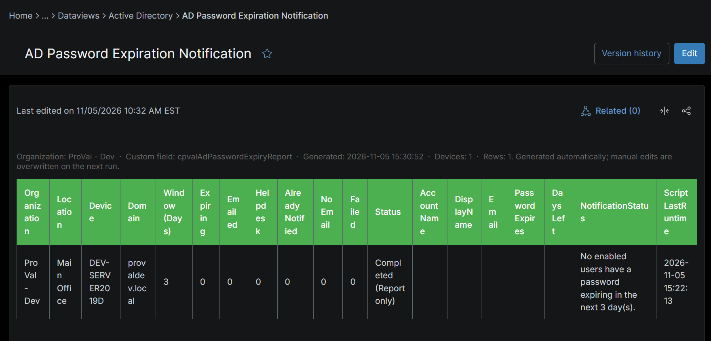
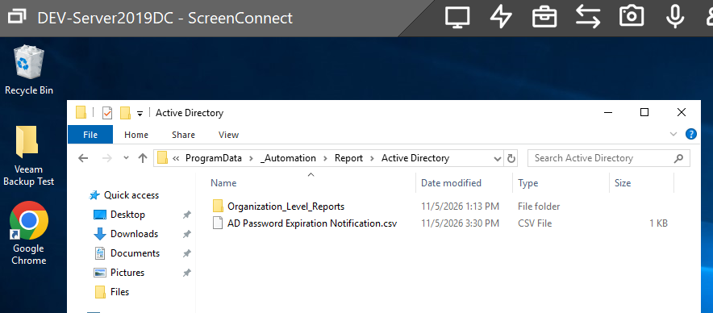

## Summary

This knowledge article shows the AD users information about the user password expiry and the email sent to them or not.

## Requirements

:::note  
The Knowledge Base articles need the **NinjaOne Documentation** app enabled in NinjaOne, as shown below. If your NinjaOne does not have it, set **Report Output** to **Local CSV Files** in the report automation. The report then creates only the CSV files, on the device that runs it.  
:::

## Where to Find the Report

| Report | Knowledge Base Article | CSV File |
| ------ | ---------------------- | -------- |
| Global | **Global Knowledge Base** > `Dataviews` > `Active Directory` > `AD Password Expiration Notification` | `C:\ProgramData\_Automation\Report\<Active Directory>\<AD Password Expiration Notification>.csv` |
| Organization | **Organization Knowledge Base** > `Dataviews` > `Active Directory` > `AD Password Expiration Notification` | `C:\ProgramData\_Automation\Report\<Active Directory>\Organization_Level_Reports\<AD Password Expiration Notification>_<Organization>.csv` |

:::note  
The articles and CSV files are replaced every time the report runs. CSV files are saved on the device that runs the report automation. An article that grows too large is split into `- Part 1`, `- Part 2` and so on.  
:::

## Report Columns

| Column Name | Appears In | Description |
| ----------- | ---------- | ----------- |
| Organization | Both | Organization the device belongs to. |
| Location | Both | Location the device belongs to. |
| Device | Both | Domain controller where the password expiry check and notifications ran. |
| Domain | Both | Active Directory domain that was checked. |
| Window (Days) | Both | Notification threshold. Users whose passwords expire within this many days are flagged. |
| Expiring | Both | Number of users whose passwords expire within the notification window. |
| Emailed | Both | Number of users who were sent a password expiry notification. |
| Helpdesk | Both | Number of notifications sent to the helpdesk contact because they could not be delivered to the user. |
| Already Notified | Both | Number of users skipped because they were already notified in an earlier run. |
| No Email | Both | Number of users with no email address in Active Directory. |
| Failed | Both | Number of users whose notification email failed to send. |
| Status | Both | Result of the script run on the device, such as completed or failed. |
| AccountName | Both | User's AD account name (sAMAccountName). |
| DisplayName | Both | User's display name in Active Directory. |
| Email | Both | User's email address from Active Directory. |
| PasswordExpires | Both | Date and time the user's password expires. |
| DaysLeft | Both | Number of days left until the user's password expires. |
| NotificationStatus | Both | Whether the user's notification was sent, skipped or failed. |
| ScriptLastRuntime | Both | Date and time the script last ran. |

## Report Settings

Values used in the [WYSIWYG Custom Field Report - Organization and Global KB](/docs/67df14cd-3c20-4a40-bb7a-80caae242687) automation to build this report.

| Script Variable                  | Value                                                                |
| -------------------------------- | -------------------------------------------------------------------- |
| Report Output                    | Knowledge Base Articles and Local CVS Files                          |
| Custom Field Name                | `cpvalAdPasswordExpiryReport`                                      |
| Report Scope                     | All Organizations and Global                                         |
| Organization KB Article Name     | AD Password Expiration Notification                                               |
| Organization KB Folder Name      | Dataviews/Active Directory                                       |
| Organization Additional Columns  |                                                |
| Global KB Article Name           | AD Password Expiration Notification                                               |
| Global KB Folder Name            | Dataviews/Active Directory                                        |
| Global Additional Columns        |                                    |
| Local Folder Name                | Active Directory                                                 |
| Local File Name                  | AD Password Expiration Notification                                              |
| Device Category                  | All                                                                  |
| Multipart                        | True                                                                 |
| Instance Url                     | The NinjaOne instance of the partner, for example `us2.ninjarmm.com` |

## Dependencies

* [Automation: WYSIWYG Custom Field Report - Organization and Global KB](/docs/67df14cd-3c20-4a40-bb7a-80caae242687)
* [Automation: AD - Password Expiration Notification](/docs/41b5da34-65d2-43df-a207-8c252c91b327)
* [Custom Field: cPVAL AD Password Expiry Report](/docs/77924cf6-6e06-43a8-bf1e-e0ae55867b46)
* [Solution - AD Password Expiration Notification](/docs/d4cea30e-2724-4a28-870e-91eb349ad028)

## Global Article Sample Screenshot

## Organization Article Sample Screenshot

## CSV Folder Sample Screenshot

The global CSV file, and the `Organization_Level_Reports` folder with one CSV file per organization.

## Changelog

### 2026-11-09

- Initial version of the document
