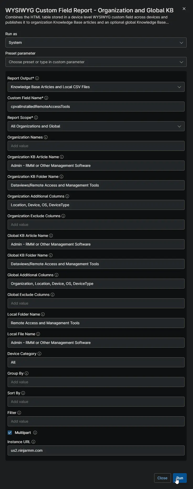
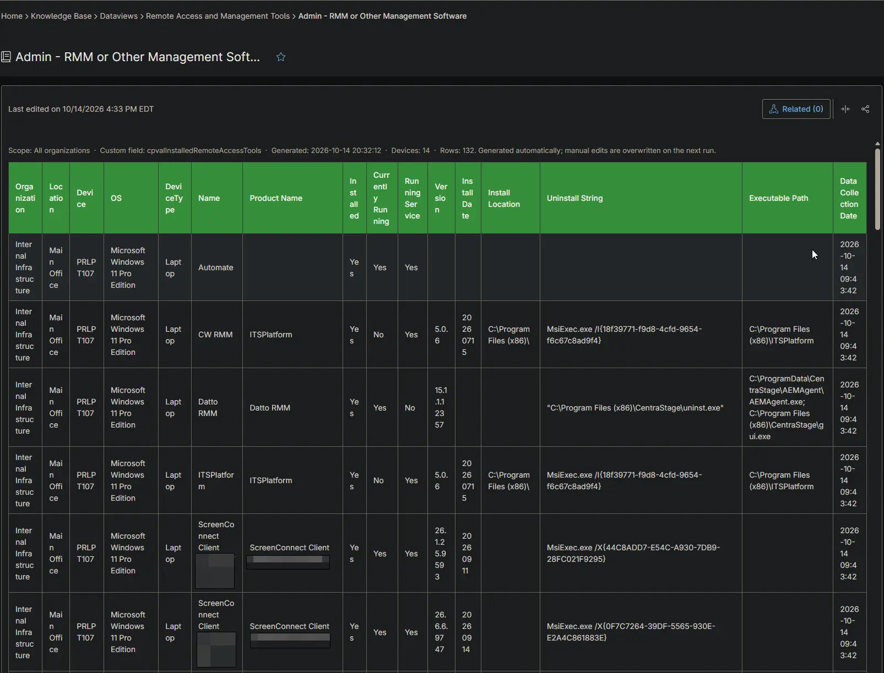
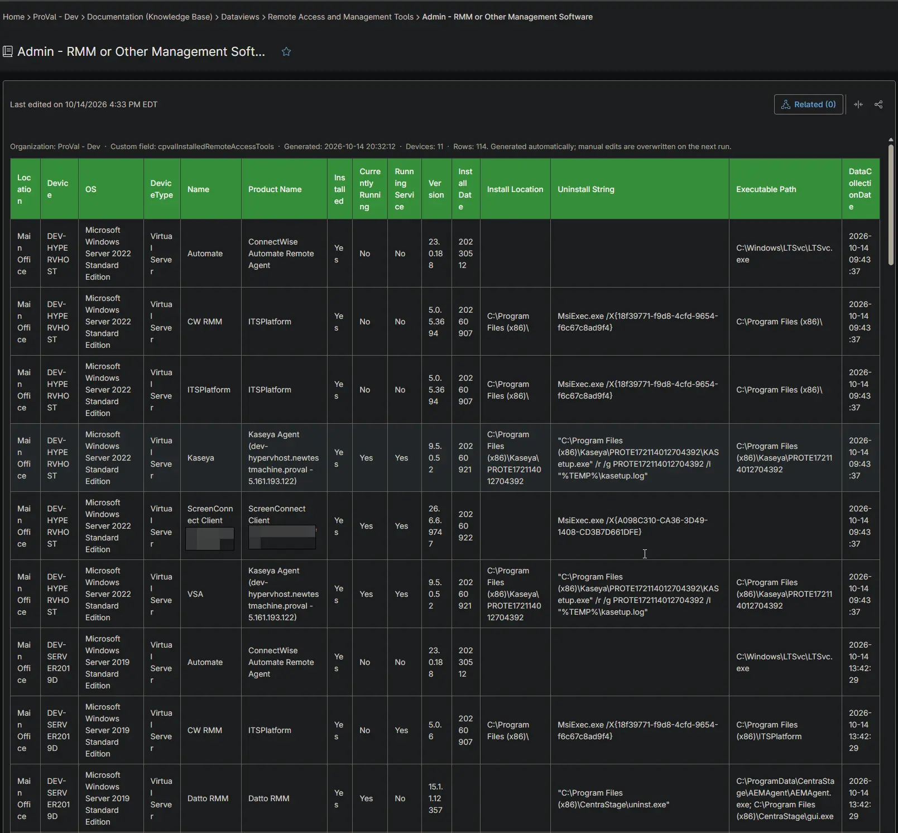
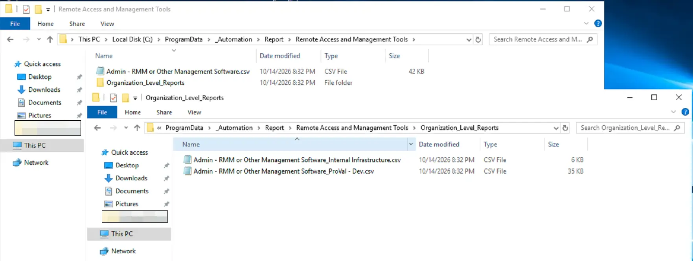

## Summary

Lists the remote access, RMM and other management tools detected on each device, such as TeamViewer, AnyDesk, ScreenConnect, Kaseya or Datto. Use it to find unapproved tools that give outside access to the devices you manage, and to confirm old RMM agents were removed after a migration. The [Installed Remote Tool Audits](/docs/8111fecc-61de-4c72-933c-b719351b7a1e) automation collects the data on each Windows device.

## Requirements

:::note  
The Knowledge Base articles need the **NinjaOne Documentation** app enabled in NinjaOne, as shown below. If your NinjaOne does not have it, set **Report Output** to **Local CSV Files** in the report automation. The report then creates only the CSV files, on the device that runs it.  
:::

## Where to Find the Report

| Report | Knowledge Base Article | CSV File |
| ------ | ---------------------- | -------- |
| Global | **Global Knowledge Base** > `Dataviews` > `Remote Access and Management Tools` > `Admin - RMM or Other Management Software` | `C:\ProgramData\_Automation\Report\Remote Access and Management Tools\Admin - RMM or Other Management Software.csv` |
| Organization | **Organization Knowledge Base** > `Dataviews` > `Remote Access and Management Tools` > `Admin - RMM or Other Management Software` | `C:\ProgramData\_Automation\Report\Remote Access and Management Tools\Organization_Level_Reports\Admin - RMM or Other Management Software_<Organization>.csv` |

:::note  
The articles and CSV files are replaced every time the report runs. CSV files are saved on the device that runs the report automation. An article that grows too large is split into `- Part 1`, `- Part 2` and so on. Only detected tools are listed. Devices without any tool do not appear.  
:::

## Report Columns

| Column Name | Appears In | Description |
| ----------- | ---------- | ----------- |
| Organization | Global only | The organization the device belongs to. |
| Location | Both | The location the device belongs to. |
| Device | Both | The device name. |
| OS | Both | The operating system of the device. |
| DeviceType | Both | The device type: `Physical Server`, `Virtual Server`, `Laptop`, `Desktop` or `Virtual Workstation`. |
| Name | Both | The tool name, or the name of the ScreenConnect instance. |
| Product Name | Both | The installed product names found for the tool. |
| Installed | Both | Always `Yes` in this report. |
| Currently Running | Both | `Yes` when the tool is running. |
| Running Service | Both | `Yes` when the tool runs as an active Windows service. |
| Version | Both | The installed version. |
| Install Date | Both | The install date, as the installer recorded it. |
| Install Location | Both | The installation folder. |
| Uninstall String | Both | The command that removes the tool. |
| Executable Path | Both | Where the tool program is located. |
| DataCollectionDate | Both | When the device collected the data. |

## Report Settings

Values used in the [WYSIWYG Custom Field Report - Organization and Global KB](/docs/67df14cd-3c20-4a40-bb7a-80caae242687) automation to build this report.

| Script Variable | Value |
| --------------- | ----- |
| Report Output | Knowledge Base Articles and Local CSV Files |
| Custom Field Name | `cpvalInstalledRemoteAccessTools` |
| Report Scope | All Organizations and Global |
| Organization KB Article Name | Admin - RMM or Other Management Software |
| Organization KB Folder Name | Dataviews/Remote Access and Management Tools |
| Organization Additional Columns | Location, Device, OS, DeviceType |
| Global KB Article Name | Admin - RMM or Other Management Software |
| Global KB Folder Name | Dataviews/Remote Access and Management Tools |
| Global Additional Columns | Organization, Location, Device, OS, DeviceType |
| Local Folder Name | Remote Access and Management Tools |
| Local File Name | Admin - RMM or Other Management Software |
| Filter | `Installed equals Yes` |
| Device Category | All |
| Multipart | True |
| Instance Url | The NinjaOne instance of the partner, for example `us2.ninjarmm.com` |

## Dependencies

* [Automation: WYSIWYG Custom Field Report - Organization and Global KB](/docs/67df14cd-3c20-4a40-bb7a-80caae242687)
* [Automation: Installed Remote Tool Audits](/docs/8111fecc-61de-4c72-933c-b719351b7a1e)
* [Custom Field: cPVAL Installed Remote Access Tools](/docs/62487ab1-8f55-426d-8127-f0ba0fcf4f66)
* [Solution: Installed Remote Access Tool Audit](/docs/eae2fab9-4697-4e1e-ad8f-93f8a09d7056)

## Global Article Sample Screenshot

## Organization Article Sample Screenshot

## CSV Folder Sample Screenshot

The global CSV file, and the `Organization_Level_Reports` folder with one CSV file per organization.

## Changelog

### 2026-10-14

- Initial version of the document
