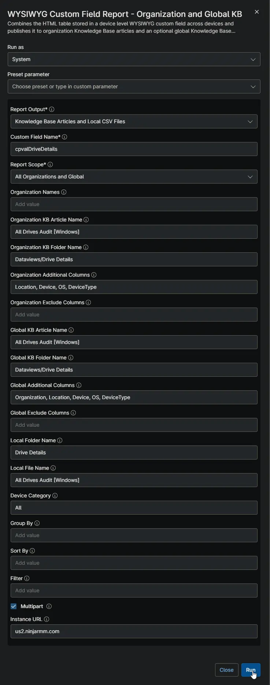
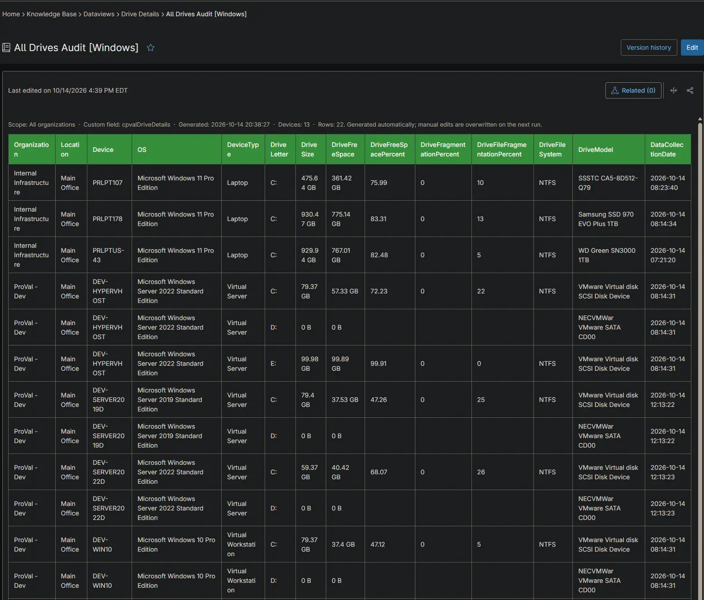
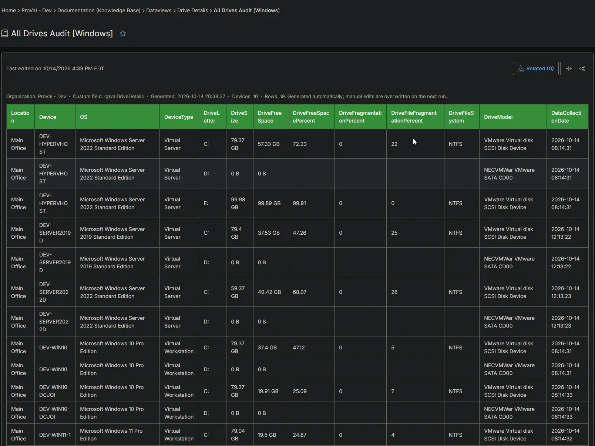
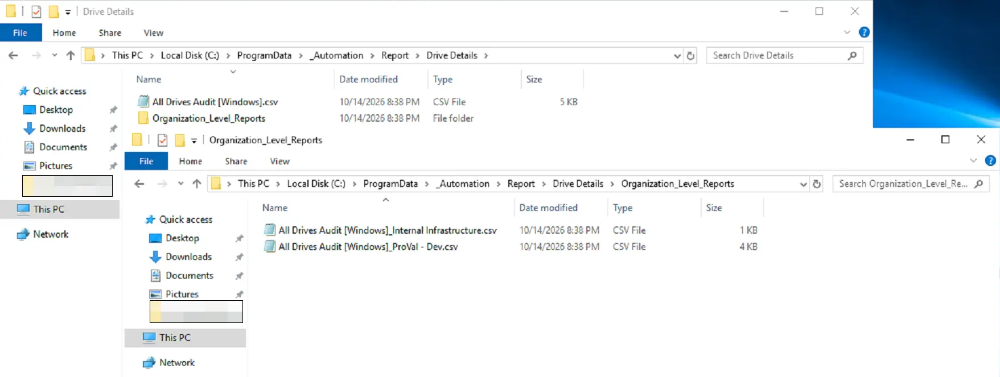

## Summary

Lists every drive on every Windows device with its size, free space, fragmentation, file system and model. Use it to find drives that are nearly full or badly fragmented before they cause problems. The [All Drives Audit [Windows]](/docs/2551b645-2fe7-47d2-9c24-41c79c1f7c35) automation collects the data on each Windows device.

## Requirements

:::note  
The Knowledge Base articles need the **NinjaOne Documentation** app enabled in NinjaOne, as shown below. If your NinjaOne does not have it, set **Report Output** to **Local CSV Files** in the report automation. The report then creates only the CSV files, on the device that runs it.  
:::

## Where to Find the Report

| Report | Knowledge Base Article | CSV File |
| ------ | ---------------------- | -------- |
| Global | **Global Knowledge Base** > `Dataviews` > `Drive Details` > `All Drives Audit [Windows]` | `C:\ProgramData\_Automation\Report\Drive Details\All Drives Audit [Windows].csv` |
| Organization | **Organization Knowledge Base** > `Dataviews` > `Drive Details` > `All Drives Audit [Windows]` | `C:\ProgramData\_Automation\Report\Drive Details\Organization_Level_Reports\All Drives Audit [Windows]_<Organization>.csv` |

:::note  
The articles and CSV files are replaced every time the report runs. CSV files are saved on the device that runs the report automation. An article that grows too large is split into `- Part 1`, `- Part 2` and so on.  
:::

## Report Columns

| Column Name | Appears In | Description |
| ----------- | ---------- | ----------- |
| Organization | Global only | The organization the device belongs to. |
| Location | Both | The location the device belongs to. |
| Device | Both | The device name. |
| OS | Both | The operating system of the device. |
| DeviceType | Both | The device type: `Physical Server`, `Virtual Server`, `Laptop`, `Desktop` or `Virtual Workstation`. |
| DriveLetter | Both | The drive letter, for example `C:`. |
| DriveSize | Both | The total size, for example `931.51 GB`. |
| DriveFreeSpace | Both | The free space, for example `120.4 GB`. |
| DriveFreeSpacePercent | Both | Free space as a percentage of the total size. Sort or filter on this column to find full drives. |
| DriveFragmentationPercent | Both | Total fragmentation of the drive. Local fixed drives only. |
| DriveFileFragmentationPercent | Both | Fragmentation of the files on the drive. Local fixed drives only. |
| DriveFileSystem | Both | The file system, for example `NTFS`. |
| DriveModel | Both | The disk model, the optical drive name, or the network path of a mapped drive. |
| DataCollectionDate | Both | When the device collected the data. |

## Report Settings

Values used in the [WYSIWYG Custom Field Report - Organization and Global KB](/docs/67df14cd-3c20-4a40-bb7a-80caae242687) automation to build this report.

| Script Variable | Value |
| --------------- | ----- |
| Report Output | Knowledge Base Articles and Local CSV Files |
| Custom Field Name | `cpvalDriveDetails` |
| Report Scope | All Organizations and Global |
| Organization KB Article Name | All Drives Audit [Windows] |
| Organization KB Folder Name | Dataviews/Drive Details |
| Organization Additional Columns | Location, Device, OS, DeviceType |
| Global KB Article Name | All Drives Audit [Windows] |
| Global KB Folder Name | Dataviews/Drive Details |
| Global Additional Columns | Organization, Location, Device, OS, DeviceType |
| Local Folder Name | Drive Details |
| Local File Name | All Drives Audit [Windows] |
| Device Category | All |
| Multipart | True |
| Instance Url | The NinjaOne instance of the partner, for example `us2.ninjarmm.com` |

## Dependencies

* [Automation: WYSIWYG Custom Field Report - Organization and Global KB](/docs/67df14cd-3c20-4a40-bb7a-80caae242687)
* [Automation: All Drives Audit [Windows]](/docs/2551b645-2fe7-47d2-9c24-41c79c1f7c35)
* [Custom Field: cPVAL Drive Details](/docs/c376d026-50bf-4f65-8743-99a774719d92)
* [Solution: All Drives Audit [Windows]](/docs/9d68f747-b433-4e36-a948-6290a7c30355)

## Global Article Sample Screenshot

## Organization Article Sample Screenshot

## CSV Folder Sample Screenshot

The global CSV file, and the `Organization_Level_Reports` folder with one CSV file per organization.

## Changelog

### 2026-10-14

- Initial version of the document
