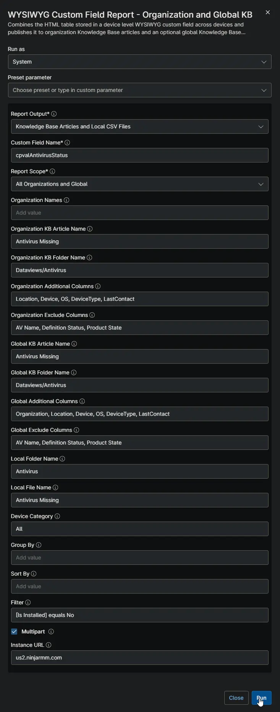
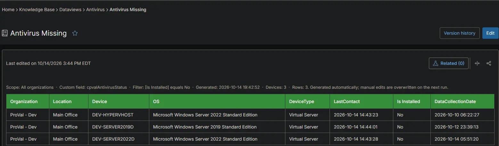
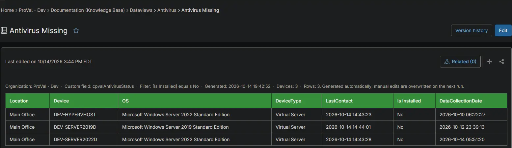
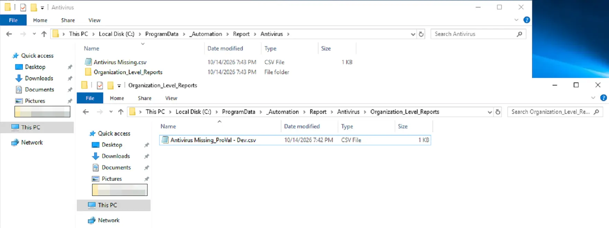

## Summary

Lists every Windows and Mac device on which NinjaOne finds no antivirus. Use it to find unprotected devices that need antivirus installed or fixed. Devices with antivirus are listed in the [Antivirus Status](/docs/460013c8-7bb9-4773-ac6b-a03689575e79) report instead. The [Antivirus Status Audit](/docs/3724a85b-929e-4f55-9b3a-bd13a21e1d05) automation collects the data from NinjaOne.

## Requirements

:::note  
The Knowledge Base articles need the **NinjaOne Documentation** app enabled in NinjaOne, as shown below. If your NinjaOne does not have it, set **Report Output** to **Local CSV Files** in the report automation. The report then creates only the CSV files, on the device that runs it.  
:::

## Where to Find the Report

| Report | Knowledge Base Article | CSV File |
| ------ | ---------------------- | -------- |
| Global | **Global Knowledge Base** > `Dataviews` > `Antivirus` > `Antivirus Missing` | `C:\ProgramData\_Automation\Report\Antivirus\Antivirus Missing.csv` |
| Organization | **Organization Knowledge Base** > `Dataviews` > `Antivirus` > `Antivirus Missing` | `C:\ProgramData\_Automation\Report\Antivirus\Organization_Level_Reports\Antivirus Missing_<Organization>.csv` |

:::note  
The articles and CSV files are replaced every time the report runs. CSV files are saved on the device that runs the report automation. An article that grows too large is split into `- Part 1`, `- Part 2` and so on. A blank `DataCollectionDate` means NinjaOne has never received antivirus information from the device. 
:::

## Report Columns

| Column Name | Appears In | Description |
| ----------- | ---------- | ----------- |
| Organization | Global only | The organization the device belongs to. |
| Location | Both | The location the device belongs to. |
| Device | Both | The device name. |
| OS | Both | The operating system of the device. |
| DeviceType | Both | The device type: `Physical Server`, `Virtual Server`, `Laptop`, `Desktop` or `Virtual Workstation`. |
| LastContact | Both | When the device last checked in with NinjaOne. |
| Is Installed | Both | Always `No` in this report. |
| DataCollectionDate | Both | When NinjaOne collected the antivirus information. Blank when NinjaOne has none for the device. |

## Report Settings

Values used in the [WYSIWYG Custom Field Report - Organization and Global KB](/docs/67df14cd-3c20-4a40-bb7a-80caae242687) automation to build this report.

| Script Variable | Value |
| --------------- | ----- |
| Report Output | Knowledge Base Articles and Local CSV Files |
| Custom Field Name | `cpvalAntivirusStatus` |
| Report Scope | All Organizations and Global |
| Organization KB Article Name | Antivirus Missing |
| Organization KB Folder Name | Dataviews/Antivirus |
| Organization Additional Columns | Location, Device, OS, DeviceType, LastContact |
| Organization Exclude Columns | AV Name, Definition Status, Product State |
| Global KB Article Name | Antivirus Missing |
| Global KB Folder Name | Dataviews/Antivirus |
| Global Additional Columns | Organization, Location, Device, OS, DeviceType, LastContact |
| Global Exclude Columns | AV Name, Definition Status, Product State |
| Local Folder Name | Antivirus |
| Local File Name | Antivirus Missing |
| Filter | `[Is Installed] equals No` |
| Device Category | All |
| Multipart | True |
| Instance Url | The NinjaOne instance of the partner, for example `us2.ninjarmm.com` |

## Dependencies

* [Automation: WYSIWYG Custom Field Report - Organization and Global KB](/docs/67df14cd-3c20-4a40-bb7a-80caae242687)
* [Automation: Antivirus Status Audit](/docs/3724a85b-929e-4f55-9b3a-bd13a21e1d05)
* [Custom Field: cPVAL Antivirus Status](/docs/20cf7c66-038f-4e83-857e-4c68ac5de358)
* [Solution: Antivirus Status Audit](/docs/d613b809-a8cf-4dde-b3fa-e36b13223eeb)

## Global Article Sample Screenshot

## Organization Article Sample Screenshot

## CSV Folder Sample Screenshot

The global CSV file, and the `Organization_Level_Reports` folder with one CSV file per organization.

## Changelog

### 2026-10-14

- Initial version of the document
