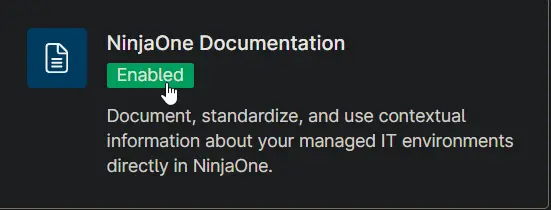
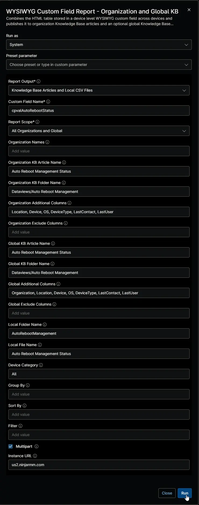
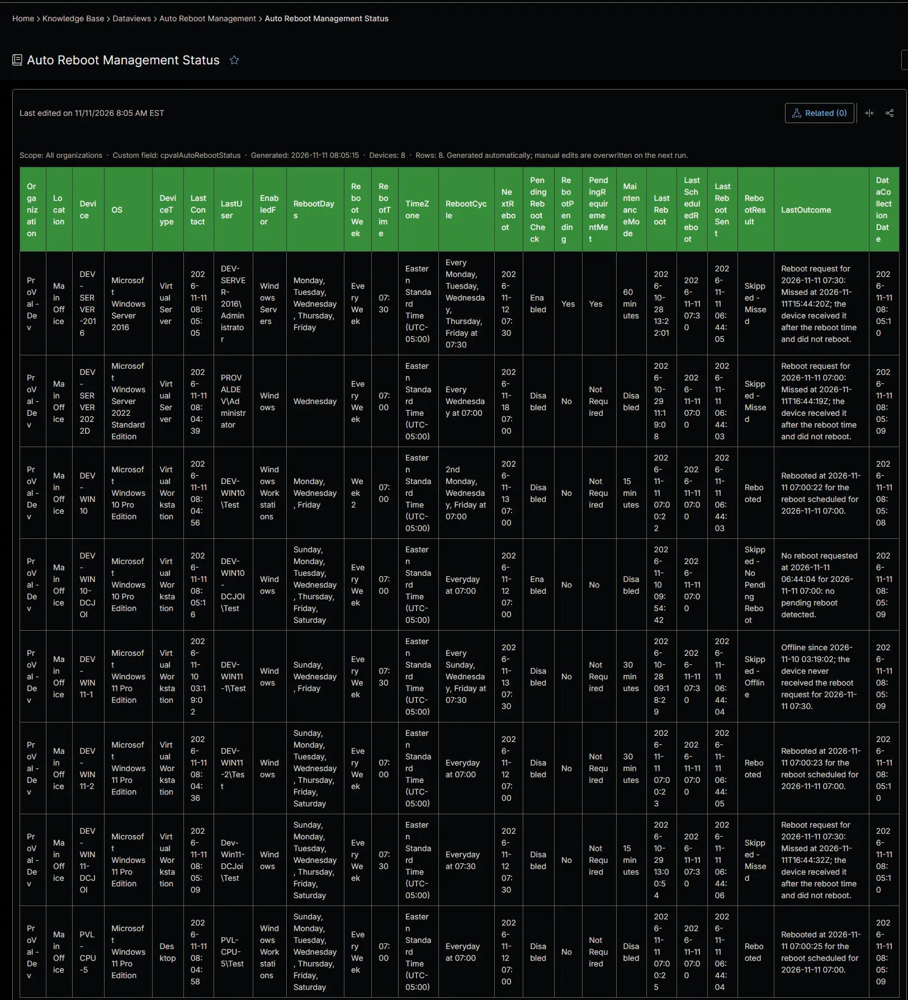
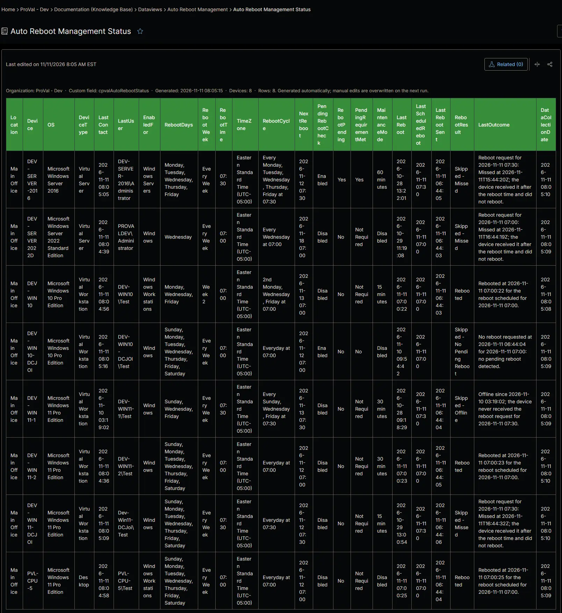
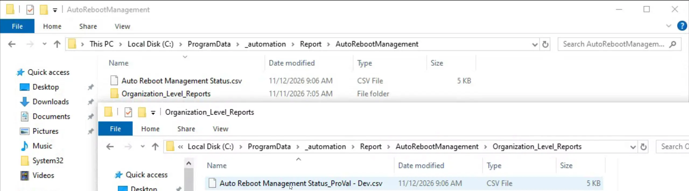

## Summary

Shows the effective restart schedule, the next restart and the result of the last scheduled restart of every Windows device enabled for the [Auto Reboot Management - NinjaOne](/docs/52091463-99b7-4a21-8ad0-7ade5b8212e7) solution. Use it to review which devices restart when, and to find restarts that failed. It replaces the [Auto Reboot Management](/docs/09e4ea2c-54d9-4e8f-bfa8-1707501d5a11) dataview of ConnectWise Automate. The [Auto Reboot Management](/docs/15697579-8f51-4c51-9812-d909edebfc8b) automation collects the data.

## Requirements

:::note  
The Knowledge Base articles need the **NinjaOne Documentation** app enabled in NinjaOne, as shown below. If your NinjaOne does not have it, set **Report Output** to **Local CSV Files** in the report automation. The report then creates only the CSV files, on the device that runs it.  
:::

## Where to Find the Report

| Report | Knowledge Base Article | CSV File |
| ------ | ---------------------- | -------- |
| Global | **Global Knowledge Base** > `Dataviews` > `Auto Reboot Management` > `Auto Reboot Management Status` | `C:\ProgramData\_Automation\Report\AutoRebootManagement\Auto Reboot Management Status.csv` |
| Organization | **Organization Knowledge Base** > `Dataviews` > `Auto Reboot Management` > `Auto Reboot Management Status` | `C:\ProgramData\_Automation\Report\AutoRebootManagement\Organization_Level_Reports\Auto Reboot Management Status_<Organization>.csv` |

:::note  
The articles and CSV files are replaced every time the report runs. CSV files are saved on the device that runs the report automation. An article that grows too large is split into `- Part 1`, `- Part 2` and so on. A device appears only while it's enabled for auto reboot and the [Auto Reboot Management](/docs/15697579-8f51-4c51-9812-d909edebfc8b) automation has run since.  
:::

## Report Columns

| Column Name | Appears In | Description |
| ----------- | ---------- | ----------- |
| Organization | Global only | The organization the device belongs to. |
| Location | Both | The location the device belongs to. |
| Device | Both | The device name. |
| OS | Both | The operating system of the device. |
| DeviceType | Both | The device type: `Physical Server`, `Virtual Server`, `Laptop`, `Desktop` or `Virtual Workstation`. |
| LastContact | Both | When the device last contacted NinjaOne. |
| LastUser | Both | The last user signed in to the device. |
| EnabledFor | Both | The value of [cPVAL Auto Reboot](/docs/cab41cb1-87d8-4d37-bbe2-3faa67516831) that applies to the device. |
| RebootDays | Both | The days the device restarts on. |
| RebootWeek | Both | `Every Week`, or the week of the month, such as `Week 2`. |
| RebootTime | Both | The restart time. |
| RebootCycle | Both | The full schedule, for example `2nd Tuesday at 02:00`. |
| NextReboot | Both | The date and time of the next restart. |
| PendingRebootCheck | Both | Whether the pending reboot check applies. |
| RebootPending | Both | Whether NinjaOne reports a pending reboot. |
| PendingRequirementMet | Both | `Yes`, `No`, or `Not Required` when the check doesn't apply. |
| MaintenanceMode | Both | The maintenance mode applied around the restart, or `Disabled`. |
| LastReboot | Both | When the device last started. |
| LastScheduledReboot | Both | The restart the solution last handled. |
| LastRebootSent | Both | When the restart request was written. |
| RebootResult | Both | The result of the last scheduled restart, for example `Rebooted` or `Not Rebooted`. The values are described in [cPVAL Auto Reboot Status](/docs/1c29d754-ec90-4f42-88f1-4ac335657fbc). |
| LastOutcome | Both | Details of the last action. |
| DataCollectionDate | Both | When the device's row last changed. |

## Report Settings

Values used in the [WYSIWYG Custom Field Report - Organization and Global KB](/docs/67df14cd-3c20-4a40-bb7a-80caae242687) automation to build this report. The [Auto Reboot Management](/docs/33d689db-0f80-4f9d-928a-eb76fe283ff5) scheduled task runs it every hour, right after [Auto Reboot Management](/docs/15697579-8f51-4c51-9812-d909edebfc8b), so the report always shows the latest run.

| Script Variable | Value |
| --------------- | ----- |
| Report Output | Knowledge Base Articles and Local CSV Files |
| Custom Field Name | `cpvalAutoRebootStatus` |
| Report Scope | All Organizations and Global |
| Organization KB Article Name | Auto Reboot Management Status |
| Organization KB Folder Name | Dataviews/Auto Reboot Management |
| Organization Additional Columns | Location, Device, OS, DeviceType, LastContact, LastUser |
| Organization Exclude Columns | |
| Global KB Article Name | Auto Reboot Management Status |
| Global KB Folder Name | Dataviews/Auto Reboot Management |
| Global Additional Columns | Organization, Location, Device, OS, DeviceType, LastContact, LastUser |
| Global Exclude Columns | |
| Local Folder Name | AutoRebootManagement |
| Local File Name | Auto Reboot Management Status |
| Filter | |
| Device Category | All |
| Multipart | True |
| Instance Url | The NinjaOne instance of the partner, for example `us2.ninjarmm.com` |

## Dependencies

* [Automation: WYSIWYG Custom Field Report - Organization and Global KB](/docs/67df14cd-3c20-4a40-bb7a-80caae242687)
* [Automation: Auto Reboot Management](/docs/15697579-8f51-4c51-9812-d909edebfc8b)
* [Custom Field: cPVAL Auto Reboot Status](/docs/1c29d754-ec90-4f42-88f1-4ac335657fbc)
* [Scheduled Task: Auto Reboot Management](/docs/33d689db-0f80-4f9d-928a-eb76fe283ff5)
* [Solution: Auto Reboot Management - NinjaOne](/docs/52091463-99b7-4a21-8ad0-7ade5b8212e7)

## Global Article Sample Screenshot

## Organization Article Sample Screenshot

## CSV Folder Sample Screenshot

The global CSV file, and the `Organization_Level_Reports` folder with one CSV file per organization.

## Changelog

### 2026-11-11

- Initial version of the document
