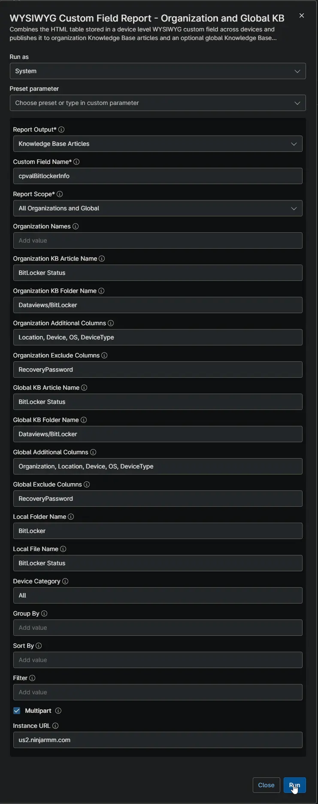
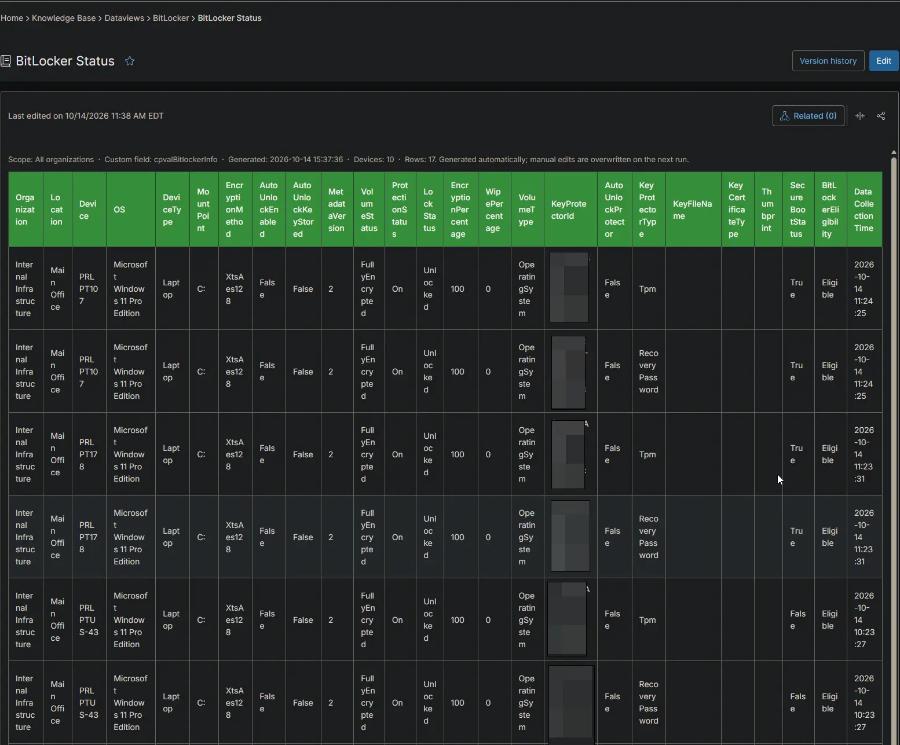
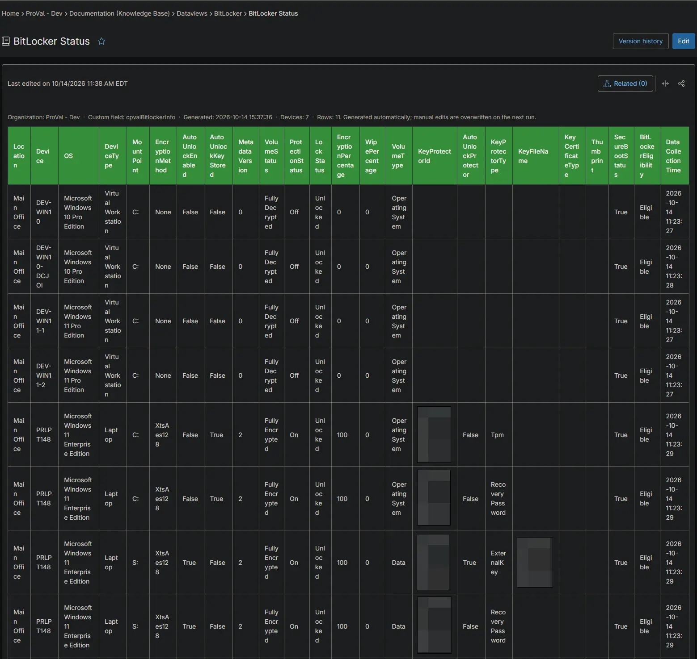
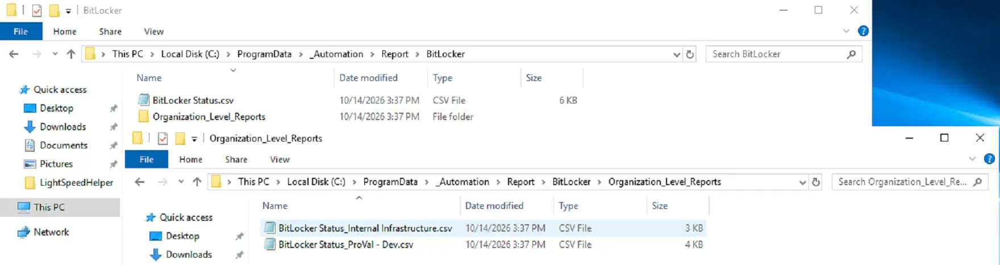

## Summary

Lists every BitLocker volume and key protector on each Windows workstation, with its Secure Boot status and BitLocker eligibility. Use it to confirm which drives are encrypted, find drives where protection is off, and see which devices are ready for BitLocker. The [BitLocker and TPM Audit](/docs/2d104874-ec69-4d95-b912-7fcd240bf592) automation collects the data on each device.

## Requirements

:::note  
The Knowledge Base articles need the **NinjaOne Documentation** app enabled in NinjaOne, as shown below. If your NinjaOne does not have it, set **Report Output** to **Local CSV Files** in the report automation. The report then creates only the CSV files, on the device that runs it.  
:::

## Where to Find the Report

| Report | Knowledge Base Article | CSV File |
| ------ | ---------------------- | -------- |
| Global | **Global Knowledge Base** > `Dataviews` > `BitLocker` > `BitLocker Status` | `C:\ProgramData\_Automation\Report\BitLocker\BitLocker Status.csv` |
| Organization | **Organization Knowledge Base** > `Dataviews` > `BitLocker` > `BitLocker Status` | `C:\ProgramData\_Automation\Report\BitLocker\Organization_Level_Reports\BitLocker Status_<Organization>.csv` |

:::note  
The articles and CSV files are replaced every time the report runs. CSV files are saved on the device that runs the report automation. An article that grows too large is split into `- Part 1`, `- Part 2` and so on. Recovery passwords are left out of this report. Find them in the [cPVAL BitLocker Info](/docs/fd545101-1cd5-4d9f-8df7-57c4df1616b9) field of the device.  
:::

## Report Columns

| Column Name | Appears In | Description |
| ----------- | ---------- | ----------- |
| Organization | Global only | The organization the device belongs to. |
| Location | Both | The location the device belongs to. |
| Device | Both | The device name. |
| OS | Both | The operating system of the device. |
| DeviceType | Both | The device type: `Physical Server`, `Virtual Server`, `Laptop`, `Desktop` or `Virtual Workstation`. |
| MountPoint | Both | The drive letter of the volume. |
| EncryptionMethod | Both | The encryption algorithm, for example `XtsAes128`. |
| AutoUnlockEnabled | Both | `True` when the volume unlocks automatically. |
| AutoUnlockKeyStored | Both | `True` when an auto-unlock key is stored on the device. |
| MetadataVersion | Both | The BitLocker metadata version of the volume. |
| VolumeStatus | Both | The encryption state, for example `FullyEncrypted` or `FullyDecrypted`. |
| ProtectionStatus | Both | `On` when the volume is encrypted and protected. |
| LockStatus | Both | `Locked` or `Unlocked`. |
| EncryptionPercentage | Both | How much of the volume is encrypted. |
| WipePercentage | Both | How much free space has been wiped. |
| VolumeType | Both | The volume type, for example `OperatingSystem` or `Data`. |
| KeyProtectorId | Both | The ID of the key protector in this row. |
| AutoUnlockProtector | Both | `True` when this protector is used for auto-unlock. |
| KeyProtectorType | Both | The protector type, for example `Tpm` or `RecoveryPassword`. |
| KeyFileName | Both | The key file name, for external key protectors. |
| KeyCertificateType | Both | The certificate type, when a certificate is used. |
| Thumbprint | Both | The certificate thumbprint, when a certificate is used. |
| SecureBootStatus | Both | `True` when Secure Boot is on. |
| BitLockerEligibility | Both | `Eligible`, `Not Eligible` or `Not Defined`, based on the TPM status. |
| DataCollectionTime | Both | When the device collected the data. |

## Report Settings

Values used in the [WYSIWYG Custom Field Report - Organization and Global KB](/docs/67df14cd-3c20-4a40-bb7a-80caae242687) automation to build this report.

| Script Variable | Value |
| --------------- | ----- |
| Report Output | Knowledge Base Articles and Local CSV Files |
| Custom Field Name | `cpvalBitlockerInfo` |
| Report Scope | All Organizations and Global |
| Organization KB Article Name | BitLocker Status |
| Organization KB Folder Name | Dataviews/BitLocker |
| Organization Additional Columns | Location, Device, OS, DeviceType |
| Organization Exclude Columns | RecoveryPassword |
| Global KB Article Name | BitLocker Status |
| Global KB Folder Name | Dataviews/BitLocker |
| Global Additional Columns | Organization, Location, Device, OS, DeviceType |
| Global Exclude Columns | RecoveryPassword |
| Local Folder Name | BitLocker |
| Local File Name | BitLocker Status |
| Device Category | All |
| Multipart | True |
| Instance Url | The NinjaOne instance of the partner, for example `us2.ninjarmm.com` |

## Dependencies

* [Automation: WYSIWYG Custom Field Report - Organization and Global KB](/docs/67df14cd-3c20-4a40-bb7a-80caae242687)
* [Automation: BitLocker and TPM Audit](/docs/2d104874-ec69-4d95-b912-7fcd240bf592)
* [Custom Field: cPVAL BitLocker Info](/docs/fd545101-1cd5-4d9f-8df7-57c4df1616b9)
* [Solution: BitLocker and TPM Audit](/docs/57c787ad-8d22-4ae4-b5e5-dac34fc600fc)

## Global Article Sample Screenshot

## Organization Article Sample Screenshot

## CSV Folder Sample Screenshot

The global CSV file, and the `Organization_Level_Reports` folder with one CSV file per organization.

## Changelog

### 2026-10-14

- Initial version of the document
