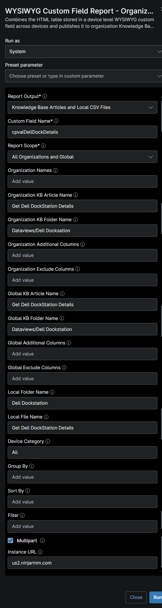
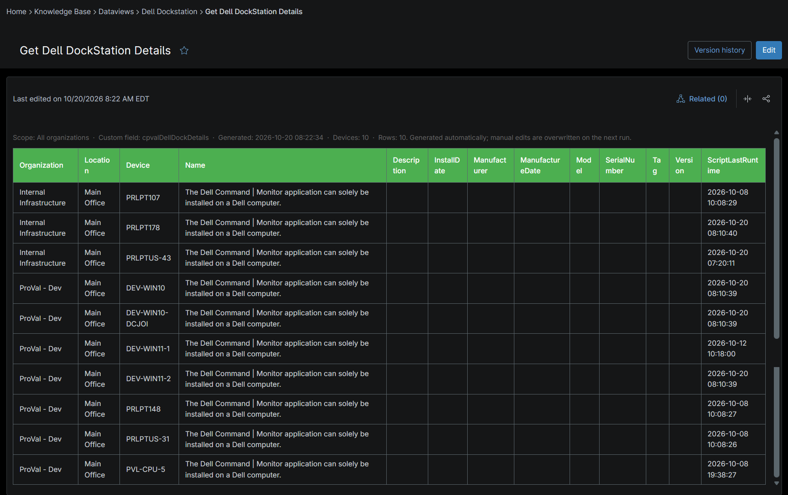
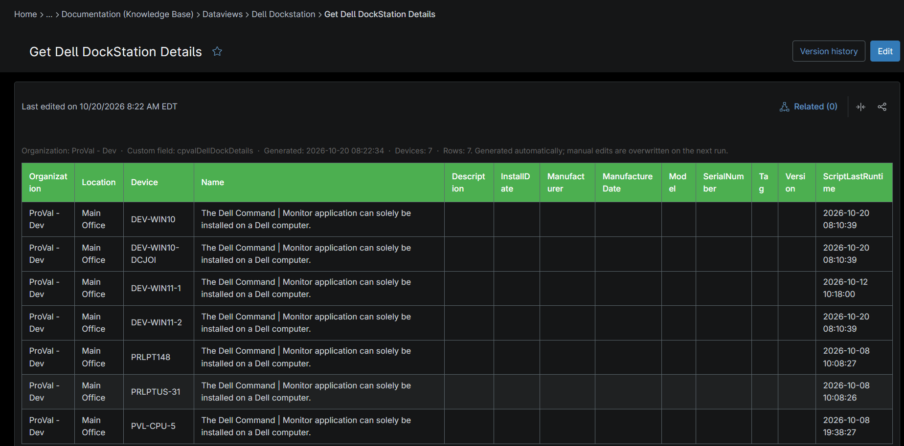
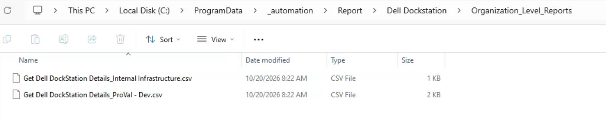

## Summary

This knowledge article is build to derive the Dell Dock Stations report of all Dell machines. It helps to show the list of dock stations connected to the Dell machines.

## Requirements

:::note  
The Knowledge Base articles need the **NinjaOne Documentation** app enabled in NinjaOne, as shown below. If your NinjaOne does not have it, set **Report Output** to **Local CSV Files** in the report automation. The report then creates only the CSV files, on the device that runs it.  
:::

## Where to Find the Report

| Report | Knowledge Base Article | CSV File |
| ------ | ---------------------- | -------- |
| Global | **Global Knowledge Base** > `Dataviews` > `Dell Dockstation` > `Get Dell DockStation Details` | `C:\ProgramData\_Automation\Report\Dell Dockstation\Get Dell DockStation Details.csv` |
| Organization | **Organization Knowledge Base** > `Dataviews` > `Dell Dockstation` > `Get Dell DockStation Details` | `C:\ProgramData\_Automation\Report\Dell Dockstation\Get Dell DockStation Details_<Organization>.csv` |

:::note  
The articles and CSV files are replaced every time the report runs. CSV files are saved on the device that runs the report automation. An article that grows too large is split into `- Part 1`, `- Part 2` and so on.  
:::

## Report Columns

| Column Name | Appears In | Description |
|-------------|------------|-------------|
| Organization | Both | The organization to which the device is assigned. |
| Location | Both | The location associated with the device. |
| Device | Both | The name of the device where the Dell Docking Station was detected. |
| Name | Both | The name of the detected Dell Docking Station connected to the device. |
| Description | Both | A description of the Dell Docking Station, including available hardware details. |
| InstallDate | Both | The date when the Dell Docking Station driver, software, or related components were installed on the device. |
| Manufacturer | Both | The manufacturer of the docking station, typically Dell Technologies. |
| ManufacturerDate | Both | The manufacturing date of the Dell Docking Station, as reported by the device firmware or hardware inventory. |
| Model | Both | The model identifier of the Dell Docking Station. |
| SerialNumber | Both | The unique serial number assigned to the Dell Docking Station. |
| Tag | Both | The asset tag or service tag associated with the Dell Docking Station. |
| Version | Both | The firmware, hardware, or software version detected for the Dell Docking Station. |
| ScriptLastRunTime | Both | The date and time when the [Script - Get Dell Dockstation](/docs/bdf95bc2-1b42-4436-a2f8-f2aca13678c4) last collected and reported the docking station information. |

## Report Settings

Values used in the [WYSIWYG Custom Field Report - Organization and Global KB](/docs/67df14cd-3c20-4a40-bb7a-80caae242687) automation to build this report.

| Script Variable | Value |
| --------------- | ----- |
| Report Output | Knowledge Base Articles and Local CSV Files |
| Custom Field Name | `cpvalDellDockDetails` |
| Report Scope | All Organizations and Global |
| Organization KB Article Name | Get Dell DockStation Details |
| Organization KB Folder Name | Dataviews/Dell Dockstation |
| Global KB Article Name | Get Dell DockStation Details |
| Global KB Folder Name | Dataviews/Dell Dockstation |
| Local Folder Name | Dell Dockstation |
| Local File Name | Get Dell DockStation Details |
| Device Category | All |
| Multipart | True |
| Instance Url | The NinjaOne instance of the partner, for example `us2.ninjarmm.com` |

## Dependencies

* [Automation: WYSIWYG Custom Field Report - Organization and Global KB](/docs/67df14cd-3c20-4a40-bb7a-80caae242687)
* [Automation: Get Dell Dockstation](/docs/bdf95bc2-1b42-4436-a2f8-f2aca13678c4)
* [Custom Field: cPVAL Dell Dock Details](/docs/01834db6-0e3c-404f-addf-9375722853b2)
* [Solution: Get Dell Dockstation](/docs/8a8440f2-4451-4aa5-ada1-1187a22b26a4)

## Global Article Sample Screenshot

## Organization Article Sample Screenshot

## CSV Folder Sample Screenshot

The global CSV file, and the `Organization_Level_Reports` folder with one CSV file per organization.

## Changelog

### 2026-10-20

- Initial version of the document
