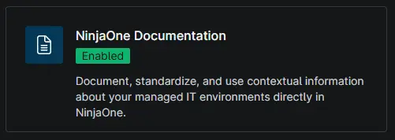
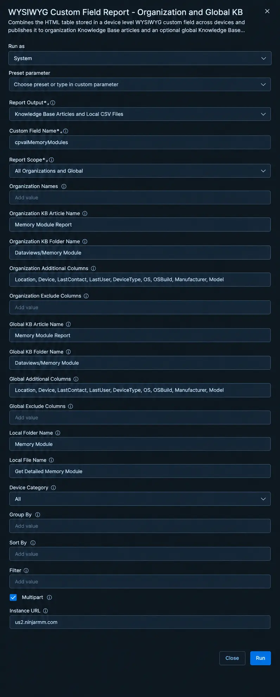
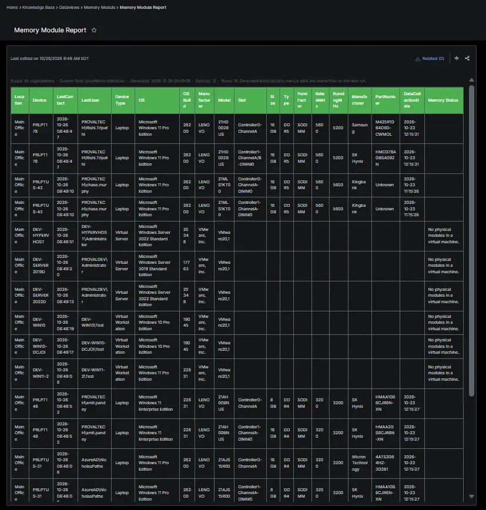
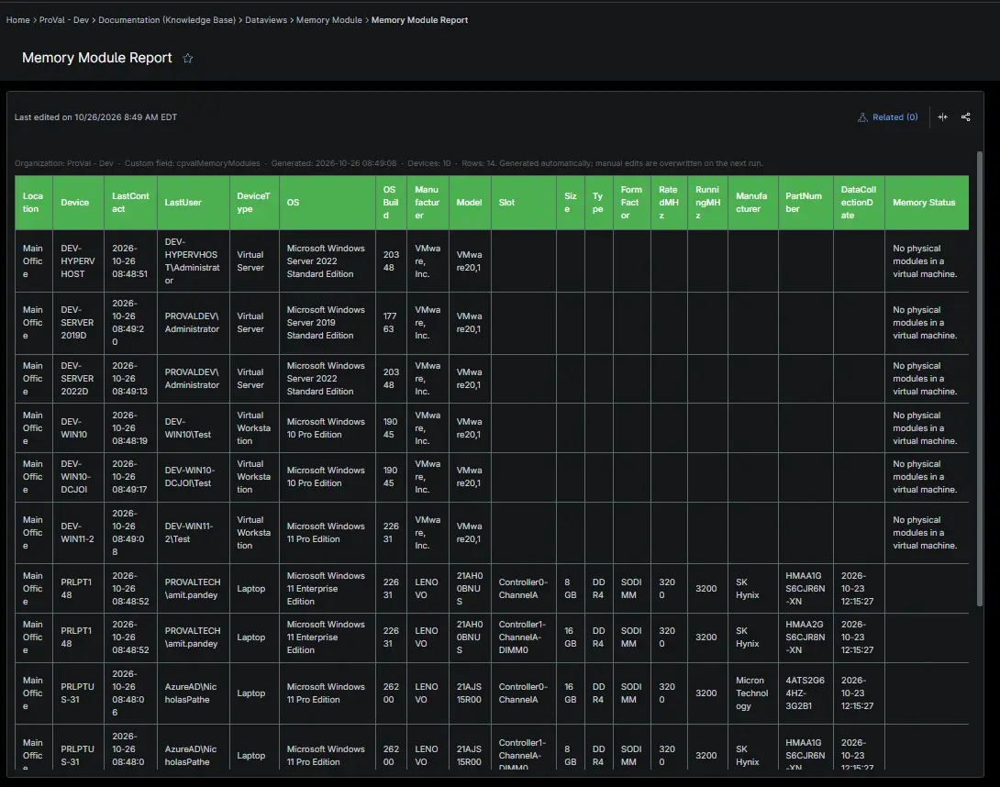
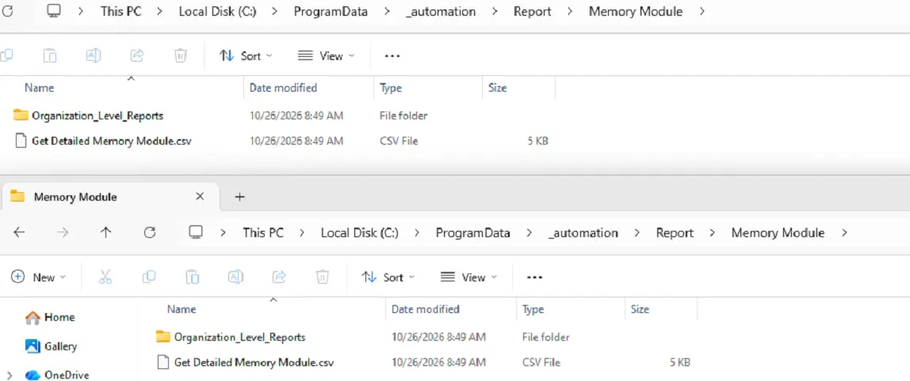

## Summary

Provides detailed information about individual physical memory modules installed in Windows servers and workstations, including slot, capacity, memory type, form factor, rated speed, running speed, manufacturer, and part number. Use this report to review installed memory modules and identify compatible hardware upgrade opportunities. The [Get Detailed Memory Information](/docs/36bad181-d46c-4c2a-a3b6-7c52800a5f76) automation collects the data and stores module details in the `cPVAL Memory Modules` custom field.

## Requirements

:::note
The Knowledge Base articles need the **NinjaOne Documentation** app enabled in NinjaOne, as shown below. If your NinjaOne does not have it, set **Report Output** to **Local CSV Files** in the report automation. The report then creates only the CSV files, on the device that runs it.
:::

## Where to Find the Report

| Report | Knowledge Base Article | CSV File |
| ------ | ---------------------- | -------- |
| Global | **Global Knowledge Base** > `Dataviews` > `Memory details` > `Memory Modules Report` | `C:\ProgramData\_Automation\Report\Memory details\Get Detailed Memory details.csv` |
| Organization | **Organization Knowledge Base** > `Dataviews` > `Memory details` > `Memory Modules Report` | `C:\ProgramData\_Automation\Report\Memory details\Organization_Level_Reports\Get Detailed Memory details_<Organization>.csv` |

:::note
The articles and CSV files are replaced every time the report runs. CSV files are saved on the device that runs the report automation. An article that grows too large is split into `- Part 1`, `- Part 2` and so on.
:::

## Report Columns

| Column Name | Appears In | Description |
| ----------- | ---------- | ----------- |
| Organization | Global only | The organization the device belongs to. |
| Location | Both | The location assigned to the device. |
| Device | Both | The device name. |
| LastContact | Both | The last contact time reported by NinjaOne. |
| LastUser | Both | The last user associated with the device, as reported by NinjaOne. |
| DeviceType | Both | The device type reported by NinjaOne. |
| OS | Both | The operating system installed on the device. |
| OSBuild | Both | The operating system build number. |
| Manufacturer | Both | The device manufacturer. |
| Model | Both | The device model. |
| Memory Modules | Both | Per-module information, including slot, capacity, memory type, form factor, rated speed, running speed, manufacturer, and part number. |

## Report Settings

Values used in the [WYSIWYG Custom Field Report - Organization and Global KB](/docs/67df14cd-3c20-4a40-bb7a-80caae242687) automation to build this report.

| Script Variable | Value |
| --------------- | ----- |
| Report Output | Knowledge Base Articles and Local CSV Files |
| Custom Field Name | `cpvalMemoryModules` |
| Report Scope | All Organizations and Global |
| Organization Names | All organizations |
| Organization KB Article Name | Memory Module Report |
| Organization KB Folder Name | Dataviews/Memory Module |
| Organization Additional Columns | Location, Device, LastContact, LastUser, DeviceType, OS, OSBuild, Manufacturer, Model |
| Organization Exclude Columns | Leave Blank |
| Global KB Article Name | Memory Module Report |
| Global KB Folder Name | Dataviews/Memory Module |
| Global Additional Columns | Location, Device, LastContact, LastUser, DeviceType, OS, OSBuild, Manufacturer, Model |
| Global Exclude Columns | Leave Blank |
| Local Folder Name | Memory Module |
| Local File Name | Get Detailed Memory Module |
| Filter | Leave Blank |
| Device Category | All |
| Multipart | `True` |
| Instance URL | The NinjaOne instance of the partner, for example `us2.ninjarmm.com` |

## Dependencies

- [Automation: WYSIWYG Custom Field Report - Organization and Global KB](/docs/67df14cd-3c20-4a40-bb7a-80caae242687)
- [Automation: Get Detailed Memory Information](/docs/36bad181-d46c-4c2a-a3b6-7c52800a5f76)
- [Custom Field: cPVAL Memory Modules](/docs/861c715f-e228-4342-b9f8-6f663917c902)
- [Solution: Get Detailed Memory Information - NinjaOne](/docs/fd8c41d3-ecf7-4eb8-95f5-4317a787a579)

## Global Article Sample Screenshot

## Organization Article Sample Screenshot

## CSV Folder Sample Screenshot

The global CSV file, and the `Organization_Level_Reports` folder with one CSV file per organization.

## Changelog

### 2026-10-23

- Initial version of the document.
