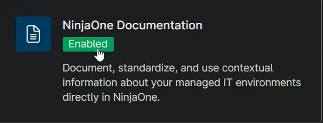
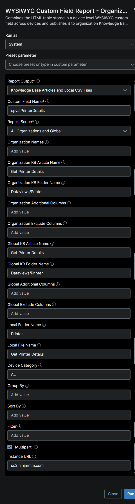
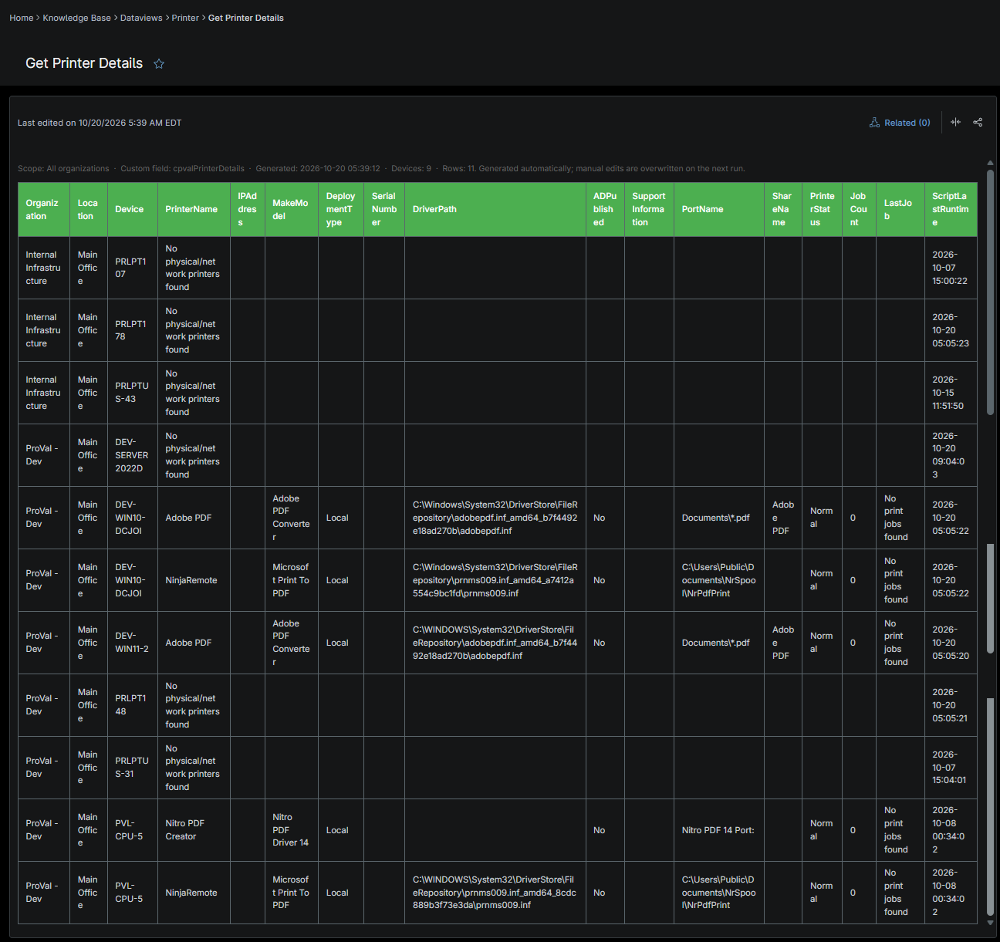
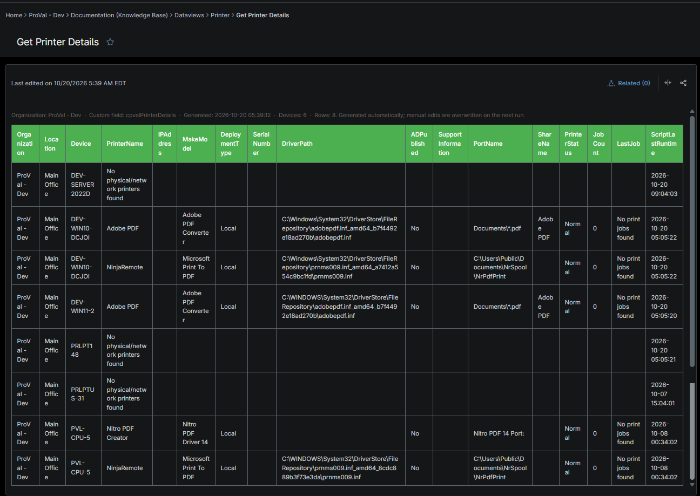
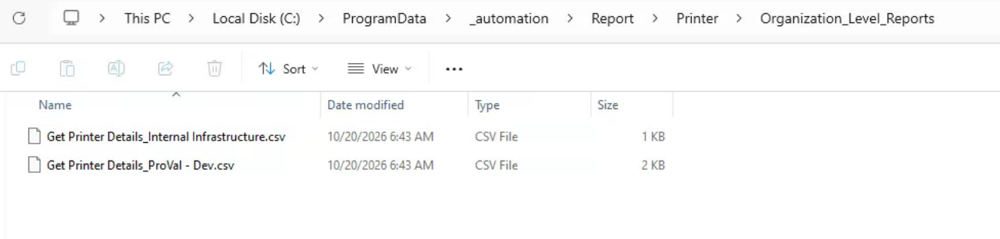

## Summary

The report shows the active printers detail of the endpoint. Use  this report to find the number of active printers of the agent. The [Get Printer Details](/docs/b97ba03c-ce1a-4337-a42b-d07dabc59412) automation collects the data on each Windows device.

## Requirements

:::note  
The Knowledge Base articles need the **NinjaOne Documentation** app enabled in NinjaOne, as shown below. If your NinjaOne does not have it, set **Report Output** to **Local CSV Files** in the report automation. The report then creates only the CSV files, on the device that runs it.  
:::

## Where to Find the Report

| Report | Knowledge Base Article | CSV File |
| ------ | ---------------------- | -------- |
| Global | **Global Knowledge Base** > `Dataviews` > `Printer` > `Get Printer Details` | `C:\ProgramData\_Automation\Report\Printer\Get Printer Details.csv` |
| Organization | **Organization Knowledge Base** > `Dataviews` > `Printer` > `Get Printer Details` | `C:\ProgramData\_Automation\Report\Printer\Get Printer Details_<Organization>.csv` |

:::note  
The articles and CSV files are replaced every time the report runs. CSV files are saved on the device that runs the report automation. An article that grows too large is split into `- Part 1`, `- Part 2` and so on.  
:::

## Report Columns

| Column Name | Appears In | Description |
|-------------|------------|-------------|
| Organization | Both | The organization to which the device is assigned. |
| Location | Both | The location associated with the device. |
| Device | Both | The name of the device where the printer was detected. |
| PrinterName | Both | The name of the installed or detected printer. |
| IPAddress | Both | The IP address assigned to the printer. |
| MakeModel | Both | The printer manufacturer and model information. |
| DeploymentType | Both | Indicates how the printer was deployed (for example, local, network, or managed deployment). |
| SerialNumber | Both | The printer's serial number, as reported by the device or printer management interface. |
| DriverPath | Both | The local file system path of the printer driver installed on the device. |
| ADPublished | Both | Indicates whether the printer is published and discoverable in Active Directory. |
| SupportInformation | Both | Contact details or support information used for vendor assistance and troubleshooting. |
| PortName | Both | The printer port configuration used for communication with the printer. |
| ShareName | Both | The shared name assigned to the printer for network access. |
| PrinterStatus | Both | The current operational status of the printer, such as Ready, Offline, Error, or Warning. |
| JobCount | Both | The total number of print jobs currently queued for the printer. |
| LastJob | Both | The date and time when the most recent print job was processed. |
| ScriptLastRunTime | Both | The date and time when the [Script - Get Printer Details](/docs/b97ba03c-ce1a-4337-a42b-d07dabc59412) last collected and reported printer information. |

## Report Settings

Values used in the [WYSIWYG Custom Field Report - Organization and Global KB](/docs/67df14cd-3c20-4a40-bb7a-80caae242687) automation to build this report.

| Script Variable | Value |
| --------------- | ----- |
| Report Output | Knowledge Base Articles and Local CSV Files |
| Custom Field Name | cpvalPrinterDetails |
| Report Scope | All Organizations and Global |
| Organization KB Article Name | Get Printer Details |
| Organization KB Folder Name | Dataviews/Printer |
| Organization Additional Columns | |
| Organization Exclude Columns | |
| Global KB Article Name | Get Printer Details |
| Global KB Folder Name | Dataviews/Printer |
| Global Additional Columns | |
| Global Exclude Columns | |
| Local Folder Name | Printer |
| Local File Name | Get Printer Details |
| Device Category | All |
| Multipart | True |
| Instance Url | The NinjaOne instance of the partner, for example us2.ninjarmm.com |

## Dependencies

* [Automation: WYSIWYG Custom Field Report - Organization and Global KB](/docs/67df14cd-3c20-4a40-bb7a-80caae242687)
* [Script: Get Printer Details](/docs/b97ba03c-ce1a-4337-a42b-d07dabc59412)
* [Custom Field: cPVAL Printer Details](/docs/4d6e483c-28b6-43ed-a83e-9f503166de5f)
* [Solution: Get Printer Details](/docs/b5c871cf-f8fc-4fde-b20c-5aabd7341ade)

## Global Article Sample Screenshot

## Organization Article Sample Screenshot

## CSV Folder Sample Screenshot

The global CSV file, and the `Organization_Level_Reports` folder with one CSV file per organization.

## Changelog

### 2026-10-21

- Initial version of the document
