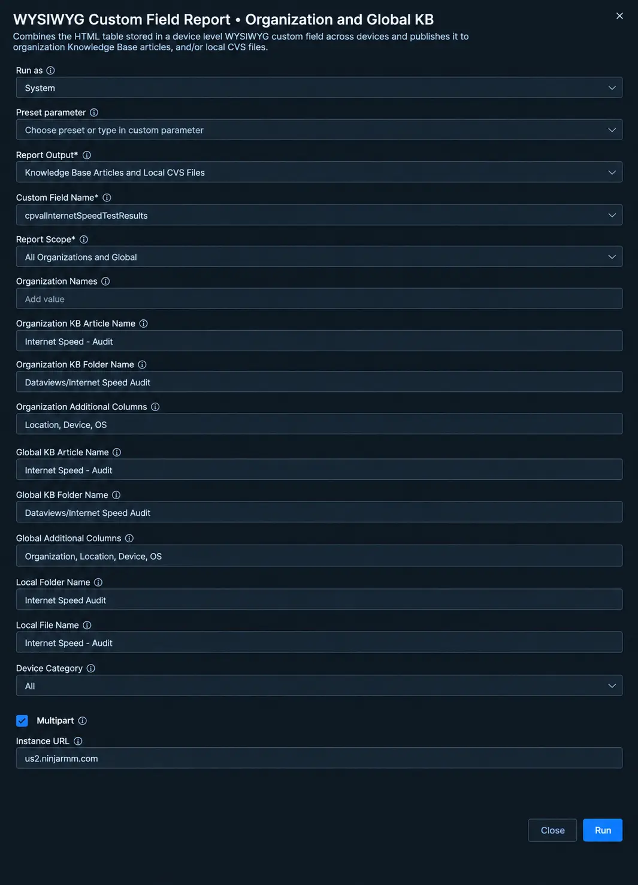
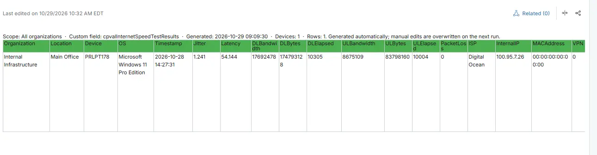
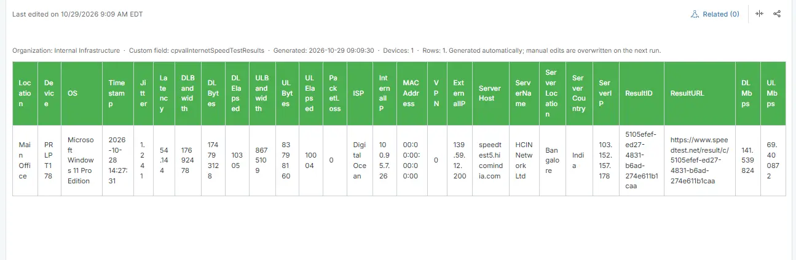
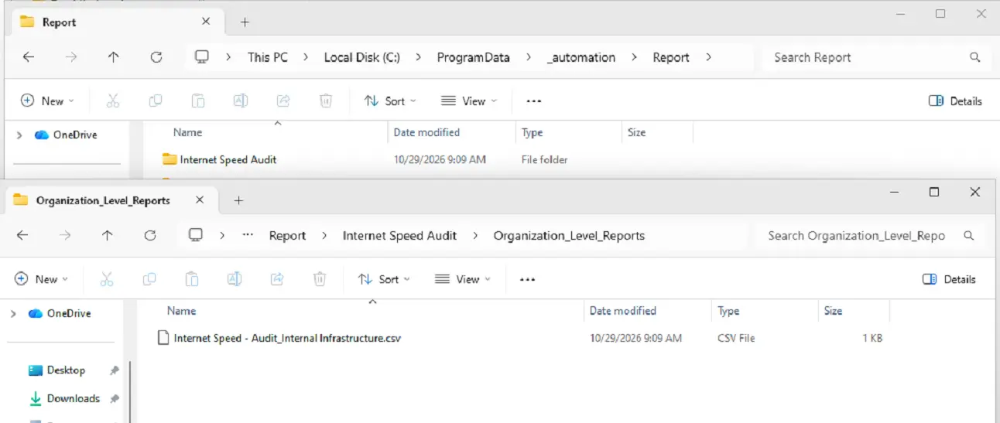

## Summary

Displays the complete results from the Internet Speed Test performed on each Windows device. The [Automation - Internet Speed - Audit](/docs/5d4e181e-6fc8-4dfb-ad53-e8aae1a784a0) automation collects and updates the results for each device whenever the script runs.

The report includes device and operating system details, test timestamp, latency, jitter, download and upload speeds, packet loss, ISP, network interface, MAC address, VPN status, internal and external IP addresses, and test server details, including server name, host, location, country, and IP address. It also provides the test result ID and URL for reviewing the detailed speed test results.

## Requirements

:::note  
The Knowledge Base articles need the **NinjaOne Documentation** app enabled in NinjaOne, as shown below. If your NinjaOne does not have it, set **Report Output** to **Local CSV Files** in the report automation. The report then creates only the CSV files, on the device that runs it.  
:::

## Where to Find the Report

| Report | Knowledge Base Article | CSV File |
| ------ | ---------------------- | -------- |
| Global | **Global Knowledge Base** > `Dataviews` > `Internet Speed Audit` > `Internet Speed - Audit` | `C:\ProgramData\_Automation\Report\Internet Speed Audit\Internet Speed - Audit.csv` |
| Organization | **Organization Knowledge Base** > `Dataviews` > `Internet Speed Audit` > `Internet Speed - Audit` | `C:\ProgramData\_Automation\Report\Internet Speed Audit\Organization_Level_Reports\Internet Speed - Audit.csv` |

:::note  
The articles and CSV files are replaced every time the report runs. CSV files are saved on the device that runs the report automation. An article that grows too large is split into `- Part 1`, `- Part 2` and so on.  
:::

## Report Columns

| Column Name | Appears In | Description |
| ----------- | ---------- | ----------- |
| Organization   | Global only | The organization the device belongs to.                               |
| Location       | Both | The location the device belongs to.                                          |
| Device         | Both | The device name.                                                             |
| OS             | Both | The operating system of the device.                                          |
| Timestamp      | Both | The time of the audit.                                                       |
| Jitter         | Both | Amount of jitter detected.                                                   |
| Latency        | Both | Amount of latency detected.                                                  |
| DLBandwidth    | Both | The measured bandwidth for download speed.                                   |
| DLBytes        | Both | The total number of bytes received in the audit.                             |
| DLElapsed      | Both | The total time taken to receive the bytes.                                   |
| ULBandwidth    | Both | The measured bandwidth for upload speed.                                     |
| ULBytes        | Both | The total number of bytes sent in the audit.                                 |
| ULElapsed      | Both | The total time taken to send the bytes.                                      |
| PacketLoss     | Both | Amount of packet loss detected.                                              |
| ISP            | Both | The name of the ISP.                                                         |
| InternalIP     | Both | The internal IP of the audited agent.                                        |
| MACAddress     | Both | The MAC address of the audited agent.                                        |
| VPN            | Both | 1 if the speed test was run on a detected VPN connection.                    |
| ExternalIP     | Both | The external IP of the audited agent.                                        |
| ServerHost     | Both | The server host that the speed test was performed against.                   |
| ServerName     | Both | The name of the server host that the speed test was performed against.       |
| ServerLocation | Both | The location of the server host that the speed test was performed against.   |
| ServerCountry  | Both | The country of the server host that the speed test was performed against.    |
| ServerIP       | Both | The IP address of the server host that the speed test was performed against. |
| ResultID       | Both | The GUID of the speed test result.                                           |
| ResultURL      | Both | The URL of the speed test result.                                            |
| DLMbps         | Both | The download speed detected in Mbps.                                         |
| ULMbps         | Both | The upload speed detected in Mbps.                                           |

## Report Settings

Values used in the [WYSIWYG Custom Field Report - Organization and Global KB](/docs/67df14cd-3c20-4a40-bb7a-80caae242687) automation to build this report.

| Script Variable                  | Value                                                                |
| -------------------------------- | -------------------------------------------------------------------- |
| Report Output                    | Knowledge Base Articles and Local CVS Files                          |
| Custom Field Name                | `cpvalInternetSpeedTestResults`                                      |
| Report Scope                     | All Organizations and Global                                         |
| Organization KB Article Name     | Internet Speed - Audit                                               |
| Organization KB Folder Name      | Dataviews/Internet Speed Audit                                       |
| Organization Additional Columns  | Location, Device, OS                                                 |
| Global KB Article Name           | Internet Speed - Audit                                               |
| Global KB Folder Name            | Dataviews/Internet Speed Audit                                       |
| Global Additional Columns        | Organization, Location, Device, OS                                   |
| Local Folder Name                | Internet Speed Audit                                                 |
| Local File Name                  | Internet Speed - Audit                                               |
| Device Category                  | All                                                                  |
| Multipart                        | True                                                                 |
| Instance Url                     | The NinjaOne instance of the partner, for example `us2.ninjarmm.com` |

## Dependencies

* [Automation - Internet Speed - Audit](/docs/5d4e181e-6fc8-4dfb-ad53-e8aae1a784a0)
* [Custom Field - cPVAL Internet Speed Test Results](/docs/96f40eb8-1282-42d2-aefa-38042d85b796)
* [Solution - Internet Speed Audit](/docs/7dc8d18c-aab4-4ad1-80bc-4e7beef98530)

## Global Article Sample Screenshot

## Organization Article Sample Screenshot

## CSV Folder Sample Screenshot

The global CSV file, and the `Organization_Level_Reports` folder with one CSV file per organization.

## Changelog

### 2026-10-29

- Initial version of the document
