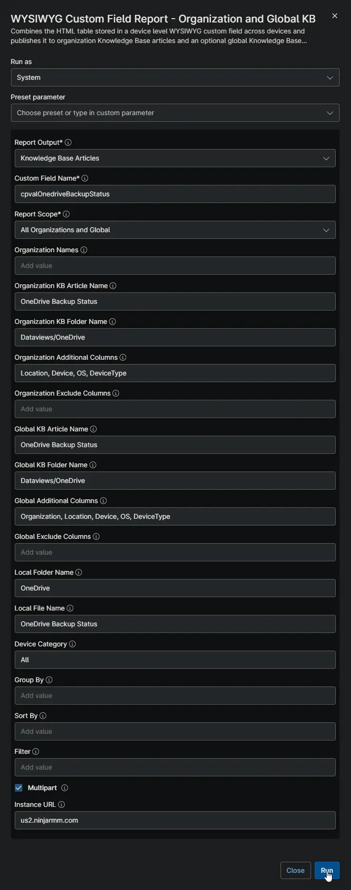
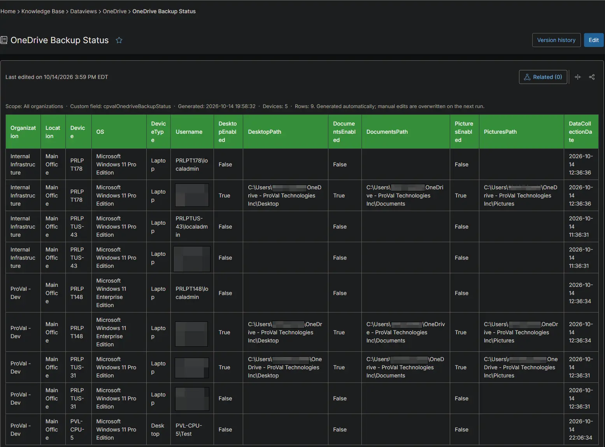
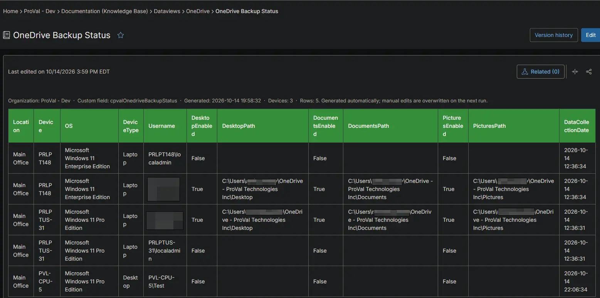
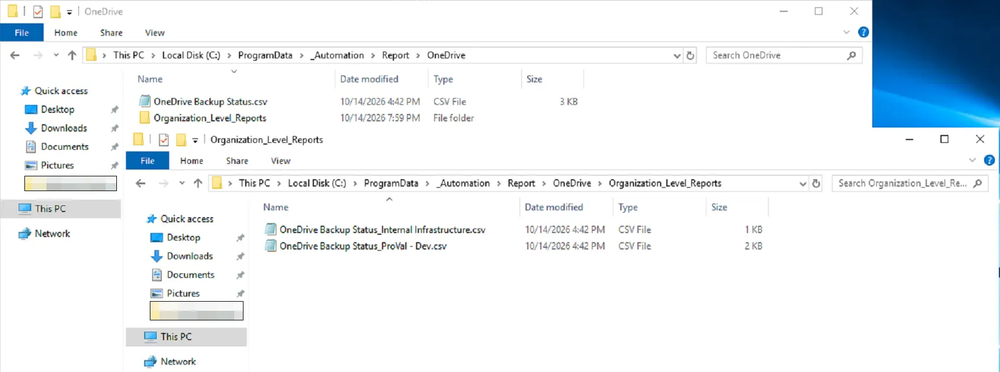

## Summary

Shows, for every user on each Windows workstation, whether the Desktop, Documents and Pictures folders are backed up to OneDrive. Use it to find users whose files would be lost if their device failed. The [Get OneDrive Backup Status](/docs/6d7374c8-a485-4748-89d9-02f913514ab9) automation collects the data on each device.

## Requirements

:::note  
The Knowledge Base articles need the **NinjaOne Documentation** app enabled in NinjaOne, as shown below. If your NinjaOne does not have it, set **Report Output** to **Local CSV Files** in the report automation. The report then creates only the CSV files, on the device that runs it.  
:::

## Where to Find the Report

| Report | Knowledge Base Article | CSV File |
| ------ | ---------------------- | -------- |
| Global | **Global Knowledge Base** > `Dataviews` > `OneDrive` > `OneDrive Backup Status` | `C:\ProgramData\_Automation\Report\OneDrive\OneDrive Backup Status.csv` |
| Organization | **Organization Knowledge Base** > `Dataviews` > `OneDrive` > `OneDrive Backup Status` | `C:\ProgramData\_Automation\Report\OneDrive\Organization_Level_Reports\OneDrive Backup Status_<Organization>.csv` |

:::note  
The articles and CSV files are replaced every time the report runs. CSV files are saved on the device that runs the report automation. An article that grows too large is split into `- Part 1`, `- Part 2` and so on. Every user profile on a device is listed, including users without OneDrive.  
:::

## Report Columns

| Column Name | Appears In | Description |
| ----------- | ---------- | ----------- |
| Organization | Global only | The organization the device belongs to. |
| Location | Both | The location the device belongs to. |
| Device | Both | The device name. |
| OS | Both | The operating system of the device. |
| DeviceType | Both | The device type: `Physical Server`, `Virtual Server`, `Laptop`, `Desktop` or `Virtual Workstation`. |
| Username | Both | The user, as `DOMAIN\user`. |
| DesktopEnabled | Both | `True` when the Desktop folder is backed up to OneDrive. |
| DesktopPath | Both | Where the Desktop folder is stored. Blank when it is not backed up. |
| DocumentsEnabled | Both | `True` when the Documents folder is backed up to OneDrive. |
| DocumentsPath | Both | Where the Documents folder is stored. Blank when it is not backed up. |
| PicturesEnabled | Both | `True` when the Pictures folder is backed up to OneDrive. |
| PicturesPath | Both | Where the Pictures folder is stored. Blank when it is not backed up. |
| DataCollectionDate | Both | When the device collected the data. |

## Report Settings

Values used in the [WYSIWYG Custom Field Report - Organization and Global KB](/docs/67df14cd-3c20-4a40-bb7a-80caae242687) automation to build this report.

| Script Variable | Value |
| --------------- | ----- |
| Report Output | Knowledge Base Articles and Local CSV Files |
| Custom Field Name | `cpvalOnedriveBackupStatus` |
| Report Scope | All Organizations and Global |
| Organization KB Article Name | OneDrive Backup Status |
| Organization KB Folder Name | Dataviews/OneDrive |
| Organization Additional Columns | Location, Device, OS, DeviceType |
| Global KB Article Name | OneDrive Backup Status |
| Global KB Folder Name | Dataviews/OneDrive |
| Global Additional Columns | Organization, Location, Device, OS, DeviceType |
| Local Folder Name | OneDrive |
| Local File Name | OneDrive Backup Status |
| Device Category | All |
| Multipart | True |
| Instance Url | The NinjaOne instance of the partner, for example `us2.ninjarmm.com` |

## Dependencies

* [Automation: WYSIWYG Custom Field Report - Organization and Global KB](/docs/67df14cd-3c20-4a40-bb7a-80caae242687)
* [Automation: Get OneDrive Backup Status](/docs/6d7374c8-a485-4748-89d9-02f913514ab9)
* [Custom Field: cPVAL OneDrive Backup Status](/docs/ba25e98b-3fed-432b-96a5-147a5ac1f321)
* [Solution: Get OneDrive Backup Status](/docs/67648c92-1636-419d-a541-e5a7f496fc85)

## Global Article Sample Screenshot

## Organization Article Sample Screenshot

## CSV Folder Sample Screenshot

The global CSV file, and the `Organization_Level_Reports` folder with one CSV file per organization.

## Changelog

### 2026-10-14

- Initial version of the document
