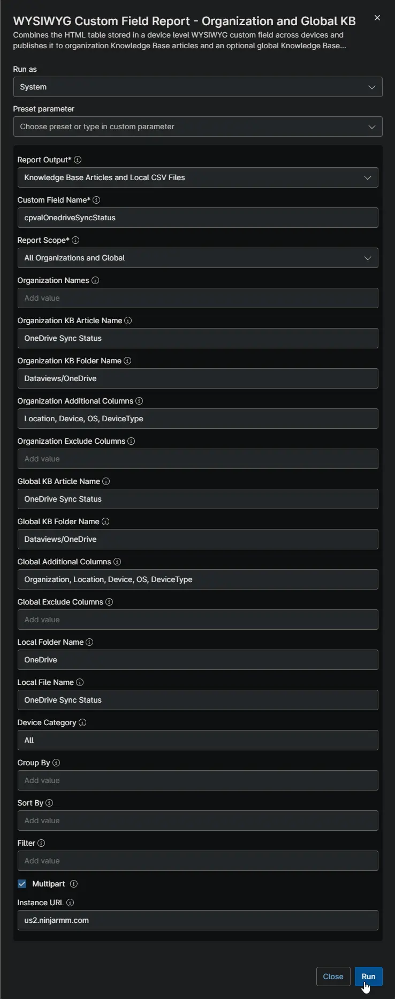
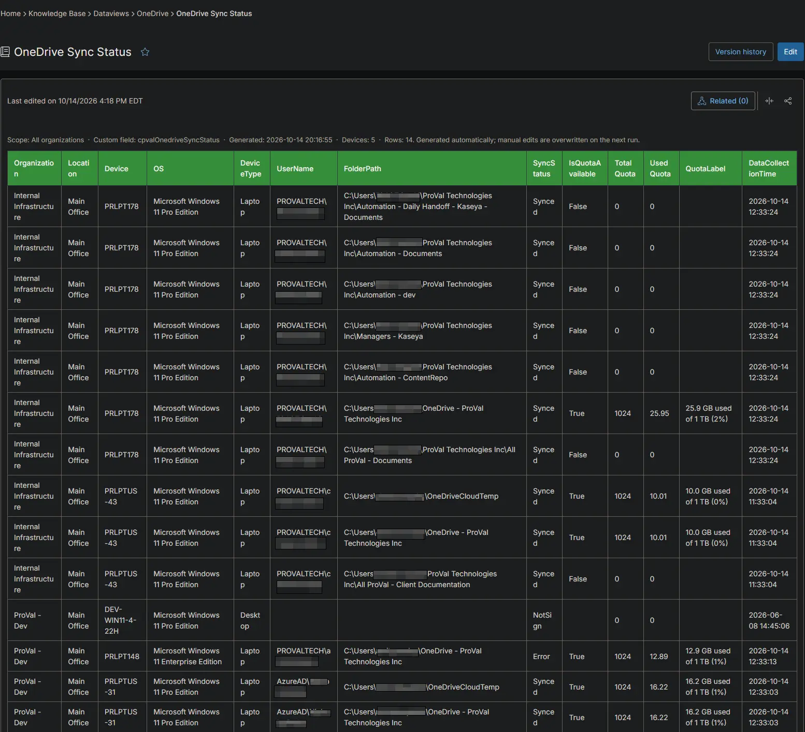
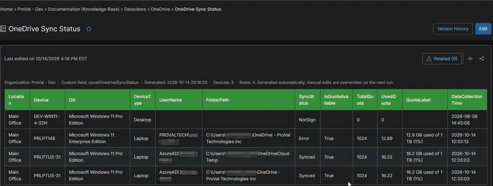
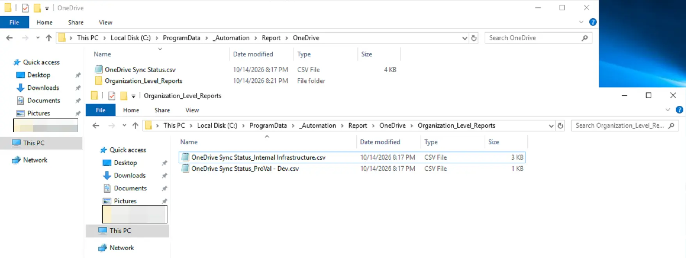

## Summary

Shows the OneDrive sync status and storage quota of the user signed in to each Windows workstation. Use it to find users whose files are not syncing or whose OneDrive is nearly full. The [Get OneDrive Sync Status](/docs/29e62bb2-d641-472d-a92b-11404471b915) automation collects the data on each device.

## Requirements

:::note  
The Knowledge Base articles need the **NinjaOne Documentation** app enabled in NinjaOne, as shown below. If your NinjaOne does not have it, set **Report Output** to **Local CSV Files** in the report automation. The report then creates only the CSV files, on the device that runs it.  
:::

## Where to Find the Report

| Report | Knowledge Base Article | CSV File |
| ------ | ---------------------- | -------- |
| Global | **Global Knowledge Base** > `Dataviews` > `OneDrive` > `OneDrive Sync Status` | `C:\ProgramData\_Automation\Report\OneDrive\OneDrive Sync Status.csv` |
| Organization | **Organization Knowledge Base** > `Dataviews` > `OneDrive` > `OneDrive Sync Status` | `C:\ProgramData\_Automation\Report\OneDrive\Organization_Level_Reports\OneDrive Sync Status_<Organization>.csv` |

:::note  
The articles and CSV files are replaced every time the report runs. CSV files are saved on the device that runs the report automation. An article that grows too large is split into `- Part 1`, `- Part 2` and so on. A device only appears after the automation has run while a user was signed in and OneDrive was running.  
:::

## Report Columns

| Column Name | Appears In | Description |
| ----------- | ---------- | ----------- |
| Organization | Global only | The organization the device belongs to. |
| Location | Both | The location the device belongs to. |
| Device | Both | The device name. |
| OS | Both | The operating system of the device. |
| DeviceType | Both | The device type: `Physical Server`, `Virtual Server`, `Laptop`, `Desktop` or `Virtual Workstation`. |
| UserName | Both | The user whose OneDrive was checked. |
| FolderPath | Both | The local OneDrive folder. |
| SyncStatus | Both | The sync state, for example `UpToDate`, `Syncing` or `Error`. |
| IsQuotaAvailable | Both | `True` when OneDrive reported storage quota information. |
| TotalQuota | Both | The total OneDrive storage, in GB. |
| UsedQuota | Both | The OneDrive storage in use, in GB. |
| QuotaLabel | Both | The storage state reported by OneDrive. |
| DataCollectionTime | Both | When the device collected the data. |

## Report Settings

Values used in the [WYSIWYG Custom Field Report - Organization and Global KB](/docs/67df14cd-3c20-4a40-bb7a-80caae242687) automation to build this report.

| Script Variable | Value |
| --------------- | ----- |
| Report Output | Knowledge Base Articles and Local CSV Files |
| Custom Field Name | `cpvalOnedriveSyncStatus` |
| Report Scope | All Organizations and Global |
| Organization KB Article Name | OneDrive Sync Status |
| Organization KB Folder Name | Dataviews/OneDrive |
| Organization Additional Columns | Location, Device, OS, DeviceType |
| Global KB Article Name | OneDrive Sync Status |
| Global KB Folder Name | Dataviews/OneDrive |
| Global Additional Columns | Organization, Location, Device, OS, DeviceType |
| Local Folder Name | OneDrive |
| Local File Name | OneDrive Sync Status |
| Device Category | All |
| Multipart | True |
| Instance Url | The NinjaOne instance of the partner, for example `us2.ninjarmm.com` |

## Dependencies

* [Automation: WYSIWYG Custom Field Report - Organization and Global KB](/docs/67df14cd-3c20-4a40-bb7a-80caae242687)
* [Automation: Get OneDrive Sync Status](/docs/29e62bb2-d641-472d-a92b-11404471b915)
* [Custom Field: cPVAL OneDrive Sync Status](/docs/03102a1f-7b86-4528-be18-c30333e6742f)
* [Solution: Get OneDrive Sync Status](/docs/22d8abe0-2ea4-48e9-8b02-6108cd2de889)

## Global Article Sample Screenshot

## Organization Article Sample Screenshot

## CSV Folder Sample Screenshot

The global CSV file, and the `Organization_Level_Reports` folder with one CSV file per organization.

## Changelog

### 2026-10-14

- Initial version of the document
