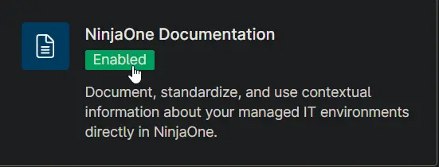
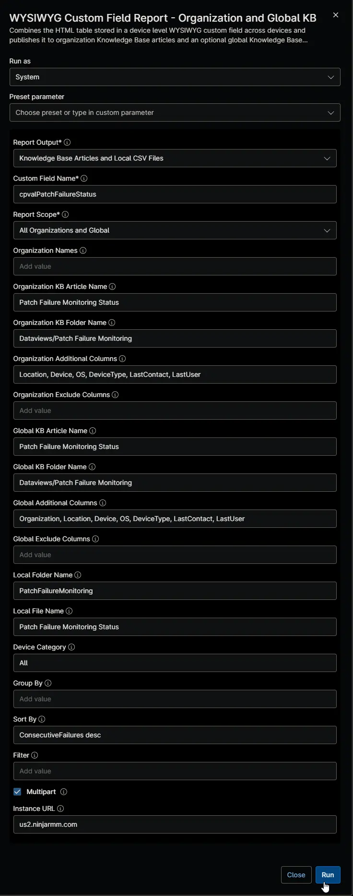
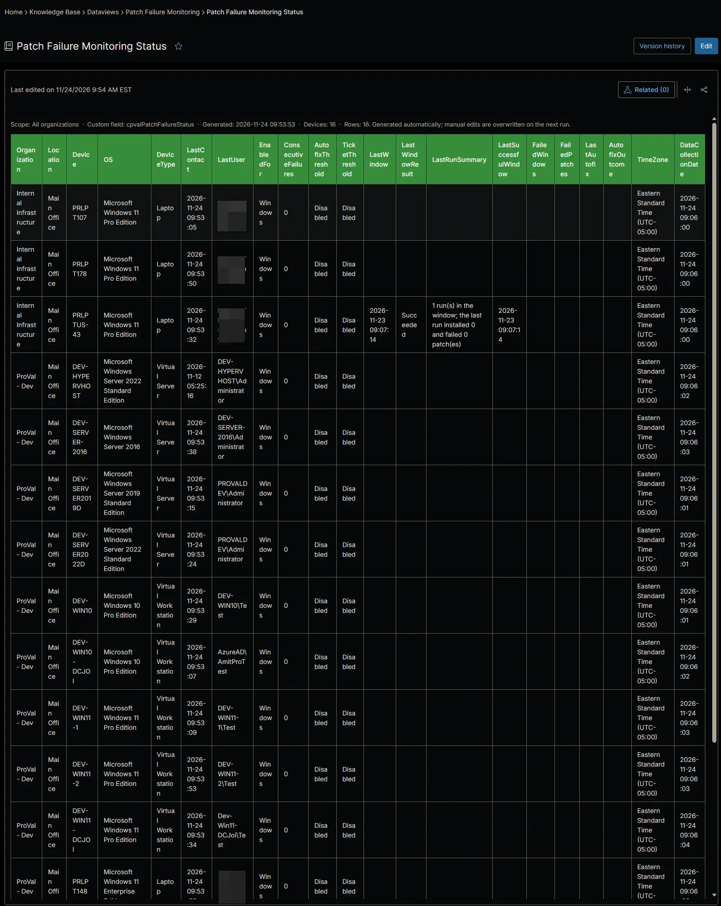
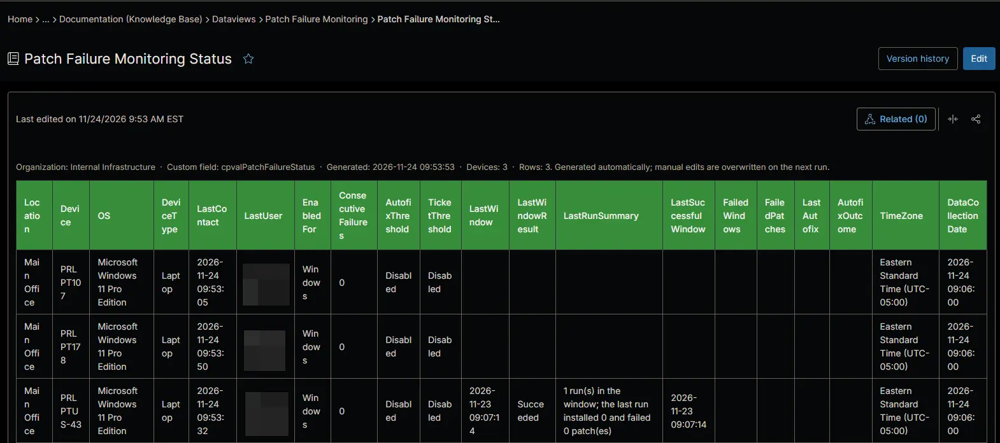
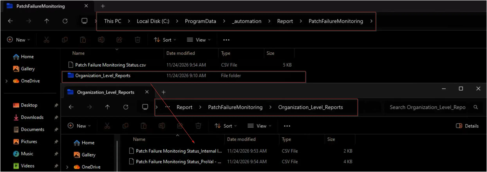

## Summary

Shows the number of consecutive failed patch windows, the thresholds, the latest patch window and the repair outcome of every Windows device monitored by the [Patch Failure Monitoring - NinjaOne](/docs/020ff3c5-06a6-4f98-9eaa-7f7392b2257a) solution. Use it to find devices whose patching keeps failing and the updates that fail, and to check whether the repair helped. The [Patch Failure Monitoring](/docs/28302386-1560-4468-be5c-c9d683b99e65) automation collects the data.

## Requirements

:::note  
The Knowledge Base articles need the **NinjaOne Documentation** app enabled in NinjaOne, as shown below. If your NinjaOne does not have it, set **Report Output** to **Local CSV Files** in the report automation. The report then creates only the CSV files, on the device that runs it.  
:::

## Where to Find the Report

| Report | Knowledge Base Article | CSV File |
| ------ | ---------------------- | -------- |
| Global | **Global Knowledge Base** > `Dataviews` > `Patch Failure Monitoring` > `Patch Failure Monitoring Status` | `C:\ProgramData\_Automation\Report\PatchFailureMonitoring\Patch Failure Monitoring Status.csv` |
| Organization | **Organization Knowledge Base** > `Dataviews` > `Patch Failure Monitoring` > `Patch Failure Monitoring Status` | `C:\ProgramData\_Automation\Report\PatchFailureMonitoring\Organization_Level_Reports\Patch Failure Monitoring Status_<Organization>.csv` |

:::note  
The articles and CSV files are replaced every time the report runs. CSV files are saved on the device that runs the report automation. An article that grows too large is split into `- Part 1`, `- Part 2` and so on. A device appears only while it's monitored and the [Patch Failure Monitoring](/docs/28302386-1560-4468-be5c-c9d683b99e65) automation has run since.  
:::

:::note  
Every time in the report, including LastContact, is in the time zone of the primary machine that runs the report, shown in the TimeZone column, not the device's own time zone.  
:::

## Report Columns

| Column Name | Appears In | Description |
| ----------- | ---------- | ----------- |
| Organization | Global only | The organization the device belongs to. |
| Location | Both | The location the device belongs to. |
| Device | Both | The device name. |
| OS | Both | The operating system of the device. |
| DeviceType | Both | The device type: `Physical Server`, `Virtual Server`, `Laptop`, `Desktop` or `Virtual Workstation`. |
| LastContact | Both | When the device last contacted NinjaOne. |
| LastUser | Both | The last user signed in to the device. |
| EnabledFor | Both | The value of [cPVAL Patch Failure Monitoring](/docs/b3797751-cb85-4d82-b943-3bde379d6481) that applies to the device. |
| ConsecutiveFailures | Both | The number of consecutive failed patch windows. |
| AutofixThreshold | Both | The autofix threshold that applies to the device, or `Disabled`. |
| TicketThreshold | Both | The ticket threshold that applies to the device, or `Disabled`. A raised threshold shows the value set, for example `3 (set to 1, raised to autofix + 1)`. |
| LastWindow | Both | The start of the latest patch window counted. |
| LastWindowResult | Both | `Failed` or `Succeeded`. |
| LastRunSummary | Both | The number of patch runs in the latest window, and how many updates the last run installed and failed. |
| LastSuccessfulWindow | Both | The start of the latest successful patch window. |
| FailedWindows | Both | The start of each failed patch window of the current run of failures. |
| FailedPatches | Both | The KB number and name of each update that failed in the latest failed window. |
| LastAutofix | Both | When [Repair Windows Update](/docs/d7bb77e6-e7b8-45d2-9fa7-f109574aa887) was last requested. |
| AutofixOutcome | Both | `Awaiting Window`, `Failed Again` or `Resolved`. The values are described in [cPVAL Patch Failure Status](/docs/6d0d7b7c-f71d-4db9-9767-e3b7cd4846cd). |
| TimeZone | Both | The time zone of every time in the report, which is the time zone of the primary machine, for example `Eastern Standard Time (UTC-05:00)`. |
| DataCollectionDate | Both | When the device's row last changed. |

## Report Settings

Values used in the [WYSIWYG Custom Field Report - Organization and Global KB](/docs/67df14cd-3c20-4a40-bb7a-80caae242687) automation to build this report. The [Patch Failure Monitoring](/docs/ffc02ba6-8c07-4075-9844-2e7327723023) scheduled task runs it once a day, right after [Patch Failure Monitoring](/docs/28302386-1560-4468-be5c-c9d683b99e65), so the report always shows the latest run.

| Script Variable | Value |
| --------------- | ----- |
| Report Output | Knowledge Base Articles and Local CSV Files |
| Custom Field Name | `cpvalPatchFailureStatus` |
| Report Scope | All Organizations and Global |
| Organization KB Article Name | Patch Failure Monitoring Status |
| Organization KB Folder Name | Dataviews/Patch Failure Monitoring |
| Organization Additional Columns | Location, Device, OS, DeviceType, LastContact, LastUser |
| Organization Exclude Columns | |
| Global KB Article Name | Patch Failure Monitoring Status |
| Global KB Folder Name | Dataviews/Patch Failure Monitoring |
| Global Additional Columns | Organization, Location, Device, OS, DeviceType, LastContact, LastUser |
| Global Exclude Columns | |
| Local Folder Name | PatchFailureMonitoring |
| Local File Name | Patch Failure Monitoring Status |
| Device Category | All |
| Group By | |
| Sort By | ConsecutiveFailures desc |
| Filter | |
| Multipart | True |
| Instance Url | The NinjaOne instance of the partner, for example `us2.ninjarmm.com` |

## Dependencies

* [Automation: WYSIWYG Custom Field Report - Organization and Global KB](/docs/67df14cd-3c20-4a40-bb7a-80caae242687)
* [Automation: Patch Failure Monitoring](/docs/28302386-1560-4468-be5c-c9d683b99e65)
* [Custom Field: cPVAL Patch Failure Status](/docs/6d0d7b7c-f71d-4db9-9767-e3b7cd4846cd)
* [Scheduled Task: Patch Failure Monitoring](/docs/ffc02ba6-8c07-4075-9844-2e7327723023)
* [Solution: Patch Failure Monitoring - NinjaOne](/docs/020ff3c5-06a6-4f98-9eaa-7f7392b2257a)

## Global Article Sample Screenshot

## Organization Article Sample Screenshot

## CSV Folder Sample Screenshot

The global CSV file, and the `Organization_Level_Reports` folder with one CSV file per organization.

## Changelog

### 2026-11-23

- Initial version of the document
