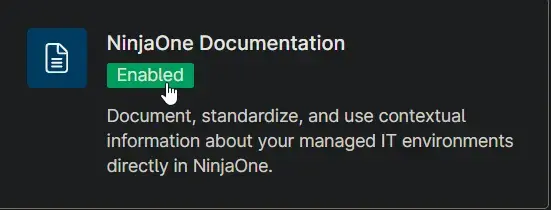
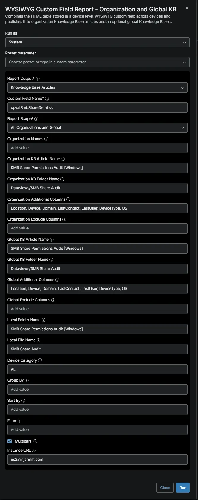
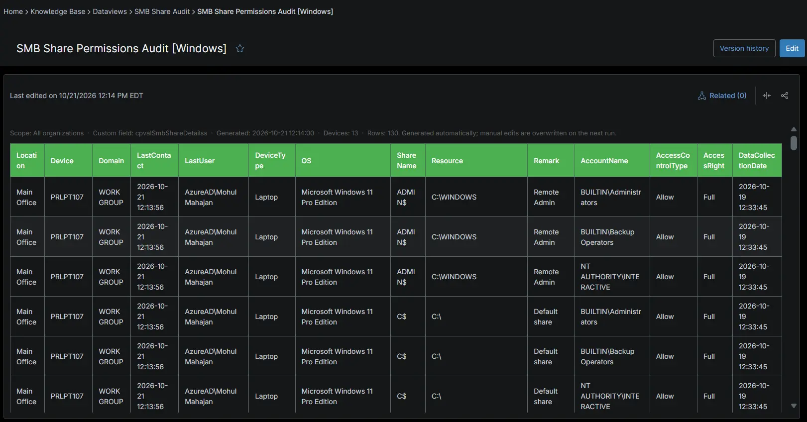
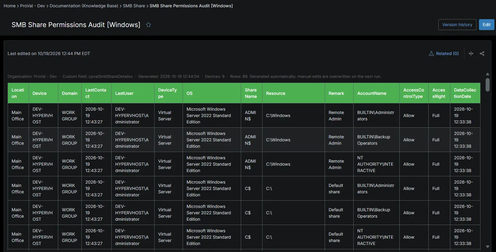
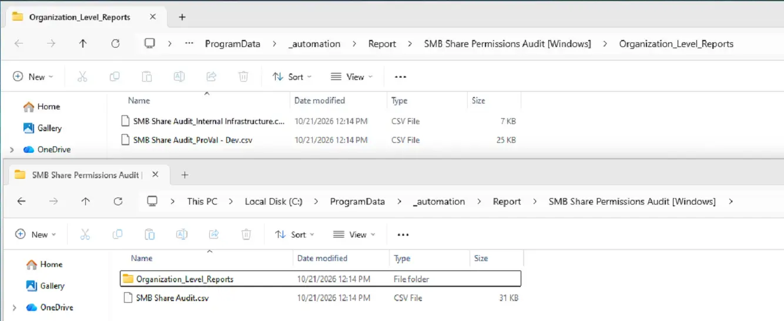

## Summary

Lists SMB share permissions on Windows devices for every client, providing details of share names, resource paths, user accounts, access control types, and access rights for auditing and security review. The [SMB Share Permissions Audit [Windows]](/docs/1e4a0ce1-e3a0-47b1-8574-4be31b24bc2a) automation collects the data on each Windows device.

## Requirements

:::note  
The Knowledge Base articles need the **NinjaOne Documentation** app enabled in NinjaOne, as shown below. If your NinjaOne does not have it, set **Report Output** to **Local CSV Files** in the report automation. The report then creates only the CSV files, on the device that runs it.  
:::

## Where to Find the Report

| Report | Knowledge Base Article | CSV File |
| ------ | ---------------------- | -------- |
| Global | **Global Knowledge Base** > `Dataviews` > `SMB Share Audit` > `SMB Share Permissions Audit [Windows]` | `C:\ProgramData\_Automation\Report\SMB Share Permissions Audit [Windows]\SMB Share Audit.csv` |
| Organization | **Organization Knowledge Base** > `Dataviews` > `SMB Share Audit` > `SMB Share Permissions Audit [Windows]` | `C:\ProgramData\_Automation\Report\SMB Share Permissions Audit [Windows]\Organization_Level_Reports\SMB Share Audit_Proval - Dev.csv` |

:::note  
The articles and CSV files are replaced every time the report runs. CSV files are saved on the device that runs the report automation. An article that grows too large is split into `- Part 1`, `- Part 2` and so on.  
:::

## Report Columns

| Column Name | Appears In | Description |
| ----------- | ---------- | ----------- |
| Organization | Global only | The organization the device belongs to. |
| Location | Both | The location the device belongs to. |
| Device | Both | The device name. |
| OS | Both | The operating system of the device. |
| ShareName | Both  | The name of the SMB share. |
| Resource | Both  | The local path where the SMB share is located. |
| Remark | Both  | The description or remark associated with the SMB share, if available. |
| AccountName | Both  | The user or group account assigned permissions to the SMB share. |
| AccessControlType | Both  | Specifies whether the permission is allowed or denied. |
| AccessRight | Both  | The level of access granted or denied, such as Read, Change, or Full. |
| DataCollectionDate | Both  | The date and time when the SMB share permission data was collected. |

## Report Settings

Values used in the [WYSIWYG Custom Field Report - Organization and Global KB](/docs/67df14cd-3c20-4a40-bb7a-80caae242687) automation to build this report.

| Script Variable | Value |
| --------------- | ----- |
| Report Output | Knowledge Base Articles and Local CVS Files |
| Custom Field Name | `cpvalSmbShareDetailss` |
| Report Scope | All Organizations and Global |
| Organization KB Article Name | SMB Share Permissions Audit [Windows] |
| Organization KB Folder Name | Dataviews/SMB Share Audit |
| Organization Additional Columns | Location, Device, Domain, LastContact, LastUser, DeviceType, OS |
| Global KB Article Name | SMB Share Permissions Audit [Windows] |
| Global KB Folder Name | Dataviews/SMB Share Audit |
| Global Additional Columns | Location, Device, Domain, LastContact, LastUser, DeviceType, OS |
| Local Folder Name | SMB Share Permissions Audit [Windows] |
| Local File Name | SMB Share Audit |
| Device Category | All |
| Multipart | True |
| Instance Url | The NinjaOne instance of the partner, for example `us2.ninjarmm.com` |

## Dependencies

* [Automation: WYSIWYG Custom Field Report - Organization and Global KB](/docs/67df14cd-3c20-4a40-bb7a-80caae242687)
* [Automation: SMB Share Permissions Audit [Windows]](/docs/1e4a0ce1-e3a0-47b1-8574-4be31b24bc2a)
* [Custom Field: cPVAL SMB Share Details](/docs/751a00ed-8de0-4146-8722-75629788411b)
* [Solution: SMB Share Permission Audit](/docs/a1a0fea8-a255-45e3-98c6-1bbe094f5693)

## Global Article Sample Screenshot

## Organization Article Sample Screenshot

## CSV Folder Sample Screenshot

The global CSV file, and the `Organization_Level_Reports` folder with one CSV file per organization.

## Changelog

### 2026-10-23

- Initial version of the document
