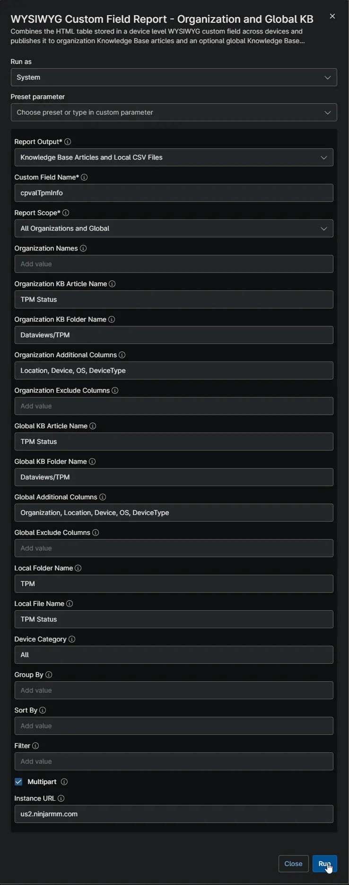
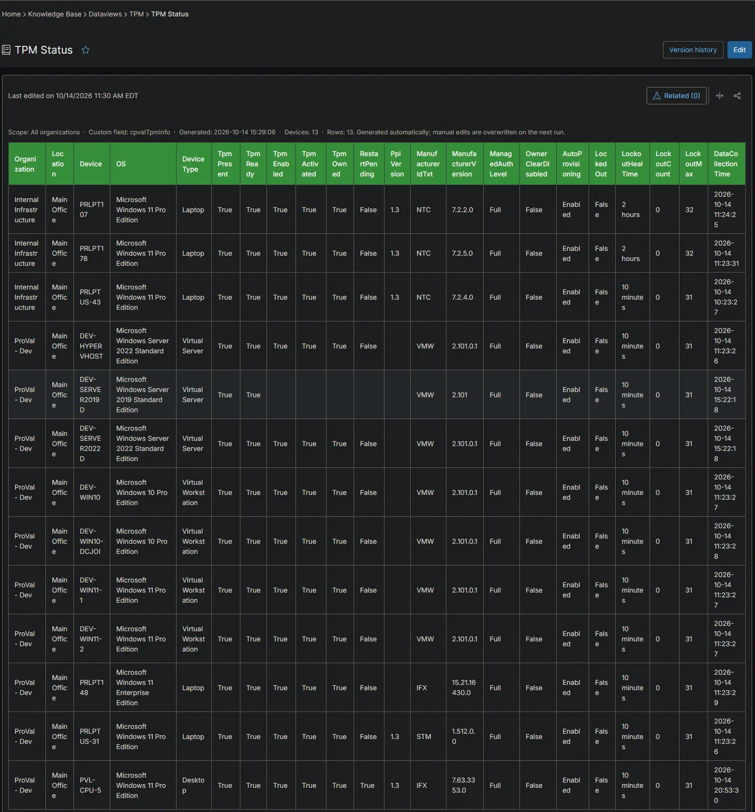
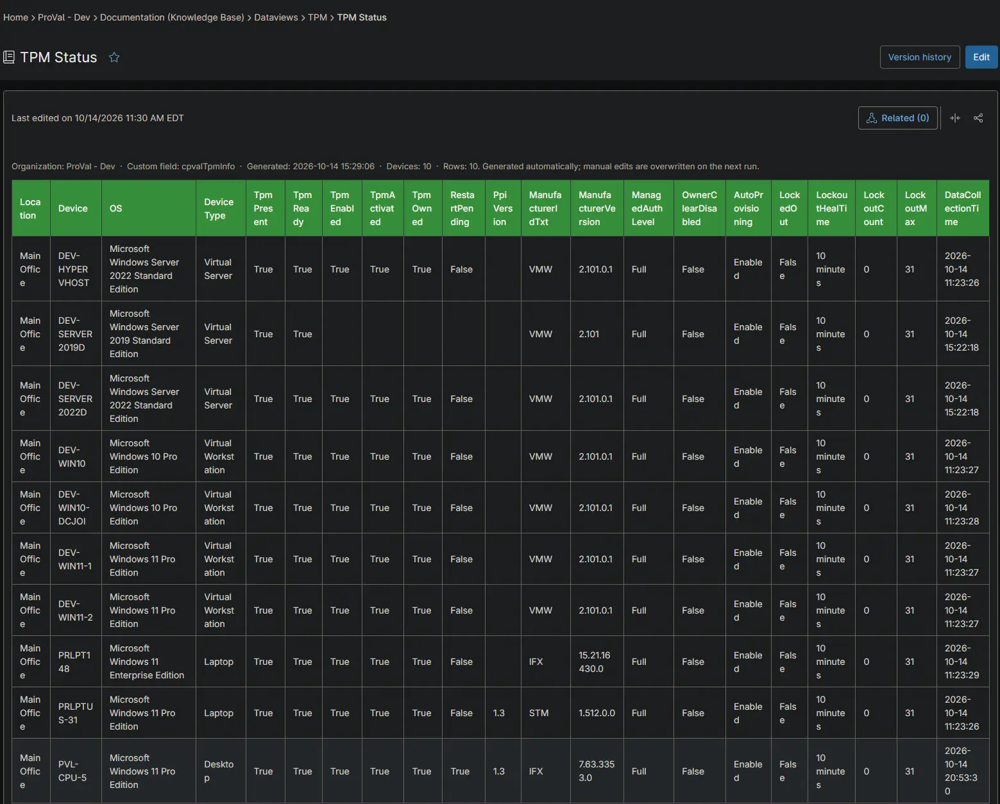
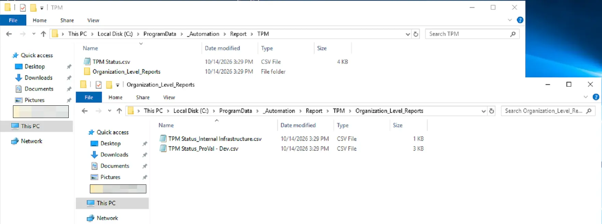

## Summary

Shows the Trusted Platform Module (TPM) status of each Windows workstation. The TPM is the security chip BitLocker uses to protect encryption keys. Use it to find devices with a missing, disabled or locked-out TPM before you roll out BitLocker. The [BitLocker and TPM Audit](/docs/2d104874-ec69-4d95-b912-7fcd240bf592) automation collects the data on each device.

## Requirements

:::note  
The Knowledge Base articles need the **NinjaOne Documentation** app enabled in NinjaOne, as shown below. If your NinjaOne does not have it, set **Report Output** to **Local CSV Files** in the report automation. The report then creates only the CSV files, on the device that runs it.  
:::

## Where to Find the Report

| Report | Knowledge Base Article | CSV File |
| ------ | ---------------------- | -------- |
| Global | **Global Knowledge Base** > `Dataviews` > `TPM` > `TPM Status` | `C:\ProgramData\_Automation\Report\TPM\TPM Status.csv` |
| Organization | **Organization Knowledge Base** > `Dataviews` > `TPM` > `TPM Status` | `C:\ProgramData\_Automation\Report\TPM\Organization_Level_Reports\TPM Status_<Organization>.csv` |

:::note  
The articles and CSV files are replaced every time the report runs. CSV files are saved on the device that runs the report automation. An article that grows too large is split into `- Part 1`, `- Part 2` and so on.  
:::

## Report Columns

| Column Name | Appears In | Description |
| ----------- | ---------- | ----------- |
| Organization | Global only | The organization the device belongs to. |
| Location | Both | The location the device belongs to. |
| Device | Both | The device name. |
| OS | Both | The operating system of the device. |
| DeviceType | Both | The device type: `Physical Server`, `Virtual Server`, `Laptop`, `Desktop` or `Virtual Workstation`. |
| TpmPresent | Both | `True` when the device has a TPM. |
| TpmReady | Both | `True` when the TPM is ready for use. |
| TpmEnabled | Both | `True` when the TPM is enabled in the BIOS or UEFI. |
| TpmActivated | Both | `True` when the TPM is activated. Applies mainly to TPM 1.2. |
| TpmOwned | Both | `True` when Windows has taken ownership of the TPM. |
| RestartPending | Both | `True` when a restart is needed to finish a TPM change. |
| PpiVersion | Both | The Physical Presence Interface version. |
| ManufacturerIdTxt | Both | The TPM manufacturer. |
| ManufacturerVersion | Both | The TPM firmware version. |
| ManagedAuthLevel | Both | How much of the TPM authorization Windows manages. |
| OwnerClearDisabled | Both | `True` when clearing the TPM is blocked by policy. |
| AutoProvisioning | Both | Whether Windows sets up the TPM automatically. |
| LockedOut | Both | `True` when the TPM is locked after too many failed attempts. |
| LockoutHealTime | Both | How long until the failed-attempt counter goes down. |
| LockoutCount | Both | The current number of failed attempts. |
| LockoutMax | Both | The number of failed attempts allowed before lockout. |
| DataCollectionTime | Both | When the device collected the data. |

## Report Settings

Values used in the [WYSIWYG Custom Field Report - Organization and Global KB](/docs/67df14cd-3c20-4a40-bb7a-80caae242687) automation to build this report.

| Script Variable | Value |
| --------------- | ----- |
| Report Output | Knowledge Base Articles and Local CSV Files |
| Custom Field Name | `cpvalTpmInfo` |
| Report Scope | All Organizations and Global |
| Organization KB Article Name | TPM Status |
| Organization KB Folder Name | Dataviews/TPM |
| Organization Additional Columns | Location, Device, OS, DeviceType |
| Global KB Article Name | TPM Status |
| Global KB Folder Name | Dataviews/TPM |
| Global Additional Columns | Organization, Location, Device, OS, DeviceType |
| Local Folder Name | TPM |
| Local File Name | TPM Status |
| Device Category | All |
| Multipart | True |
| Instance Url | The NinjaOne instance of the partner, for example `us2.ninjarmm.com` |

## Dependencies

* [Automation: WYSIWYG Custom Field Report - Organization and Global KB](/docs/67df14cd-3c20-4a40-bb7a-80caae242687)
* [Automation: BitLocker and TPM Audit](/docs/2d104874-ec69-4d95-b912-7fcd240bf592)
* [Custom Field: cPVAL TPM Info](/docs/68c098e2-54f1-40f8-9574-f70f1948e4ba)
* [Solution: BitLocker and TPM Audit](/docs/57c787ad-8d22-4ae4-b5e5-dac34fc600fc)

## Global Article Sample Screenshot

## Organization Article Sample Screenshot

## CSV Folder Sample Screenshot

The global CSV file, and the `Organization_Level_Reports` folder with one CSV file per organization.

## Changelog

### 2026-10-14

- Initial version of the document
