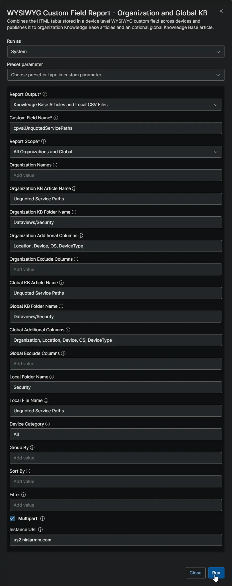
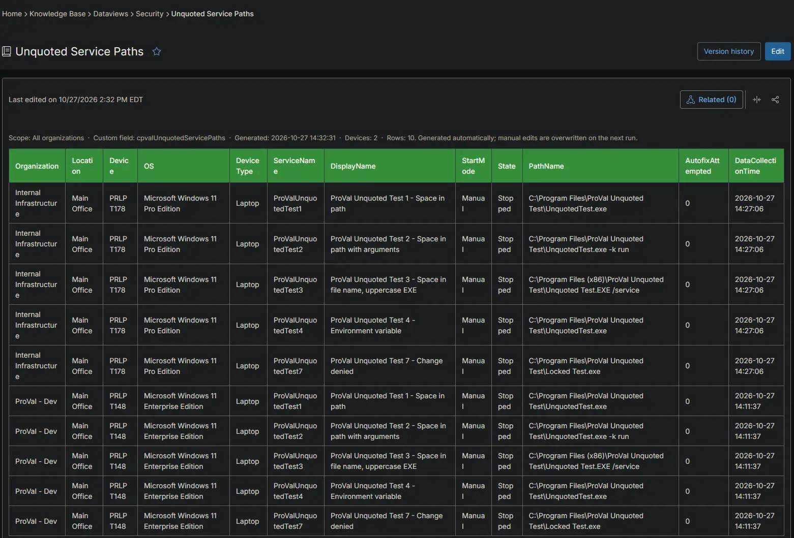
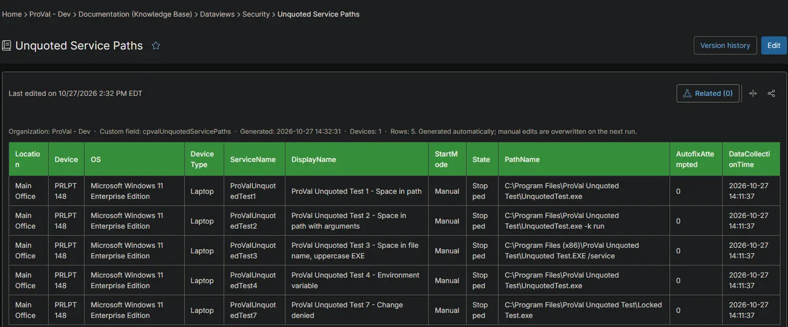
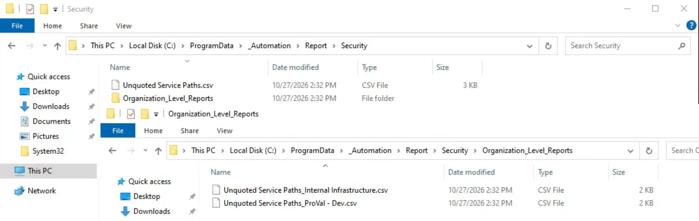

## Summary

Lists the Windows services with an unquoted executable path on each device, including the services the autofix could not fix. Use it to find the services security scans report as a privilege escalation risk and to follow up on failed fixes. The [Unquoted Service Paths - Detection](/docs/73387129-5472-4b0e-945e-f7822c57185d) automation collects the data on each device, and [Unquoted Service Paths - Autofix](/docs/2b0fa58e-fc89-45fd-a1d5-7e7e64096e30) updates it after every fix.

## Requirements

:::note  
The Knowledge Base articles need the **NinjaOne Documentation** app enabled in NinjaOne, as shown below. If your NinjaOne does not have it, set **Report Output** to **Local CSV Files** in the report automation. The report then creates only the CSV files, on the device that runs it.  
:::

## Where to Find the Report

| Report | Knowledge Base Article | CSV File |
| ------ | ---------------------- | -------- |
| Global | **Global Knowledge Base** > `Dataviews` > `Security` > `Unquoted Service Paths` | `C:\ProgramData\_Automation\Report\Security\Unquoted Service Paths.csv` |
| Organization | **Organization Knowledge Base** > `Dataviews` > `Security` > `Unquoted Service Paths` | `C:\ProgramData\_Automation\Report\Security\Organization_Level_Reports\Unquoted Service Paths_<Organization>.csv` |

:::note  
The articles and CSV files are replaced every time the report runs. CSV files are saved on the device that runs the report automation. An article that grows too large is split into `- Part 1`, `- Part 2` and so on. Devices without an unquoted service path have an empty [cPVAL Unquoted Service Paths](/docs/b3d517ef-c7e4-4dc7-aa10-1e52b6edb196) field, so they do not appear in the report.  
:::

## Report Columns

| Column Name | Appears In | Description |
| ----------- | ---------- | ----------- |
| Organization | Global only | The organization the device belongs to. |
| Location | Both | The location the device belongs to. |
| Device | Both | The device name. |
| OS | Both | The operating system of the device. |
| DeviceType | Both | The device type: `Physical Server`, `Virtual Server`, `Laptop`, `Desktop` or `Virtual Workstation`. |
| ServiceName | Both | The name of the service. |
| DisplayName | Both | The display name of the service. |
| StartMode | Both | How the service starts, for example `Auto`, `Manual` or `Disabled`. |
| State | Both | The state of the service when the data was collected, for example `Running` or `Stopped`. |
| PathName | Both | The path and arguments of the service. |
| AutofixAttempted | Both | `1` when the path is still unquoted after the autofix ran. `0` when the detection script recorded the service. |
| DataCollectionTime | Both | When the device collected the data. |

## Report Settings

Values used in the [WYSIWYG Custom Field Report - Organization and Global KB](/docs/67df14cd-3c20-4a40-bb7a-80caae242687) automation to build this report.

| Script Variable | Value |
| --------------- | ----- |
| Report Output | Knowledge Base Articles and Local CSV Files |
| Custom Field Name | `cpvalUnquotedServicePaths` |
| Report Scope | All Organizations and Global |
| Organization KB Article Name | Unquoted Service Paths |
| Organization KB Folder Name | Dataviews/Security |
| Organization Additional Columns | Location, Device, OS, DeviceType |
| Global KB Article Name | Unquoted Service Paths |
| Global KB Folder Name | Dataviews/Security |
| Global Additional Columns | Organization, Location, Device, OS, DeviceType |
| Local Folder Name | Security |
| Local File Name | Unquoted Service Paths |
| Filter | Leave blank |
| Device Category | All |
| Multipart | True |
| Instance Url | The NinjaOne instance of the partner, for example `us2.ninjarmm.com` |

## Dependencies

* [Automation: WYSIWYG Custom Field Report - Organization and Global KB](/docs/67df14cd-3c20-4a40-bb7a-80caae242687)
* [Automation: Unquoted Service Paths - Detection](/docs/73387129-5472-4b0e-945e-f7822c57185d)
* [Automation: Unquoted Service Paths - Autofix](/docs/2b0fa58e-fc89-45fd-a1d5-7e7e64096e30)
* [Custom Field: cPVAL Unquoted Service Paths](/docs/b3d517ef-c7e4-4dc7-aa10-1e52b6edb196)
* [Solution: Unquoted Service Paths - NinjaOne](/docs/463a9e42-df91-406d-b53c-285f4cbdabac)

## Global Article Sample Screenshot

## Organization Article Sample Screenshot

## CSV Folder Sample Screenshot

The global CSV file, and the `Organization_Level_Reports` folder with one CSV file per organization.

## Changelog

### 2026-10-27

- Initial version of the document
