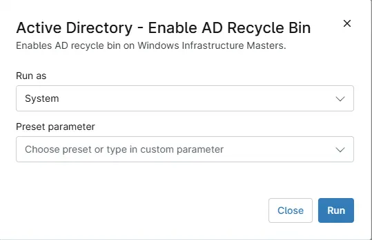

## Overview

Enables AD recycle bin on Windows Infrastructure Masters.

## Requirements

- Windows domain controllers running Windows Server 2008 R2 or later
- Forest functional level of Windows Server 2008 R2 or higher
- PowerShell 5.1 on the domain controllers
- Run As: `System`

## Sample Run

## Dependencies

* [Custom Field : cPVAL AD Recycle Bin State](/docs/e107ce39-7a0c-42ef-92b4-2951d9f02f20)
* [Solution - AD Recycle Bin](/docs/56ed4b40-11ce-4f8d-b1ca-c897d2c496e6)

## Automation Setup/Import

[Automation Configuration](https://github.com/ProVal-Tech/ninjarmm/blob/main/scripts/active-directory-enable-ad-recycle-bin.ps1)

## Output

- Activity Details
- Custom Field: * [Custom Field : cPVAL AD Recycle Bin State](/docs/e107ce39-7a0c-42ef-92b4-2951d9f02f20)

## Changelog

### 2026-10-29

- Initial version of the document
