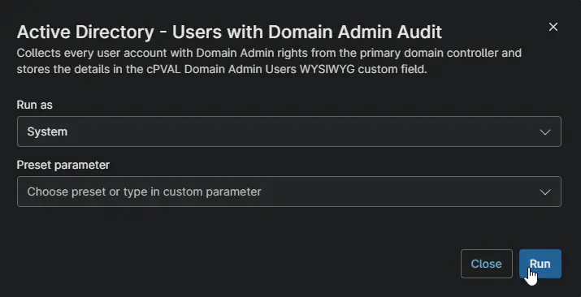

## Overview

Collects every user account with Domain Admin rights, including accounts that get the rights through nested groups, and stores the list in [cPVAL Domain Admin Users](/docs/dca9853f-1914-4f06-a700-a3a9926a123f). For each account it records whether the account is enabled, when it last signed in, and when its password was last changed and when it expires. Use it to review who can administer the domain and to find stale admin accounts.

:::note  
Schedule it against your domain controllers. Only the primary domain controller collects data. The other domain controllers skip the run and report success.  
:::

## Requirements

- Windows Server domain controller. Data is collected only on the primary domain controller.
- Active Directory PowerShell module. Domain controllers have it by default.
- Run As: `System`
- PowerShell 5.1

## Sample Run

## Custom Fields

| Custom Field | Scope | Type | Description |
| ------------ | ----- | ---- | ----------- |
| [cPVAL Domain Admin Users](/docs/dca9853f-1914-4f06-a700-a3a9926a123f) | Device | WYSIWYG | Stores the list of accounts with Domain Admin rights. |

## Dependencies

* [Custom Field: cPVAL Domain Admin Users](/docs/dca9853f-1914-4f06-a700-a3a9926a123f)
* [Audit Report: Active Directory - Users With Domain Admin](/docs/630beb69-029d-4103-8fd0-f5d3f3311bfc)
* [Solution: Active Directory - Users with Domain Admin Audit](/docs/66340c96-0b27-472f-add9-609e38df48c1)

## Automation Setup/Import

[Automation Configuration](https://github.com/ProVal-Tech/ninjarmm/blob/main/scripts/active-directory-users-with-domain-admin-audit.ps1)

## Output

- Activity Details
- Custom Field: [cPVAL Domain Admin Users](/docs/dca9853f-1914-4f06-a700-a3a9926a123f)

## Changelog

### 2026-10-14

- Initial version of the document
