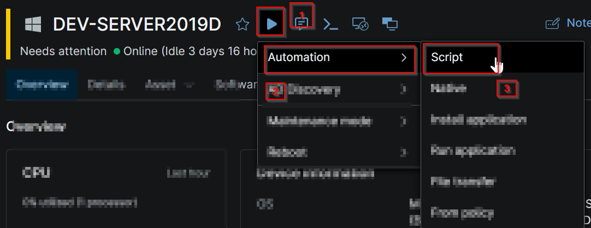
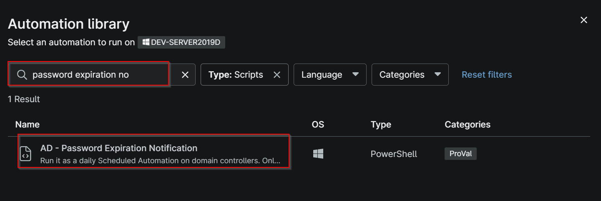
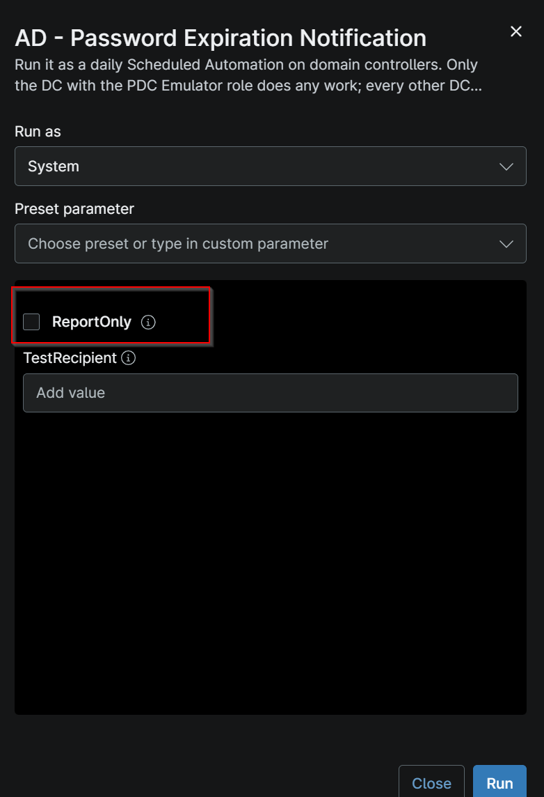
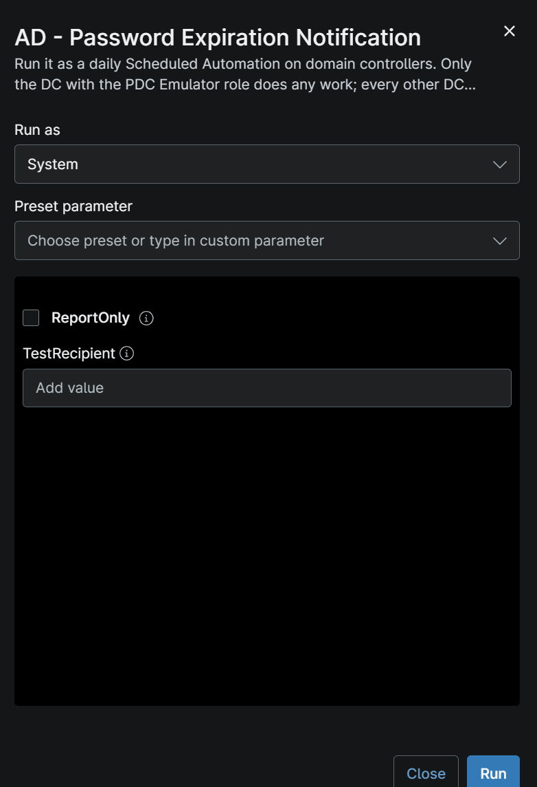
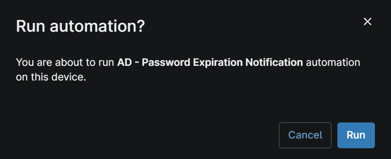

## Overview

For every enabled user whose password expires within N days (default 7) the script:
        1. Emails the user (AD 'mail' attribute) through Microsoft Graph or SMTP.
        2. If the user has no email address, emails an optional helpdesk / PSA address instead
           (replaces the Automate "Create New Ticket" branch), otherwise records it as an issue.
        3. Writes an HTML table (one row per user) to a WYSIWYG custom field and an issue count to an Integer custom field, so a NinjaOne Custom Field condition can raise an alert or ticket.

## Requirements

- Windows Server with Roles `Infrastructure Master`
- Run As: `System`
- PowerShell 5.1

## Sample Run

- Navigate to Automation -> Script:

- Search for the script `AD - Password Expiration Notification` and click on it.

- To run the script without setting the custom field [cPVAL AD Password Expiry Email Method](/docs/546c3075-2c22-4886-b9a6-224055c744e7) Email method (Graph or SMTP), toggle the `ReportOnly` option, this will run the script and update the custom field [cPVAL AD Password Expiry Report](/docs/77924cf6-6e06-43a8-bf1e-e0ae55867b46) so that the knowledge article can be populated.

- Once the Email method is set in the custom field [cPVAL AD Password Expiry Email Method](/docs/546c3075-2c22-4886-b9a6-224055c744e7) either (Graph or SMTP), run the script directly without setting the script variable parameter to report the password expiration via email to the AD user whose password is about to expire within the threshold or the helpdesk user if the AD user email doesn't exist.

- Click on Run again

## Custom Fields

| Custom Field | Scope | Type | Description |
| ------------ | ----- | ---- | ----------- |
| [Custom Field: cPVAL AD Password Expiry Report](/docs/77924cf6-6e06-43a8-bf1e-e0ae55867b46) | Device | WYSIWYG | This custom field stores the last-run summary, expiring user list, including their status in the html data (tabular format).|

## Dependencies

* [Custom Field: cPVAL AD Password Expiry Email Method](/docs/546c3075-2c22-4886-b9a6-224055c744e7)
* [Custom Field: cPVAL AD Password Expiry Report](/docs/77924cf6-6e06-43a8-bf1e-e0ae55867b46)
* [Audit Report: AD Password Expiration Notification](/docs/82ba2eb4-6323-4480-920d-439ff41da0e0)
* [Solution - AD Password Expiration Notification](/docs/d4cea30e-2724-4a28-870e-91eb349ad028)

## Automation Setup/Import

[Automation Configuration](https://github.com/ProVal-Tech/ninjarmm/blob/main/scripts/ad-password-expiration-notification.ps1)

## Output

- Activity Details
- Custom Field: [Custom Field: cPVAL AD Password Expiry Report](/docs/77924cf6-6e06-43a8-bf1e-e0ae55867b46)

## Changelog

### 2026-11-09

- Initial version of the document