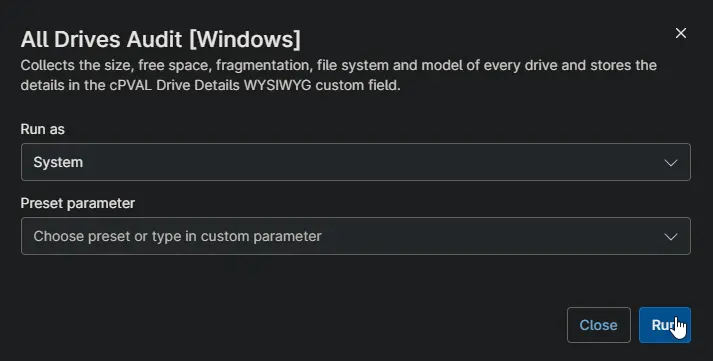

## Overview

Collects every drive on the device with its size, free space, free space percentage, fragmentation, file system and model, and stores the list in [cPVAL Drive Details](/docs/c376d026-50bf-4f65-8743-99a774719d92). Sizes are shown in the most readable unit, from bytes to terabytes. Use it to spot drives that are nearly full or badly fragmented.

:::note  
The fragmentation check only reads the drive. It never defragments it. On large or busy drives the check can take a few minutes.  
:::

## Requirements

- Windows
- Run As: `System`
- PowerShell 5.1

## Sample Run

## Custom Fields

| Custom Field | Scope | Type | Description |
| ------------ | ----- | ---- | ----------- |
| [cPVAL Drive Details](/docs/c376d026-50bf-4f65-8743-99a774719d92) | Device | WYSIWYG | Stores the list of drives with their size, free space, fragmentation, file system and model. |

## Dependencies

* [Custom Field: cPVAL Drive Details](/docs/c376d026-50bf-4f65-8743-99a774719d92)
* [Audit Report: All Drives Audit [Windows]](/docs/67c68be0-7c35-473f-8479-459d0e9b9406)
* [Solution: All Drives Audit [Windows]](/docs/9d68f747-b433-4e36-a948-6290a7c30355)

## Automation Setup/Import

[Automation Configuration](https://github.com/ProVal-Tech/ninjarmm/blob/main/scripts/all-drives-audit-windows.ps1)

## Output

- Activity Details
- Custom Field: [cPVAL Drive Details](/docs/c376d026-50bf-4f65-8743-99a774719d92)

## Changelog

### 2026-10-14

- Initial version of the document
