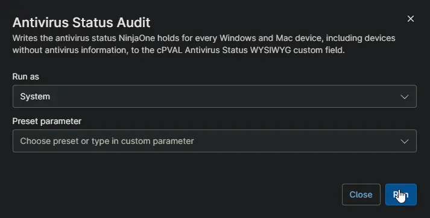

## Overview

Copies the antivirus information NinjaOne already shows under **Details > Antivirus** into [cPVAL Antivirus Status](/docs/20cf7c66-038f-4e83-857e-4c68ac5de358) on every Windows and Mac device. It records each antivirus product with its definition status and whether it is switched on. Devices without antivirus get a row that says so. Use it to report antivirus status and missing antivirus across all clients.

:::note  
Schedule this automation against one device only, such as a server that is always online. One run updates every device in NinjaOne.  
:::

## Requirements

- A NinjaOne API application with the **Client Credentials** grant type and the **Monitoring** and **Management** scopes.
- The client ID and client secret of that application stored in [cPVAL Ninja API Client ID](/docs/32142af2-d352-4d0d-9ec3-9dae0a5fef88) and [cPVAL Ninja API Client Secret](/docs/58b01634-4e1a-4793-aafd-18526ea8c80e).
- The NinjaOne instance of the partner set in the script, for example `us2.ninjarmm.com`.
- Windows device with internet access to the NinjaOne instance.
- Run As: `System`
- PowerShell 5.1

## Sample Run

## Custom Fields

| Custom Field | Scope | Type | Description |
| ------------ | ----- | ---- | ----------- |
| [cPVAL Antivirus Status](/docs/20cf7c66-038f-4e83-857e-4c68ac5de358) | Device | WYSIWYG | Stores the antivirus products of each device, or a row showing that none was found. |
| [cPVAL Ninja API Client ID](/docs/32142af2-d352-4d0d-9ec3-9dae0a5fef88) | System | Secure | Client ID of the NinjaOne API application. |
| [cPVAL Ninja API Client Secret](/docs/58b01634-4e1a-4793-aafd-18526ea8c80e) | System | Secure | Client secret of the NinjaOne API application. |

## Dependencies

* [Custom Field: cPVAL Antivirus Status](/docs/20cf7c66-038f-4e83-857e-4c68ac5de358)
* [Custom Field: cPVAL Ninja API Client ID](/docs/32142af2-d352-4d0d-9ec3-9dae0a5fef88)
* [Custom Field: cPVAL Ninja API Client Secret](/docs/58b01634-4e1a-4793-aafd-18526ea8c80e)
* [Audit Report: Antivirus Status](/docs/460013c8-7bb9-4773-ac6b-a03689575e79)
* [Audit Report: Antivirus Missing](/docs/08cc8eb4-7a6f-4a17-a34e-218e5ff5e547)
* [Solution: Antivirus Status Audit](/docs/d613b809-a8cf-4dde-b3fa-e36b13223eeb)

## Automation Setup/Import

[Automation Configuration](https://github.com/ProVal-Tech/ninjarmm/blob/main/scripts/antivirus-status-audit.ps1)

## Output

- Activity Details
- Custom Field: [cPVAL Antivirus Status](/docs/20cf7c66-038f-4e83-857e-4c68ac5de358) on every Windows and Mac device

## Changelog

### 2026-10-14

- Initial version of the document
