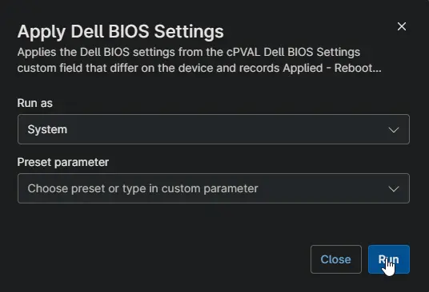

## Overview

This script applies the expected BIOS settings to a Dell workstation and flags the device for a restart. It runs automatically from the [Enforce Dell BIOS Settings](/docs/86f44138-3e57-4c1f-8d7e-c4a0efc70fac) compound condition when settings differ.

**When to use:**

- Bring Dell BIOS settings in line with the standard, for example a daily power-on time and Wake on LAN.
- Re-apply the settings when they were changed on a device.

**How it works:**

- Runs only when [cPVAL Enforce Dell BIOS Settings](/docs/eb1c5a88-0933-45e4-96e7-f71422e4ddba) is set to Enforce.
- Only the settings that differ are changed, in the order they are listed in [cPVAL Dell BIOS Settings](/docs/0ca65a80-d1c0-4ef9-b078-cd3e8d9d89db).
- Settings this model does not have are skipped and listed.
- The status is set to Applied - Reboot Pending. The script does not restart the device.
- After the device restarts, [Check Dell BIOS Settings](/docs/a9117300-d45b-45e8-9cfe-e85859b1931b) verifies the settings and sets the status to Compliant.

**Requirements:**

- Dell workstation running Windows 10 or Windows 11.
- Runs elevated (System context).
- No BIOS setup password on the device. With a password set, the change fails and the status shows the reason.
- The custom fields listed in Dependencies.

## Sample Run

## Scenarios

### Example 1: Running the script on a device with different settings

Some settings on the device differ from [cPVAL Dell BIOS Settings](/docs/0ca65a80-d1c0-4ef9-b078-cd3e8d9d89db). Only those settings are changed, and the device is not restarted. Restart the device to complete the change. The next check after the restart verifies the settings and sets the status to Compliant.

**Status:** `Applied - Reboot Pending | 2026-10-16 21:05:12 | Changed: AutoOn, AutoOnHr`

### Example 2: Running the script on a model that does not have every setting

The model does not have one of the expected settings, such as WakeOnDock on many desktops. That setting is skipped, and the rest are applied.

**Status:** `Applied - Reboot Pending | 2026-10-16 21:05:12 | Changed: AutoOn, AutoOnHr; Not supported: WakeOnDock`

### Example 3: Running the script on a device with a BIOS setup password

The device has a BIOS setup password, so Dell Command | Configure rejects the change. Nothing is changed on the device, and the status shows the Dell Command | Configure message.

**Status:** `Failed | 2026-10-16 21:05:12 | Exit code 65: Setup Password is required to change the setting.`

### Example 4: Running the script when every setting already matches

The settings already match, for example because they were changed by hand after the last check. Nothing is changed on the device.

**Status:** `Compliant | 2026-10-16 21:05:12`

### Example 5: Running the script when the solution is not set to Enforce

[cPVAL Enforce Dell BIOS Settings](/docs/eb1c5a88-0933-45e4-96e7-f71422e4ddba) is set to Audit or None, or is left blank, for example when the script is run by hand. No settings are applied, and the status is not changed.

## Dependencies

- [Solution: Enforce Dell BIOS Settings](/docs/d3ee4598-13c1-4d19-8b6c-d368f2a00ab3)
- [Compound Condition: Enforce Dell BIOS Settings](/docs/86f44138-3e57-4c1f-8d7e-c4a0efc70fac)
- [Custom Field: cPVAL Enforce Dell BIOS Settings](/docs/eb1c5a88-0933-45e4-96e7-f71422e4ddba)
- [Custom Field: cPVAL Dell BIOS Settings](/docs/0ca65a80-d1c0-4ef9-b078-cd3e8d9d89db)
- [Custom Field: cPVAL Dell BIOS Settings Status](/docs/1ddc8f49-ede2-4d44-871e-b448e8ba61ba)
- [Script: Initialize-DellCommandConfigure](/docs/a0f958c9-7364-4bde-af18-01e6232620cc) (the underlying agnostic script)

## Custom Fields

| Field Name | Type | Mandatory | Scope | Description |
| ---------- | ---- | --------- | ----- | ----------- |
| [cPVAL Enforce Dell BIOS Settings](/docs/eb1c5a88-0933-45e4-96e7-f71422e4ddba) | Drop-down | Yes | Organization, Location, Device | Audit or Enforce turns the solution on. None or blank skips the device. |
| [cPVAL Dell BIOS Settings](/docs/0ca65a80-d1c0-4ef9-b078-cd3e8d9d89db) | Multi-line | Yes | Organization, Location, Device | The expected settings, one `Option=Value` pair per line. |
| [cPVAL Dell BIOS Settings Status](/docs/1ddc8f49-ede2-4d44-871e-b448e8ba61ba) | Text | Yes | Device | Stores the result. Read-only for technicians. |

## Automation Setup/Import

[Automation Configuration](https://github.com/ProVal-Tech/ninjarmm/blob/main/scripts/apply-dell-bios-settings.ps1)

## Output

- **Activity Details:** Each expected setting with PASS or FAIL, the settings that were applied, and the result.
- **Custom Field:** [cPVAL Dell BIOS Settings Status](/docs/1ddc8f49-ede2-4d44-871e-b448e8ba61ba) is set to Applied - Reboot Pending, Compliant or Failed.
- **Restart:** The settings take effect after the next restart. The device is not restarted automatically.

## Changelog

### 2026-10-16

- Initial version of the document
