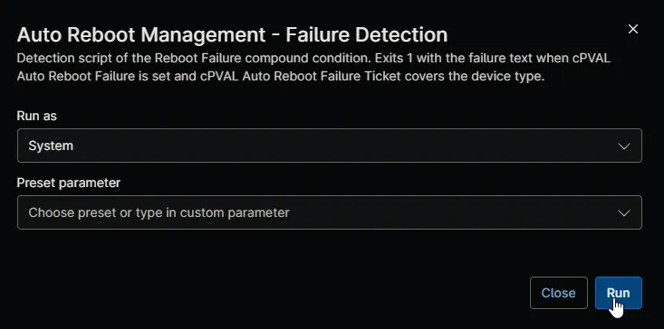

## Overview

This automation is the detection script of the [Auto Reboot Management - Reboot Failure [Windows Servers]](/docs/f458ca84-e7c2-44d1-ad9c-15421c77d5d4) and [Auto Reboot Management - Reboot Failure [Windows Workstations]](/docs/76d88457-ec23-4b6b-81e2-af0a13583aa0) compound conditions. It reads [cPVAL Auto Reboot Failure](/docs/3b31f3bd-c1b1-4f43-bce9-ea6f669f783a) and [cPVAL Auto Reboot Failure Ticket](/docs/4c0f96e5-8387-4cb6-8426-d267ec01b0f9) on the device. It exits with `1` and a line beginning with `Detected:`, followed by the failure, when a failed restart is recorded and ticketing covers the device type. The compound condition then creates a ticket with the failure in it. The automation makes no changes.

:::note  
The compound conditions run this automation every 30 minutes, so you don't need to run it yourself. It exits with `0` when no failure is recorded or ticketing isn't enabled for the device type, and with `2` when a custom field can't be read.  
:::

## Requirements

- Windows 10, Windows 11, or Windows Server 2012 R2 or later
- Run As: `System`
- PowerShell 5.1

## Sample Run

## Scenarios

- **Failure with ticketing enabled:** [cPVAL Auto Reboot Failure](/docs/3b31f3bd-c1b1-4f43-bce9-ea6f669f783a) holds a failure and [cPVAL Auto Reboot Failure Ticket](/docs/4c0f96e5-8387-4cb6-8426-d267ec01b0f9) is `Windows`, or `Windows Servers` on a server, or `Windows Workstations` on a workstation. The automation exits with `1` and reports the failure.
- **Failure with ticketing disabled:** the failure is recorded, but the ticketing field is `Disabled`, blank, or set for the other device type. The automation exits with `0` and reports why no ticket is needed.
- **No failure:** [cPVAL Auto Reboot Failure](/docs/3b31f3bd-c1b1-4f43-bce9-ea6f669f783a) is empty. The automation exits with `0`.

## Custom Fields

| Custom Field | Scope | Type | Description |
| ------------ | ----- | ---- | ----------- |
| [cPVAL Auto Reboot Failure](/docs/3b31f3bd-c1b1-4f43-bce9-ea6f669f783a) | Device | Text | Read for the latest failed restart. |
| [cPVAL Auto Reboot Failure Ticket](/docs/4c0f96e5-8387-4cb6-8426-d267ec01b0f9) | Organization, Location, Device | Drop-down | Read, with inheritance, for the device types that get a ticket. |

## Dependencies

- [Custom Field: cPVAL Auto Reboot Failure](/docs/3b31f3bd-c1b1-4f43-bce9-ea6f669f783a)
- [Custom Field: cPVAL Auto Reboot Failure Ticket](/docs/4c0f96e5-8387-4cb6-8426-d267ec01b0f9)
- [Compound Condition: Auto Reboot Management - Reboot Failure [Windows Servers]](/docs/f458ca84-e7c2-44d1-ad9c-15421c77d5d4)
- [Compound Condition: Auto Reboot Management - Reboot Failure [Windows Workstations]](/docs/76d88457-ec23-4b6b-81e2-af0a13583aa0)
- [Ticket Template: Auto Reboot - Failure](/docs/375c80c2-07dd-43b9-b24b-3cc4c948c105)
- [Solution: Auto Reboot Management - NinjaOne](/docs/52091463-99b7-4a21-8ad0-7ade5b8212e7)

## Automation Setup/Import

[Automation Configuration](https://github.com/ProVal-Tech/ninjarmm/blob/main/scripts/auto-reboot-management-failure-detection.ps1)

## Output

- Activity Details

## Changelog

### 2026-11-11

- Initial version of the document
