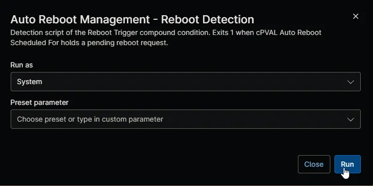

## Overview

This automation is the detection script of the [Auto Reboot Management - Reboot Trigger [Windows Servers]](/docs/41ccbc86-b7f0-4674-9c7c-f765a0e0df01) and [Auto Reboot Management - Reboot Trigger [Windows Workstations]](/docs/5313102f-bd2a-4350-a775-07c150632573) compound conditions. It reads [cPVAL Auto Reboot Scheduled For](/docs/e66d4978-0402-4f68-bc8d-af7d32dafce6) on the device and exits with `1` and a line beginning with `Detected:` when the field holds a pending restart request. The compound condition then runs [Auto Reboot Management - Reboot Machine](/docs/585400cb-52f4-4432-84b7-a57569a3dc39). The automation makes no changes.

:::note  
The compound conditions run this automation every 6 minutes, so you don't need to run or schedule it yourself. It exits with `0` when there's no pending request, and with `2` when the custom field can't be read.  
:::

## Requirements

- Windows 10, Windows 11, or Windows Server 2012 R2 or later
- Run As: `System`
- PowerShell 5.1

## Sample Run

## Scenarios

- **Pending request:** [cPVAL Auto Reboot Scheduled For](/docs/e66d4978-0402-4f68-bc8d-af7d32dafce6) holds a restart time such as `2026-11-10T07:00:00Z`. The automation exits with `1` and reports the restart time in UTC and in the device's local time.
- **Request already handled:** the field holds a restart time followed by `Scheduled`, `Missed` or `Failed`. The automation exits with `0`.
- **No request:** the field is empty. The automation exits with `0`.
- **Restart time already passed:** the request is still detected, so [Auto Reboot Management - Reboot Machine](/docs/585400cb-52f4-4432-84b7-a57569a3dc39) can record it as missed without restarting the device.

## Custom Fields

| Custom Field | Scope | Type | Description |
| ------------ | ----- | ---- | ----------- |
| [cPVAL Auto Reboot Scheduled For](/docs/e66d4978-0402-4f68-bc8d-af7d32dafce6) | Device | Text | Read to find a pending restart request. |

## Dependencies

- [Custom Field: cPVAL Auto Reboot Scheduled For](/docs/e66d4978-0402-4f68-bc8d-af7d32dafce6)
- [Automation: Auto Reboot Management - Reboot Machine](/docs/585400cb-52f4-4432-84b7-a57569a3dc39)
- [Compound Condition: Auto Reboot Management - Reboot Trigger [Windows Servers]](/docs/41ccbc86-b7f0-4674-9c7c-f765a0e0df01)
- [Compound Condition: Auto Reboot Management - Reboot Trigger [Windows Workstations]](/docs/5313102f-bd2a-4350-a775-07c150632573)
- [Solution: Auto Reboot Management - NinjaOne](/docs/52091463-99b7-4a21-8ad0-7ade5b8212e7)

## Automation Setup/Import

[Automation Configuration](https://github.com/ProVal-Tech/ninjarmm/blob/main/scripts/auto-reboot-management-reboot-detection.ps1)

## Output

- Activity Details

## Changelog

### 2026-11-11

- Initial version of the document
