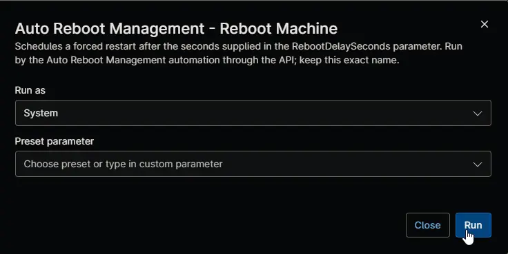

## Overview

This automation restarts a device for the [Auto Reboot Management - NinjaOne](/docs/52091463-99b7-4a21-8ad0-7ade5b8212e7) solution. The [Auto Reboot Management - Reboot Trigger [Windows Servers]](/docs/41ccbc86-b7f0-4674-9c7c-f765a0e0df01) and [Auto Reboot Management - Reboot Trigger [Windows Workstations]](/docs/5313102f-bd2a-4350-a775-07c150632573) compound conditions run it when [cPVAL Auto Reboot Scheduled For](/docs/e66d4978-0402-4f68-bc8d-af7d32dafce6) holds a pending restart request. It schedules a forced restart for the requested time, so Windows shows the signed-in user a restart notice until then, and writes the outcome back to the same field.

:::note  
The compound conditions run this automation, so you don't need to run it yourself. It takes no script variables. It never restarts a device when the requested time has already passed, so a device that comes online late isn't restarted without notice.  
:::

## Requirements

- Windows 10, Windows 11, or Windows Server 2012 R2 or later
- Run As: `System`
- PowerShell 5.1

## Sample Run

## Scenarios

- **Restart time ahead:** the automation schedules a forced restart for that time and writes `Scheduled at` and the time to [cPVAL Auto Reboot Scheduled For](/docs/e66d4978-0402-4f68-bc8d-af7d32dafce6). The user sees a notice that the computer will restart, at what time, and should save their work.
- **Restart time passed:** the automation doesn't restart the device and writes `Missed at` and the time.
- **Restart already scheduled in Windows:** the existing restart or shutdown is left in place and the outcome is `Scheduled`, so a repeated run never cancels or moves a restart.
- **No pending request:** for example after a technician cleared the field to cancel the restart. The automation makes no changes.
- **Restart can't be scheduled:** the automation writes `Failed at`, the time and the reason, and shows as failed.

## Custom Fields

| Custom Field | Scope | Type | Description |
| ------------ | ----- | ---- | ----------- |
| [cPVAL Auto Reboot Scheduled For](/docs/e66d4978-0402-4f68-bc8d-af7d32dafce6) | Device | Text | Read for the requested restart time and rewritten with the outcome. |

## Dependencies

- [Custom Field: cPVAL Auto Reboot Scheduled For](/docs/e66d4978-0402-4f68-bc8d-af7d32dafce6)
- [Automation: Auto Reboot Management - Reboot Detection](/docs/43641711-d392-4d1e-af16-991a71b6536a)
- [Compound Condition: Auto Reboot Management - Reboot Trigger [Windows Servers]](/docs/41ccbc86-b7f0-4674-9c7c-f765a0e0df01)
- [Compound Condition: Auto Reboot Management - Reboot Trigger [Windows Workstations]](/docs/5313102f-bd2a-4350-a775-07c150632573)
- [Automation: Auto Reboot Management](/docs/15697579-8f51-4c51-9812-d909edebfc8b)
- [Solution: Auto Reboot Management - NinjaOne](/docs/52091463-99b7-4a21-8ad0-7ade5b8212e7)

## Automation Setup/Import

[Automation Configuration](https://github.com/ProVal-Tech/ninjarmm/blob/main/scripts/auto-reboot-management-reboot-machine.ps1)

## Output

- Activity Details
- Custom Field: [cPVAL Auto Reboot Scheduled For](/docs/e66d4978-0402-4f68-bc8d-af7d32dafce6)
- A scheduled restart of the device

## Changelog

### 2026-11-11

- Initial version of the document
