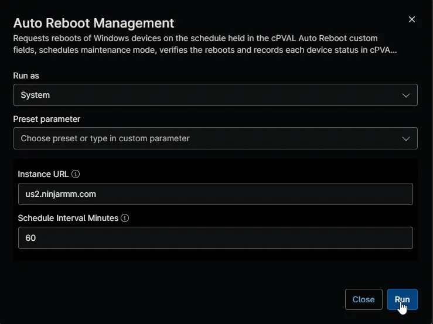
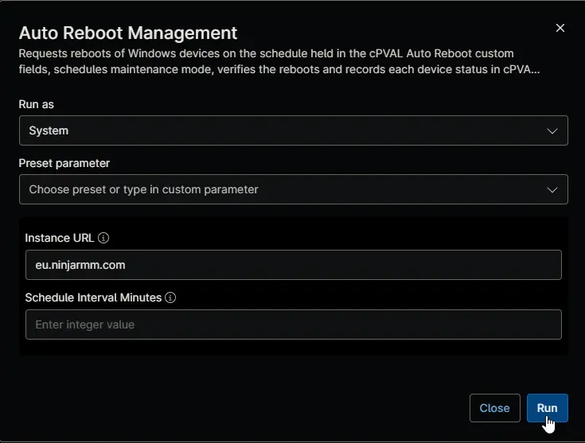

## Overview

This automation is the engine of the [Auto Reboot Management - NinjaOne](/docs/52091463-99b7-4a21-8ad0-7ade5b8212e7) solution. It reads the Auto Reboot Management custom fields of every Windows device through the NinjaOne API, works out the schedule that applies to each device, and writes a restart request to [cPVAL Auto Reboot Scheduled For](/docs/e66d4978-0402-4f68-bc8d-af7d32dafce6) on every device due to restart before its next run. The device then restarts itself through the reboot trigger compound conditions. The automation also schedules maintenance mode around the restart, checks whether earlier restarts happened, and keeps [cPVAL Auto Reboot Status](/docs/1c29d754-ec90-4f42-88f1-4ac335657fbc) and [cPVAL Auto Reboot Failure](/docs/3b31f3bd-c1b1-4f43-bce9-ea6f669f783a) current.

:::note  
The [Auto Reboot Management](/docs/33d689db-0f80-4f9d-928a-eb76fe283ff5) scheduled task runs this automation every hour, at 5 minutes past the hour, on **one** device. Don't schedule it anywhere else: every run covers the whole tenant, so running it on more devices writes every request several times and uses up the API rate limit. The automation changes nothing on the device it runs on.  
:::

:::note  
The automation works in the time zone of the device it runs on. It reads the selected restart days and times in that time zone, and every time it writes to [cPVAL Auto Reboot Status](/docs/1c29d754-ec90-4f42-88f1-4ac335657fbc) and [cPVAL Auto Reboot Failure](/docs/3b31f3bd-c1b1-4f43-bce9-ea6f669f783a) is in that time zone too, which the TimeZone column and the end of each failure show. For devices in other time zones, see [Time Zones](/docs/52091463-99b7-4a21-8ad0-7ade5b8212e7#time-zones).  
:::

## Requirements

- One Windows device that's always online, such as a server
- Run As: `System`
- PowerShell 5.1
- HTTPS access from that device to the NinjaOne instance
- An API application with the **Client Credentials** grant type and the **Monitoring** and **Management** scopes, stored in [cPVAL Ninja API Client ID](/docs/32142af2-d352-4d0d-9ec3-9dae0a5fef88) and [cPVAL Ninja API Client Secret](/docs/58b01634-4e1a-4793-aafd-18526ea8c80e). The application used by [WYSIWYG Custom Field Report - Organization and Global KB](/docs/67df14cd-3c20-4a40-bb7a-80caae242687) works.

## How It Works

1. **Authenticate:** reads the Client ID and Client Secret from the secure custom fields and signs in to the NinjaOne API.
2. **Read:** reads every Windows device, the Auto Reboot Management custom fields at every level, and which servers run the domain controller or Hyper-V services.
3. **Check earlier restarts:** compares each device's last boot time with the restart it last requested, and records the result.
4. **Request restarts:** writes the restart time to [cPVAL Auto Reboot Scheduled For](/docs/e66d4978-0402-4f68-bc8d-af7d32dafce6) on every online device due to restart before the next run, within the hour, and schedules maintenance mode around it. A device that's offline is recorded as `Skipped - Offline` and restarts at its next scheduled time.
5. **Record:** updates [cPVAL Auto Reboot Status](/docs/1c29d754-ec90-4f42-88f1-4ac335657fbc) where a value changed, records new failures in [cPVAL Auto Reboot Failure](/docs/3b31f3bd-c1b1-4f43-bce9-ea6f669f783a), and clears the fields of devices no longer enabled.

## Sample Run

### Default settings

Run every hour by the [Auto Reboot Management](/docs/33d689db-0f80-4f9d-928a-eb76fe283ff5) scheduled task on one device of a US2 instance.

| Script Variable | Value |
| --------------- | ----- |
| Instance URL | `us2.ninjarmm.com` |
| Schedule Interval Minutes | `60` |

### Another NinjaOne instance

Run every hour on one device of an EU instance, using the default interval of 60 minutes.

| Script Variable | Value |
| --------------- | ----- |
| Instance URL | `eu.ninjarmm.com` |

## Parameters

| Name | Calculated Name | Example | Accepted Values | Required | Default | Type | Description |
| ---- | --------------- | ------- | --------------- | -------- | ------- | ---- | ----------- |
| Instance URL | instanceUrl | `us2.ninjarmm.com` | Any valid NinjaOne instance host | False | `us2.ninjarmm.com` | string/text | NinjaOne instance the API application belongs to. Must match the tenant's region. |
| Schedule Interval Minutes | scheduleIntervalMinutes | `60` | `60` to `240` | False | `60` | Integer | How often the automation runs, in minutes. Restarts due within this many minutes of the start of the run are requested, so it must match the **Recur every** value of the [Auto Reboot Management](/docs/33d689db-0f80-4f9d-928a-eb76fe283ff5) scheduled task: `60` for every hour. |

## Custom Fields

| Custom Field | Scope | Type | Description |
| ------------ | ----- | ---- | ----------- |
| [cPVAL Ninja API Client ID](/docs/32142af2-d352-4d0d-9ec3-9dae0a5fef88) | System | Secure | Client ID of the API application. Read at runtime. |
| [cPVAL Ninja API Client Secret](/docs/58b01634-4e1a-4793-aafd-18526ea8c80e) | System | Secure | Client Secret of the API application. Read at runtime. |
| [cPVAL Auto Reboot](/docs/cab41cb1-87d8-4d37-bbe2-3faa67516831) | Organization, Location, Device | Drop-down | Which Windows devices are restarted. |
| [cPVAL Auto Reboot Include DC](/docs/4f0f00f5-6c67-4a73-b278-43e6560c9f63) | Organization, Location, Device | Drop-down | Includes domain controllers. |
| [cPVAL Auto Reboot Include Hyper-V Host](/docs/e351778e-b498-48ba-a674-7e8f4d783b15) | Organization, Location, Device | Drop-down | Includes Hyper-V hosts. |
| [cPVAL Auto Reboot Days](/docs/56684cc0-aa4b-4d81-b03b-272db16cb1e7) | Organization, Location, Device | Multi-select | Days of the week to restart on. |
| [cPVAL Auto Reboot Time](/docs/bf65ebff-8d3b-463b-a97f-90dd19ff45fc) | Organization, Location, Device | Drop-down | Time of the restart. |
| [cPVAL Auto Reboot Week Server](/docs/de971df1-518d-4504-8efe-deae1895296d) | Organization, Location, Device | Drop-down | Week of the month servers restart in. |
| [cPVAL Auto Reboot Week Workstation](/docs/5a05feef-d177-49a7-a5fd-876d7589c567) | Organization, Location, Device | Drop-down | Week of the month workstations restart in. |
| [cPVAL Auto Reboot Maint Minutes Server](/docs/0eaf1688-afde-434f-befa-316cdb1c799a) | Organization, Location, Device | Integer | Maintenance mode minutes around a server restart. |
| [cPVAL Auto Reboot Maint Minutes Workstation](/docs/4be14fcc-a128-4e62-ae37-0a198df4da53) | Organization, Location, Device | Integer | Maintenance mode minutes around a workstation restart. |
| [cPVAL Auto Reboot Pending Check Server](/docs/38c18108-d3cc-433e-b14d-1f34db785b62) | Organization, Location, Device | Drop-down | Restarts servers only when a reboot is pending. |
| [cPVAL Auto Reboot Pending Check Workstation](/docs/82857979-0e81-45a3-af31-77a1e0def920) | Organization, Location, Device | Drop-down | Restarts workstations only when a reboot is pending. |
| [cPVAL Auto Reboot Failure Ticket](/docs/4c0f96e5-8387-4cb6-8426-d267ec01b0f9) | Organization, Location, Device | Drop-down | Not read by this automation. Used by the reboot failure compound conditions. |
| [cPVAL Auto Reboot Status](/docs/1c29d754-ec90-4f42-88f1-4ac335657fbc) | Device | WYSIWYG | Written with the effective schedule, next restart and result of the last restart. |
| [cPVAL Auto Reboot Failure](/docs/3b31f3bd-c1b1-4f43-bce9-ea6f669f783a) | Device | Text | Written when a scheduled restart fails. |
| [cPVAL Auto Reboot Scheduled For](/docs/e66d4978-0402-4f68-bc8d-af7d32dafce6) | Device | Text | Written with the restart time in UTC when a restart is due. |

:::note  
Every Auto Reboot Management custom field needs its **API** permission set to **Read Only** or **Read/Write**, and [cPVAL Auto Reboot Status](/docs/1c29d754-ec90-4f42-88f1-4ac335657fbc), [cPVAL Auto Reboot Failure](/docs/3b31f3bd-c1b1-4f43-bce9-ea6f669f783a) and [cPVAL Auto Reboot Scheduled For](/docs/e66d4978-0402-4f68-bc8d-af7d32dafce6) need **Read/Write**. The run fails before anything is changed if a field is missing or has the wrong type.  
:::

## Dependencies

* [Custom Field: cPVAL Ninja API Client ID](/docs/32142af2-d352-4d0d-9ec3-9dae0a5fef88)
* [Custom Field: cPVAL Ninja API Client Secret](/docs/58b01634-4e1a-4793-aafd-18526ea8c80e)
* [Custom Field: cPVAL Auto Reboot](/docs/cab41cb1-87d8-4d37-bbe2-3faa67516831)
* [Custom Field: cPVAL Auto Reboot Days](/docs/56684cc0-aa4b-4d81-b03b-272db16cb1e7)
* [Custom Field: cPVAL Auto Reboot Time](/docs/bf65ebff-8d3b-463b-a97f-90dd19ff45fc)
* [Custom Field: cPVAL Auto Reboot Status](/docs/1c29d754-ec90-4f42-88f1-4ac335657fbc)
* [Custom Field: cPVAL Auto Reboot Failure](/docs/3b31f3bd-c1b1-4f43-bce9-ea6f669f783a)
* [Custom Field: cPVAL Auto Reboot Scheduled For](/docs/e66d4978-0402-4f68-bc8d-af7d32dafce6)
* [Compound Condition: Auto Reboot Management - Reboot Trigger [Windows Servers]](/docs/41ccbc86-b7f0-4674-9c7c-f765a0e0df01)
* [Compound Condition: Auto Reboot Management - Reboot Trigger [Windows Workstations]](/docs/5313102f-bd2a-4350-a775-07c150632573)
* [Automation: Auto Reboot Management - Reboot Machine](/docs/585400cb-52f4-4432-84b7-a57569a3dc39)
* [Scheduled Task: Auto Reboot Management](/docs/33d689db-0f80-4f9d-928a-eb76fe283ff5)
* [Audit Report: Auto Reboot Management Status](/docs/413d9e77-6f09-457a-9ff1-f9142b0e38e9)
* [Solution: Auto Reboot Management - NinjaOne](/docs/52091463-99b7-4a21-8ad0-7ade5b8212e7)

## Automation Setup/Import

[Automation Configuration](https://github.com/ProVal-Tech/ninjarmm/blob/main/scripts/auto-reboot-management.ps1)

## Output

- Activity Details, ending with a run summary and a single line beginning with `Success` or `Failure`
- Custom Field: [cPVAL Auto Reboot Scheduled For](/docs/e66d4978-0402-4f68-bc8d-af7d32dafce6)
- Custom Field: [cPVAL Auto Reboot Status](/docs/1c29d754-ec90-4f42-88f1-4ac335657fbc)
- Custom Field: [cPVAL Auto Reboot Failure](/docs/3b31f3bd-c1b1-4f43-bce9-ea6f669f783a)
- Maintenance mode on the devices due to restart

## Changelog

### 2026-11-11

- Initial version of the document
