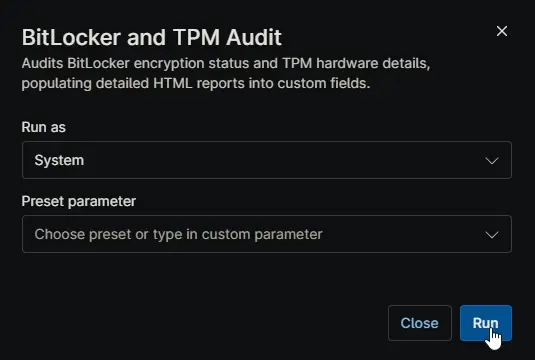

## Overview

Audits disk encryption and hardware security on Windows devices. It records every BitLocker volume and key protector, the Secure Boot status and BitLocker eligibility in [cPVAL BitLocker Info](/docs/fd545101-1cd5-4d9f-8df7-57c4df1616b9), and the Trusted Platform Module (TPM) details in [cPVAL TPM Info](/docs/68c098e2-54f1-40f8-9574-f70f1948e4ba). It checks [cPVAL BitLocker Enabled for System Drive](/docs/5f6128a5-4fc8-44b2-adb2-40c2ac92edc5) when the system drive is protected, and fills the individual cPVAL Audit fields used for grouping.

:::note  

- This automation is only compatible with Windows devices.  
- Servers need the BitLocker Drive Encryption feature enabled for the BitLocker audit.  
- The TPM audit still runs when the BitLocker audit fails.  
- Secure Boot shows `False` on devices that do not support it.  

:::

## Requirements

- Windows
- Run As: `System`
- PowerShell 5.1

## Sample Run

## Custom Fields

| Custom Field | Scope | Type | Description |
| ------------ | ----- | ---- | ----------- |
| [cPVAL BitLocker Info](/docs/fd545101-1cd5-4d9f-8df7-57c4df1616b9) | Device | WYSIWYG | Stores every BitLocker volume and key protector, with Secure Boot status and BitLocker eligibility. |
| [cPVAL BitLocker Enabled for System Drive](/docs/5f6128a5-4fc8-44b2-adb2-40c2ac92edc5) | Device | Checkbox | Checked when the system drive has a BitLocker key protector. |
| [cPVAL TPM Info](/docs/68c098e2-54f1-40f8-9574-f70f1948e4ba) | Device | WYSIWYG | Stores the TPM details of the device. |
| [cPVAL Audit Encryption Percentage](/docs/1c59227a-466d-4f42-a06f-0c2c0950d07e) | Device | String | Encryption percentage of the first volume in the BitLocker table. |
| [cPVAL Audit Encryption Method](/docs/66adc025-26ec-43f9-ae1e-330c422c799c) | Device | String | Encryption method of the first volume in the BitLocker table. |
| [cPVAl Audit Mount Point](/docs/ced74400-a022-4fa2-9b72-4c10e92e36ab) | Device | String | Drive letter of the first volume in the BitLocker table. |
| [cPVAL Audit Lock Status](/docs/52ff36d4-e554-4741-aae1-4bd1a50165ee) | Device | String | Lock status of the first volume in the BitLocker table. |
| [cPVAL Audit Protection Status](/docs/dbf6abbd-fff0-4e1f-a6a7-b87994df64ca) | Device | String | Protection status of the first volume in the BitLocker table. |
| [cPVAL Audit Volume Status](/docs/916d0353-8a35-4690-8d40-04b2a95112e1) | Device | String | Volume status of the first volume in the BitLocker table. |
| [cPVAL Audit TPM Activated](/docs/d7079417-ab2f-460a-ab63-6ec1f7b986ca) | Device | String | `True` when the TPM is activated. |
| [cPVAL Audit TPM Enabled](/docs/20f300a5-65f7-443b-aeeb-16ee9e7dc923) | Device | String | `True` when the TPM is enabled. |
| [cPVAL Audit TPM Present](/docs/5014cdab-65a5-45d9-9587-70d354cbe89b) | Device | String | `True` when the device has a TPM. |
| [cPVAL Audit TPM Ready](/docs/878b60d8-f498-4479-85db-43252189026e) | Device | String | `True` when the TPM is ready for use. |

## Dependencies

* [Custom Field: cPVAL BitLocker Enabled for System Drive](/docs/5f6128a5-4fc8-44b2-adb2-40c2ac92edc5)
* [Custom Field: cPVAL BitLocker Info](/docs/fd545101-1cd5-4d9f-8df7-57c4df1616b9)
* [Custom Field: cPVAL TPM Info](/docs/68c098e2-54f1-40f8-9574-f70f1948e4ba)
* [Custom Field: cPVAL Audit Encryption Percentage](/docs/1c59227a-466d-4f42-a06f-0c2c0950d07e)
* [Custom Field: cPVAL Audit Encryption Method](/docs/66adc025-26ec-43f9-ae1e-330c422c799c)
* [Custom Field: cPVAl Audit Mount Point](/docs/ced74400-a022-4fa2-9b72-4c10e92e36ab)
* [Custom Field: cPVAL Audit Lock Status](/docs/52ff36d4-e554-4741-aae1-4bd1a50165ee)
* [Custom Field: cPVAL Audit Protection Status](/docs/dbf6abbd-fff0-4e1f-a6a7-b87994df64ca)
* [Custom Field: cPVAL Audit Volume Status](/docs/916d0353-8a35-4690-8d40-04b2a95112e1)
* [Custom Field: cPVAL Audit TPM Activated](/docs/d7079417-ab2f-460a-ab63-6ec1f7b986ca)
* [Custom Field: cPVAL Audit TPM Enabled](/docs/20f300a5-65f7-443b-aeeb-16ee9e7dc923)
* [Custom Field: cPVAL Audit TPM Present](/docs/5014cdab-65a5-45d9-9587-70d354cbe89b)
* [Custom Field: cPVAL Audit TPM Ready](/docs/878b60d8-f498-4479-85db-43252189026e)
* [Audit Report: BitLocker Status](/docs/249c4ee7-7b81-4adf-97c6-d44c967ad2d1)
* [Audit Report: TPM Status](/docs/3127d0f3-0fd7-4a89-8eb5-4c30a37dabba)
* [Solution: BitLocker and TPM Audit](/docs/57c787ad-8d22-4ae4-b5e5-dac34fc600fc)

## Automation Setup/Import

[Automation Configuration](https://github.com/ProVal-Tech/ninjarmm/blob/main/scripts/bitlocker-and-tpm-audit.ps1)

## Output

- Activity Details
- Custom Fields
  - [cPVAL BitLocker Enabled for System Drive](/docs/5f6128a5-4fc8-44b2-adb2-40c2ac92edc5)  
  - [cPVAL BitLocker Info](/docs/fd545101-1cd5-4d9f-8df7-57c4df1616b9)  
  - [cPVAL TPM Info](/docs/68c098e2-54f1-40f8-9574-f70f1948e4ba)  

## Changelog

### 2026-10-14

- Added the `SecureBootStatus` and `BitLockerEligibility` columns to [cPVAL BitLocker Info](/docs/fd545101-1cd5-4d9f-8df7-57c4df1616b9).
- The cPVAL Audit fields are now optional. A missing field is logged as a warning and no longer fails the run.
- The run now ends with a clear success or failure message listing any field that could not be updated.
- Fixed the message shown when the BitLocker module is missing, which showed the server text on workstations.
- Added the [BitLocker Status](/docs/249c4ee7-7b81-4adf-97c6-d44c967ad2d1) and [TPM Status](/docs/3127d0f3-0fd7-4a89-8eb5-4c30a37dabba) reports to the dependencies.

### 2026-04-14

- Updated the solution to individually update the below custom field.
- As the script previously update the custom field in HTML format.
- We need to create group on which the HTML format data is not shows there. 
- That is reason we have update the individual custom field.

  - cPVAL Audit Encryption Percentage
  - cPVAL Audit Encryption Method
  - cPVAl Audit Mount Point	
  - cPVAL Audit Lock Status
  - cPVAL Audit Protection Status
  - cPVAL Audit Volume Status
  - cPVAL Audit TPM Activated
  - cPVAL Audit TPM Enabled
  - cPVAL Audit TPM Present
  - cPVAL Audit TPM Ready

### 2026-01-08

- Initial version of the document
