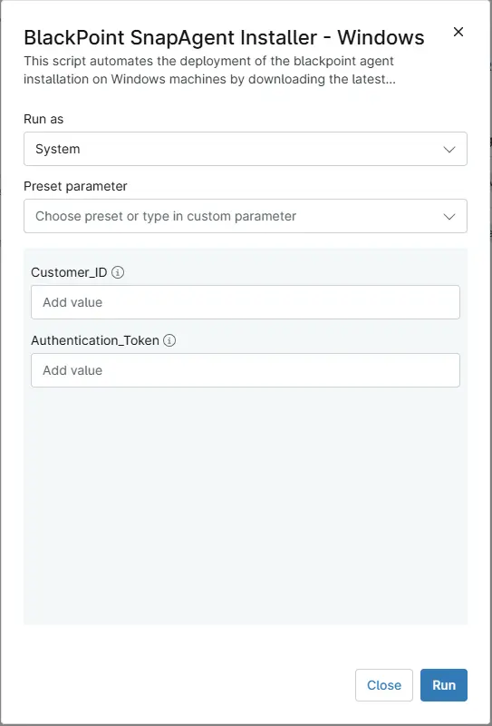

## Overview

Downloads, validates, and runs the [Install-BlackPointAgent](/docs/0cf14533-c145-4a77-8ea7-8c70476768a9)  from the ProVal content repository to install the BlackPoint agent.

## Sample Run

`Play Button` > `Run Automation` > `Script`  

## Parameters

`Note: If the value is present under the custom field then variables do not need to be put during the script execution. As the script get the data from either Custom field or variables.`

| Name | Example | Accepted Values | Required | Default | Type | Description |
| ---- | ------- | --------------- | -------- | ------- | ---- | ----------- |
| Customer_ID | -- | -- | NO | "" | `String/Text` |Stores the unique BlackPoint Account UID used to identify and link endpoints to the correct BlackPoint account. |
| Authentication_Token  |--  | -- | NO| "" | `String/Text` | Unique BlackPoint Authentication Code required to authenticate and install the BlackPoint Agent on endpoints. |

## Dependencies

- [Custom Field - cPVAL BP CustomerID](/docs/83df96df-47eb-43f4-860a-af3f686641c4)
- [Custom Field - cPVAL BP Authentication Token](/docs/7537a07a-9dda-4302-8ef4-b66ae94df2b8)
- [Solution - BlackPoint SnapAgent Deployment](/docs/b9f13c4b-742d-4118-be8e-0c03e43ded17)
- [Install-BlackPointAgent](/docs/0cf14533-c145-4a77-8ea7-8c70476768a9)

## Automation Setup/Import

- [Automation Configuration](https://github.com/ProVal-Tech/ninjarmm/blob/main/scripts/black-point-deployment-windows.ps1)

## Output

- Activity Details

## Changelog

### 2026-11-06

- Replaced the `BP_AccountUID` and `BP_Win_CompanyEXE` parameters with `Customer_ID` and `Authentication_Token`.
- Updated the PowerShell script with the following changes:
  - The script no longer downloads a company EXE from the BlackPoint portal.
  - The script is now a NinjaOne wrapper. It downloads the [Install-BlackPointAgent](/docs/0cf14533-c145-4a77-8ea7-8c70476768a9) script from contentrepo.net and checks its signature against ProVal's approved thumbprints.
  - The script then runs `Install-BlackPointAgent.ps1` with `-CustomerID` and `-AuthenticationToken` and reports the agnostic script's log and error log.
  - The script now reads the `cpvalBpCustomerid` and `cpvalBpAuthenticationToken` custom fields instead of `cpvalbpaccountuid` and `cpvalbpwincompanyexe`.
  - Custom field values now take precedence over script variables. Previously, script variables took precedence.

### 2025-11-28

- Initial version of the document
