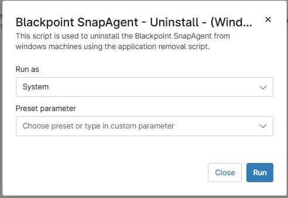

## Overview

This script uninstalls every BlackPoint component (Agent, Application Control, Defender Manager and Vulnerability Scanner). It finds each uninstall registration by display name, identifies the uninstall method (MSI or silent EXE), stops the BlackPoint services, then removes each component and verifies that nothing is left registered.

## Sample Run
`Play Button` > `Run Automation` > `Script`  
**Run As:** `System`  

## Dependencies

- [Solution - BlackPoint SnapAgent Deployment](/docs/b9f13c4b-742d-4118-be8e-0c03e43ded17)

## Automation Setup/Import

- [Automation Configuration](https://github.com/ProVal-Tech/ninjarmm/blob/main/scripts/blackpoint-uninstall-windows.ps1)

## Output

- Activity Details

## Changelog

### 2026-11-06

- Updated the script with the following changes:
  - The script now uninstalls every BlackPoint component (Agent, Application Control, Defender Manager and Vulnerability Scanner) instead of only the SnapAgent and ZTAC.
  - The script finds each component in the Uninstall registry keys and runs the uninstaller that component registered (MSI or silent EXE).
  - The script stops the BlackPoint services before it removes the components, and removes them in up to three passes.
  - After removal, the script verifies that no BlackPoint component is still registered. It exits with code 1 if one is.
  - The script no longer force-deletes leftover files, folders, registry keys or services.
  - The script now runs as 64-bit only.
  - Renamed the script from `Blackpoint SnapAgent - Uninstall - (Windows)` to `BlackPoint - Uninstall All Components - (Windows)`.
- Updated the automation configuration link to `blackpoint-uninstall-windows.ps1`.

### 2025-11-28

- Initial version of the document
