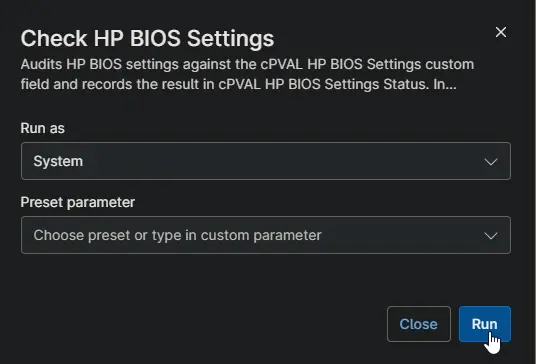

## Overview

This script checks whether a HP workstation's BIOS settings match the expected settings, without changing anything. It is the detection script of the [Enforce HP BIOS Settings](/docs/20215141-015b-4108-b40b-26070194acc1) compound condition.

**When to use:**

- Audit BIOS settings across HP workstations before enforcing them.
- Confirm that applied settings took effect after a restart.
- Trigger [Apply HP BIOS Settings](/docs/c338d928-7659-4ade-862c-7f8cebc3472d) on devices whose settings differ.

**How it works:**

- Runs only on HP workstations where [cPVAL Enforce HP BIOS Settings](/docs/d6023b8f-c04c-4453-89ce-bc729be9fb79) is Audit or Enforce. Other devices are skipped.
- The current BIOS settings are read with the HP BIOS Configuration Utility, which is downloaded if needed.
- Each setting in [cPVAL HP BIOS Settings](/docs/91f31a3a-5d44-4a05-a1fd-5eba010aa03a) is compared with the device. Settings this model does not have are skipped and listed.
- The result is stored in [cPVAL HP BIOS Settings Status](/docs/dae68716-9ea4-4f05-a0d4-4c2899fd22b7).
- Devices waiting for a restart after settings were applied are skipped until they restart.

**Requirements:**

- HP workstation running Windows 10 or Windows 11.
- Runs elevated (System context).
- The custom fields listed in Dependencies.

:::note  
In Enforce mode, the activity shows as failed (exit code 1) when settings differ. This is expected: it tells the compound condition to run [Apply HP BIOS Settings](/docs/c338d928-7659-4ade-862c-7f8cebc3472d).  
:::

## Sample Run

## Scenarios

### Example 1: Running the script on a device that matches the expected settings

[cPVAL Enforce HP BIOS Settings](/docs/d6023b8f-c04c-4453-89ce-bc729be9fb79) is set to Audit or Enforce, and every setting in [cPVAL HP BIOS Settings](/docs/91f31a3a-5d44-4a05-a1fd-5eba010aa03a) matches the device. Each setting is listed with PASS, and the activity completes successfully.

**Status:** `Compliant | 2026-10-16 21:05:12`

### Example 2: Running the script in Audit mode on a device with different settings

[cPVAL Enforce HP BIOS Settings](/docs/d6023b8f-c04c-4453-89ce-bc729be9fb79) is set to Audit, and some settings differ from [cPVAL HP BIOS Settings](/docs/91f31a3a-5d44-4a05-a1fd-5eba010aa03a). Each of those settings is listed with FAIL and its current value. Nothing is changed on the device. Switch to Enforce when you are ready to apply the settings.

**Status:** `Non-Compliant | 2026-10-16 21:05:12 | Mismatch: Wake On LAN, Sunday`

### Example 3: Running the script in Enforce mode on a device with different settings

[cPVAL Enforce HP BIOS Settings](/docs/d6023b8f-c04c-4453-89ce-bc729be9fb79) is set to Enforce, and some settings differ. The script lists them and ends with exit code 1, so the activity shows as failed. The compound condition then runs [Apply HP BIOS Settings](/docs/c338d928-7659-4ade-862c-7f8cebc3472d), which changes the settings and updates the status.

**Output:** `Detected: 2 setting(s) differ from the expected values: Wake On LAN, Sunday.`

### Example 4: Running the script on a model that does not have every setting

The model does not have one of the expected settings, such as After Power Loss on many laptops. That setting is skipped and listed in the status. The remaining settings are checked as usual.

**Status:** `Compliant | 2026-10-16 21:05:12 | Not supported: After Power Loss`

### Example 5: Running the script on a device waiting for a restart

The settings were applied, but the device has not restarted since. The check is skipped, and the status stays unchanged. After the restart, the next check verifies the settings and sets the status to Compliant.

**Status:** `Applied - Reboot Pending | 2026-10-16 21:05:12 | Changed: Wake On LAN, Sunday`

### Example 6: Running the script with incorrectly formatted expected settings

[cPVAL HP BIOS Settings](/docs/91f31a3a-5d44-4a05-a1fd-5eba010aa03a) contains a line that does not follow the required format, for example `Wake On LAN Boot to Hard Drive` (the equals sign is missing). The check stops with exit code 2, and nothing else runs. Correct the line, and the next check runs normally.

**Status:** `Failed | 2026-10-16 21:05:12 | Invalid expected settings: line 1 (Wake On LAN Boot to Hard Drive)`

## Dependencies

- [Solution: Enforce HP BIOS Settings](/docs/ec68a35d-7884-4e39-bebb-6f2b37d77eca)
- [Compound Condition: Enforce HP BIOS Settings](/docs/20215141-015b-4108-b40b-26070194acc1)
- [Custom Field: cPVAL Enforce HP BIOS Settings](/docs/d6023b8f-c04c-4453-89ce-bc729be9fb79)
- [Custom Field: cPVAL HP BIOS Settings](/docs/91f31a3a-5d44-4a05-a1fd-5eba010aa03a)
- [Custom Field: cPVAL HP BIOS Settings Status](/docs/dae68716-9ea4-4f05-a0d4-4c2899fd22b7)
- [Script: Initialize-HPBiosConfigUtility](/docs/b5d53223-2755-48da-b4f5-a1cd5fa9f58f) (the underlying agnostic script)

## Custom Fields

| Field Name | Type | Mandatory | Scope | Description |
| ---------- | ---- | --------- | ----- | ----------- |
| [cPVAL Enforce HP BIOS Settings](/docs/d6023b8f-c04c-4453-89ce-bc729be9fb79) | Drop-down | Yes | Organization, Location, Device | Audit or Enforce turns the solution on. None or blank skips the device. |
| [cPVAL HP BIOS Settings](/docs/91f31a3a-5d44-4a05-a1fd-5eba010aa03a) | Multi-line | Yes | Organization, Location, Device | The expected settings, one `Setting Name=Value` pair per line. |
| [cPVAL HP BIOS Settings Status](/docs/dae68716-9ea4-4f05-a0d4-4c2899fd22b7) | Text | Yes | Device | Stores the result. Read-only for technicians. |

## Automation Setup/Import

[Automation Configuration](https://github.com/ProVal-Tech/ninjarmm/blob/main/scripts/check-hp-bios-settings.ps1)

## Output

- **Activity Details:** Each expected setting with PASS or FAIL and the current value. Settings this model does not have are listed as skipped.
- **Custom Field:** [cPVAL HP BIOS Settings Status](/docs/dae68716-9ea4-4f05-a0d4-4c2899fd22b7) is updated when the result changes.
- **Export File:** The current BIOS configuration is saved to C:\ProgramData\_Automation\Script\Initialize-HPBiosConfigUtility\CurrentBiosSettings.txt.
- **Exit Code:** 0 when the check completes, including Audit mode results. 1 when settings differ in Enforce mode. 2 when the check could not complete; the reason is in the activity details and, where possible, in the status.

## Changelog

### 2026-10-16

- Initial version of the document
