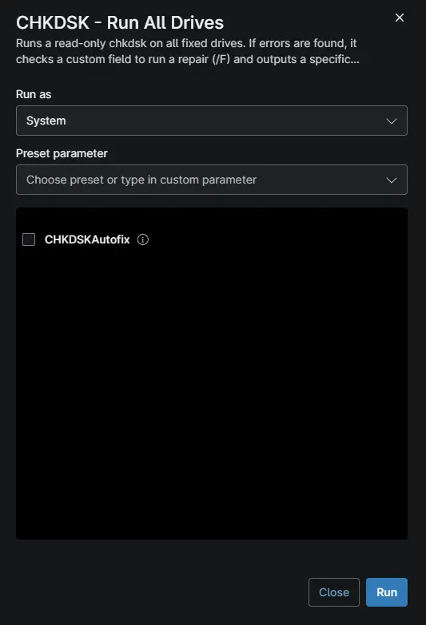

## Overview

This automation scans all internal fixed drives for bad sectors using a read-only `chkdsk`. If errors are found and the `cpvalChkdskAutofix` custom field is set to "Enabled", it schedules an offline repair using `chkdsk /F` on the target drives. The results and error messages are output directly to the NinjaOne activity log, and the script exits with code 1 to trigger ticket creation via compound condition. Schedule this automation as a routine maintenance task to proactively monitor disk health and automatically remediate corruption before it leads to drive failures.

**Note:** 
>Before running this automation, ensure the `cpvalChkdskAutofix` device custom field is created in NinjaOne. If this field is not set to "Enabled", the script will only report the errors and exit without attempting a repair. Additionally, the script will intentionally show as "Failed" (Exit Code 1) when disk problems are found; this behavior is required to trigger the ticket creation or commenting condition in the NinjaOne policy.

-----
## Requirements

- Supported operating system and device role
- Run As: `System`
- PowerShell 5.1

## Sample Run

## Custom Fields

| Custom Field | Scope | Type | Description |
| ------------ | ----- | ---- | ----------- |
| [cPVAL ChkDsk Autofix](/docs/398e0f9e-6f9c-482d-a977-b278ed79d7df) | `Device, Organization, Location, System` | Drop-down |This is used to set if autofix needs to be executed or not during the script run. |

## Parameters

| Name | Calculated Name | Type | Default Value | Description |
| ---- | ------- | --------------- | ----------- | -----------
| `CHKDSKAutofix` | `chkdskautofix` | `Checkbox` | --- | This is used to run enable the function to run autofix if Checked |

## Dependencies

* [Custom Field - cPVAL ChkDsk Autofix](/docs/398e0f9e-6f9c-482d-a977-b278ed79d7df)
* [Solution: CHKDSK All Drives - NinjaOne](/docs/d7759df0-48d0-45c4-a1ca-958fe849ad79)

## Automation Setup/Import

[Automation Configuration](https://github.com/ProVal-Tech/ninjarmm/blob/main/scripts/chkdsk-all-drives.ps1)

## Output

- Activity Details

## Changelog

### 2026-10-16

- Initial version of the document
