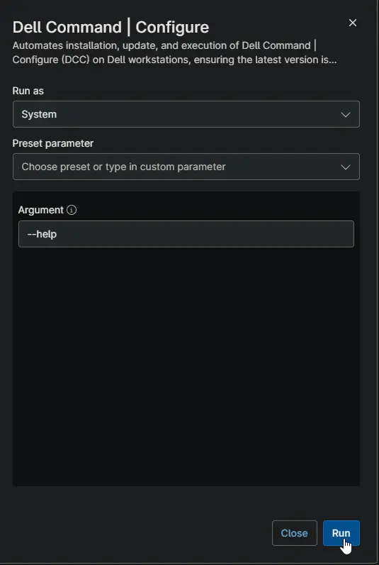
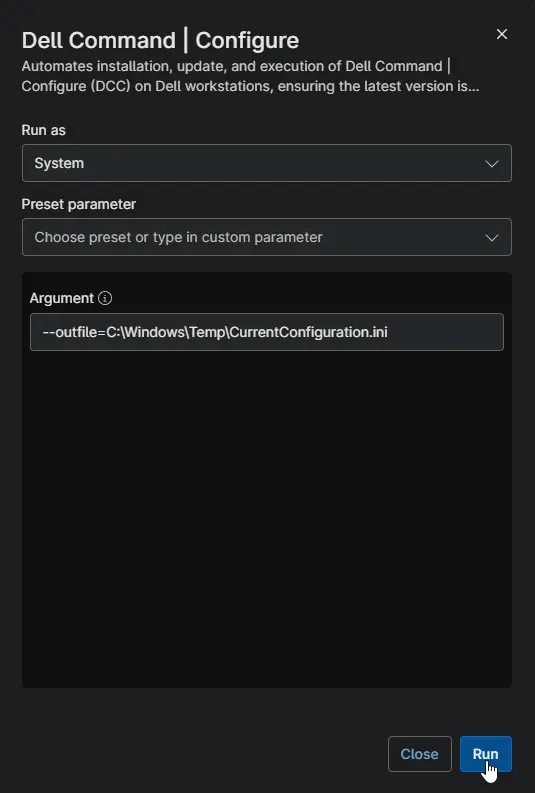
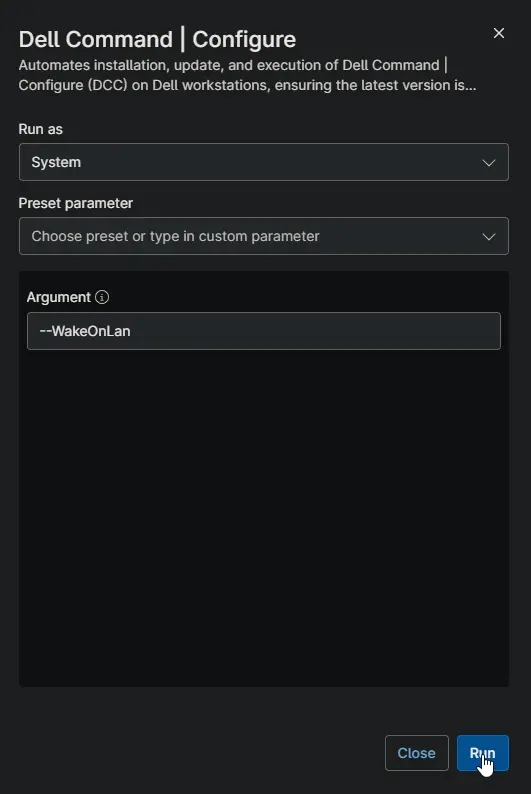
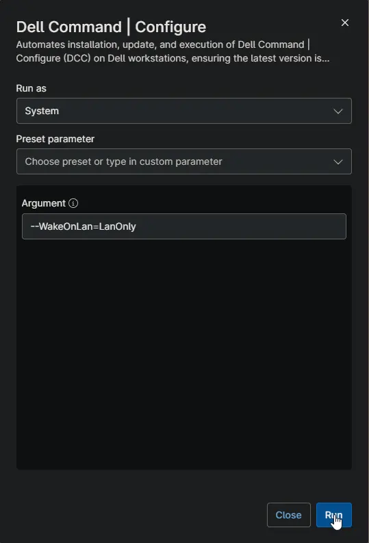
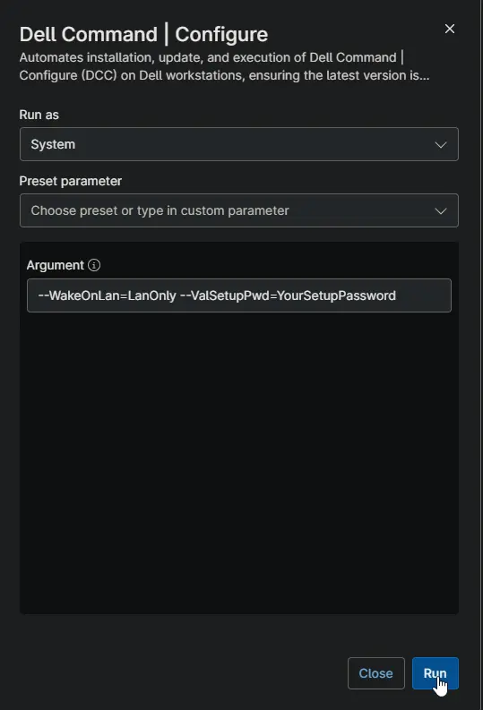
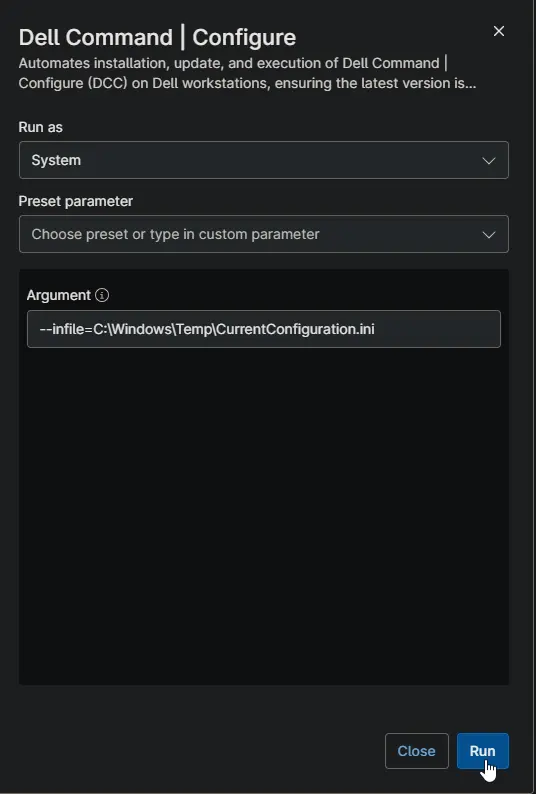

## Overview

This script reads and changes BIOS settings on Dell workstations using Dell Command | Configure (DCC), without visiting the device.

**When to use:**

- Check the current value of a BIOS setting, such as Wake on LAN.
- Export a device's full BIOS configuration for review or reuse.
- Change a BIOS setting remotely, including on devices with a BIOS setup password.
- Apply the same BIOS configuration to other devices of the same model.

**How it works:**

- DCC is installed, or upgraded to the latest version, before every run.
- The value of Argument is passed to the DCC command-line tool (cctk.exe). With no value, the tool lists the supported options.
- The result code is translated into a plain-language message in the activity output.
- Many BIOS changes take effect only after the next restart. The script does not restart the device.

**Requirements:**

- Dell workstation running Windows 10 or Windows 11.
- Runs elevated (System context).
- Internet access to download DCC.

:::note  
Incorrect BIOS settings can stop a device from starting. Test a change on one device before running it on many.  
:::

## Sample Run

### Example 1: Running the script to list the supported options

Leave **Argument** at its default, `--help`. The activity lists every option available on this model. Options marked with * are read-only.

### Example 2: Running the script to export the current BIOS configuration

Set **Argument** to `--outfile=C:\Windows\Temp\CurrentConfiguration.ini`. Every BIOS setting and its current value is saved to this file on the device. Use it to review settings, or to apply them to other devices (Example 6).

### Example 3: Running the script to check the current value of a setting

Set **Argument** to `--WakeOnLan`. The current Wake on LAN value is shown in the activity output. Nothing is changed.

### Example 4: Running the script to change a BIOS setting

Set **Argument** to `--WakeOnLan=LanOnly`. Wake on LAN is enabled for the wired network adapter. Use Example 1 or the DCC BIOS options reference to find the setting names and values for your model.

### Example 5: Running the script to change a setting on a device with a BIOS setup password

Set **Argument** to `--WakeOnLan=LanOnly --ValSetupPwd=YourSetupPassword`, replacing YourSetupPassword with the device's BIOS setup password. Without the password, the change fails with a password-required message. The argument, including the password, appears in the activity details.

### Example 6: Running the script to apply a saved BIOS configuration

Set **Argument** to `--infile=C:\Windows\Temp\CurrentConfiguration.ini`. Every setting in the file is applied to the device. The file must already be on the device. Export it from a device of the same model (Example 2), and remove any settings you do not want to change.

## Dependencies

- [Script: Initialize-DellCommandConfigure](/docs/a0f958c9-7364-4bde-af18-01e6232620cc) (the underlying agnostic script)

## Parameters

| Name | Example | Accepted Values | Required | Default | Type | Description |
| ---- | ------- | --------------- | -------- | ------- | ---- | ----------- |
| Argument | `--WakeOnLan=LanOnly` | Any option from the DCC [general options](https://www.dell.com/support/manuals/en-us/command-configure-v4.2/dcc_cli_4.2/general-options?guid=guid-70b4993d-58d3-48ef-a8db-ae7feb6e01ae&lang=en-us) and [BIOS options](https://www.dell.com/support/manuals/en-us/command-configure-v4.2/dcc_cli_4.2/bios-options?guid=guid-44c059be-b76d-4b2f-b8ef-655f736c40ce&lang=en-us) references. | False | `--help` | String/Text | The DCC option to run. Separate multiple options with a space. Leave blank to list the supported options. |

## Automation Setup/Import

[Automation Configuration](https://github.com/ProVal-Tech/ninjarmm/blob/main/scripts/dell-command-configure.ps1)

## Output

- **Activity Details:** The run log, including the DCC version check, the option that ran, the DCC output, and a plain-language result. Errors are reported in the activity output.
- **Exported File:** When --outfile is used, the BIOS configuration is saved to the path given.
- **Log Files:** A copy of the run log is kept on the device in C:\ProgramData\_Automation\Script\Initialize-DellCommandConfigure.

## Changelog

### 2026-10-16

- Updated the document to the current template. The script is no longer shown in the document; import it from the Automation Configuration link.
- The automation now downloads and runs the latest [Initialize-DellCommandConfigure](/docs/a0f958c9-7364-4bde-af18-01e6232620cc) script.
- Replaced the Sample Run section with usage scenarios.

### 2025-06-16

- Initial version of the document
