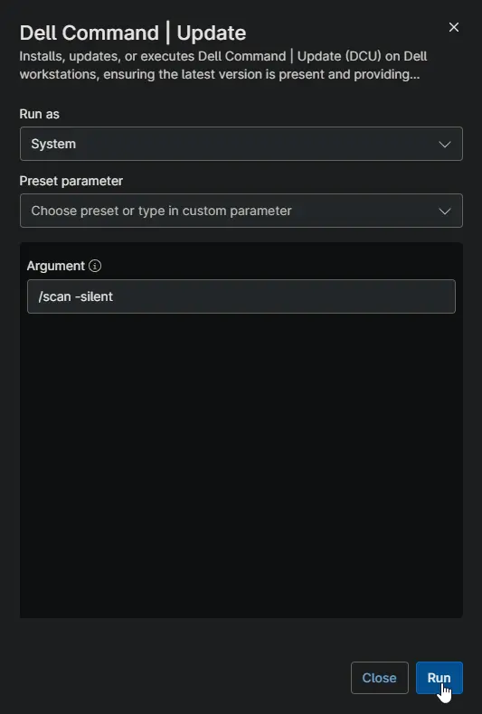
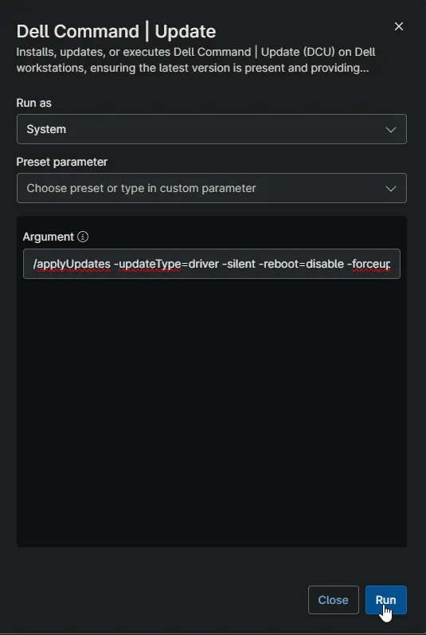
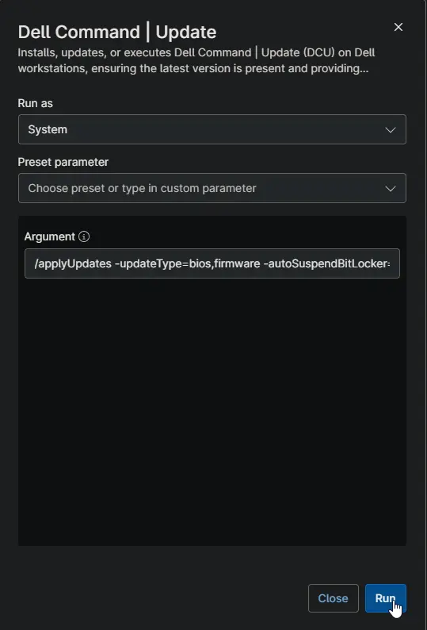
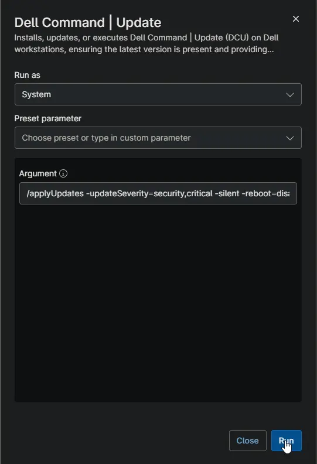

## Overview

This script keeps Dell workstations up to date with drivers, BIOS, firmware, and Dell applications using Dell Command | Update (DCU).

**When to use:**

- Check which Dell updates a device needs, without installing anything.
- Install driver updates without restarting the device.
- Install BIOS and firmware updates during a maintenance window.
- Install only security and critical updates.

**How it works:**

- DCU is installed, or upgraded to the latest version, before every run.
- If another Dell update is already running, the script waits for it. It stops rather than interrupt a BIOS or firmware update.
- To avoid unplanned restarts, the script adds -reboot=disable to update commands that do not set a -reboot value.
- If DCU is busy, the script retries up to three times.
- After updates are installed, a new scan lists any updates that are still pending.

**Requirements:**

- Dell workstation running Windows 10 or Windows 11. Servers are not supported.
- Runs elevated (System context).
- Internet access to download DCU and the updates.

:::note  
Some BIOS and firmware updates restart the device on their own, even with -reboot=disable. Run them during a maintenance window and keep laptops on AC power.  
:::

## Sample Run

### Example 1: Running the script to scan for available updates

Leave **Argument** at its default, `/scan -silent`. DCU checks the device and lists every applicable update with its name, type, and urgency. Nothing is installed.

### Example 2: Running the script to install driver updates without a restart

Set **Argument** to `/applyUpdates -updateType=driver -silent -reboot=disable -forceupdate=enable`. Available driver updates are installed and the device does not restart. The -forceupdate=enable option installs updates even when a user has paused them in DCU.

### Example 3: Running the script to install BIOS and firmware updates

Set **Argument** to `/applyUpdates -updateType=bios,firmware -autoSuspendBitLocker=enable -silent -reboot=disable`. BitLocker is suspended for the update, so the device does not ask for its recovery key at the next startup. Restart the device afterwards to finish the update.

### Example 4: Running the script to install only security and critical updates

Set **Argument** to `/applyUpdates -updateSeverity=security,critical -silent -reboot=disable`. Only updates that Dell rates as security or critical are installed. Other updates stay pending and appear in the follow-up scan.

## Dependencies

- [Script: Initialize-DellCommandUpdate](/docs/aa963f3d-f149-4bfa-8fdc-30f12c21ce7f) (the underlying agnostic script)

## Parameters

| Name | Example | Accepted Values | Required | Default | Type | Description |
| ---- | ------- | --------------- | -------- | ------- | ---- | ----------- |
| Argument | `/applyUpdates -updateType=driver -silent -reboot=disable` | Any command and options from the [DCU CLI reference](https://www.dell.com/support/manuals/en-us/command-update/dcu_rg/dell-command-%7C-update-cli-commands?guid=guid-92619086-5f7c-4a05-bce2-0d560c15e8ed&lang=en-us). Run `/help` to list them. | False | `/scan -silent` | String/Text | The DCU command to run. Leave blank to scan for updates. |

## Automation Setup/Import

[Automation Configuration](https://github.com/ProVal-Tech/ninjarmm/blob/main/scripts/dell-command-update.ps1)

## Output

- **Activity Details:** The run log, including the DCU version check, the command that ran, the DCU output, and a plain-language result. Errors are reported in the activity output.
- **Restart:** When installed updates need a restart to finish, the run ends with a warning instead of a failure. Restart the device to complete them.
- **Log Files:** A copy of the run log is kept on the device in C:\ProgramData\_Automation\Script\Initialize-DellCommandUpdate.

## Changelog

### 2026-10-16

- Updated the document to the current template. The script is no longer shown in the document; import it from the Automation Configuration link.
- The automation now downloads and runs the latest [Initialize-DellCommandUpdate](/docs/aa963f3d-f149-4bfa-8fdc-30f12c21ce7f) script. This adds a wait for running Dell updates, automatic retries, and a follow-up scan after updates.
- Replaced the Sample Run section with usage scenarios.

### 2025-06-16

- Initial version of the document
