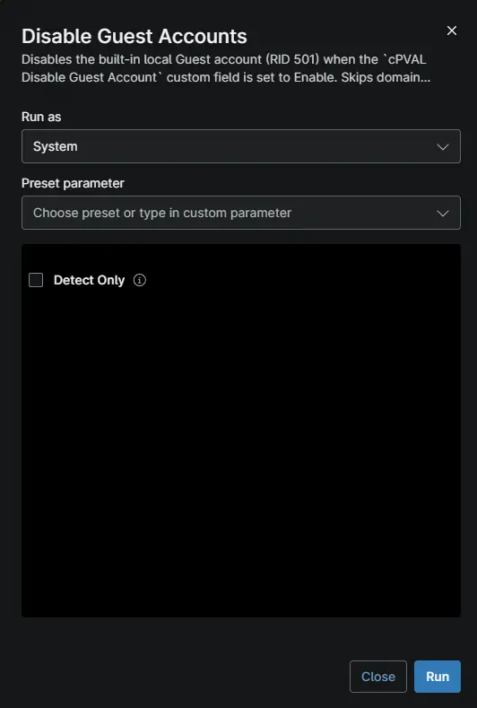

## Overview

Detects and disables the built-in Windows Guest account. If the account is already disabled, nothing changes. This automation runs the [Disable-GuestAccount](/docs/585e6715-2136-4b26-baca-d8f7e09f8b88) script in NinjaOne.

Use it when a security audit or policy requires the Guest account to be disabled. The [Guest Account Removal Monitor](/docs/4b2a084a-e67b-4c61-801c-d5103e08b619) compound condition runs it on Windows workstations and servers where the [cPVAL Disable Guest Account](/docs/b7743a14-544e-4e5c-8c20-7579dd0c5c39) custom field is set to `Enable`.

Domain controllers are not supported.

## Sample Run

## Dependencies

- [Agnostic Script - Disable-GuestAccount](/docs/585e6715-2136-4b26-baca-d8f7e09f8b88)
- [Compound Condition - Guest Account Removal Monitor](/docs/4b2a084a-e67b-4c61-801c-d5103e08b619)
- [Solution - Disable Guest Account](/docs/5e9750da-82c2-4f0a-a6a0-894412269e53)

## Script Variables

| Name | Type | Required | Default | Description |
| ---- | ---- | -------- | ------- | ----------- |
| `Detect Only` | Checkbox | No | Unchecked | Checks the Guest account and makes no changes. The automation exits with code `1` if the account is enabled, and `0` if it is not. |

## Automation Setup/Import

[Automation Configuration](https://github.com/ProVal-Tech/ninjarmm/blob/main/scripts/disable-guest-accounts.ps1)

## Output

- Activity Details

You'll know it worked when the activity details show `Disabled Guest account` or `already disabled`.

## Troubleshooting

| Problem | Cause | Solution |
| --- | --- | --- |
| The automation fails on a domain controller. | A domain controller's Guest account applies to the whole domain. | Manage the domain's Guest account with Group Policy. |
| The activity shows `Invalid Signature`. | The script was changed after import. | Re-import the automation without editing the script. |
| The Guest account is enabled again later. | A Group Policy or Intune policy turns it back on. | Set **Accounts: Guest account status** to **Disabled** in that policy. |

## Changelog

### 2026-10-12

- The automation now runs the [Disable-GuestAccount](/docs/585e6715-2136-4b26-baca-d8f7e09f8b88) script.
- Added the `Detect Only` script variable to check the Guest account without making changes.
- The automation no longer reads the custom field. The [Guest Account Removal Monitor](/docs/4b2a084a-e67b-4c61-801c-d5103e08b619) compound condition checks it instead.

### 2026-10-09

- Initial version of the document.
