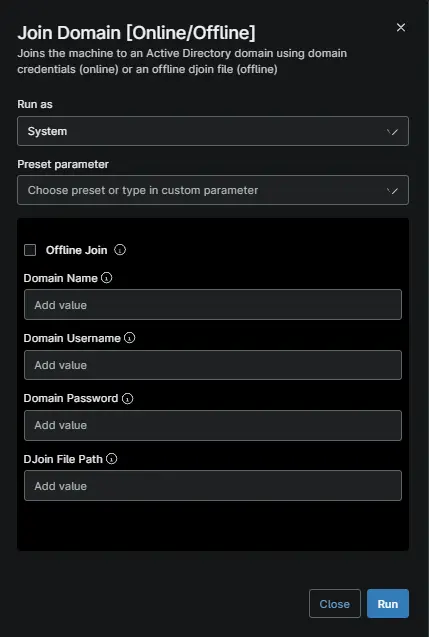

## Summary

The **Join Domain [Online/Offline]** automation is used to join a Windows computer to an Active Directory domain using either the online credential-based method or the offline domain join method.

The automation is a NinjaOne script that reads the values entered in its script variables, retrieves the agnostic `Join-Domain.ps1` script from the ProVal Content Repository, validates its code signature, and executes it with the selected parameters. After execution, the script returns the content of the agnostic script's log file and fails if an error log is found.

The automation supports the following methods:

- **Online Domain Join:** Uses the domain name and domain credentials to join the computer to the domain. The computer restarts automatically after a successful join.
- **Offline Domain Join:** Uses a previously generated offline domain join file to join the computer to the domain. A restart is required afterwards to complete the join.

**Note:** `The computer must have the required network connectivity and DNS configuration to locate the domain controller when using the online method. The offline method requires a valid offline domain join file on the target computer.`

## Dependencies

- [Agnostic script - Join Domain](/docs/fb3e4906-6520-4b5b-bc35-db7b79b45f7d)
- For the offline method, an offline domain join file generated using the [Generate DJoin File [Domain Controller]](/docs/d1313948-cbd2-420e-b5af-f633b894edeb)

## Sample Run

## Variables

| Name | Type | Mandatory | Default | Description |
|---|---|---|---|---|
| `Offline Join` | `Checkbox` | `False` | Unchecked | Unchecked = online domain join. Checked = offline domain join using the DJoin file. |
| `Domain Name` | `String/Text` | `False` | | FQDN of the domain to join. Required for the online join. Example: `contoso.local` |
| `Domain Username` | `String/Text` | `False` | | Domain account with permission to join computers. Required for the online join. Example: `CONTOSO\JoinAdmin` |
| `Domain Password` | `String/Text` | `False` | | Password of the domain account. Required for the online join. |
| `DJoin File Path` | `String/Text` | `False` | | Full path of the offline domain join `.txt` file on the target computer. Required for the offline join. Example: `C:\Temp\PC01-OfflineJoin.txt` |

None of the variables are marked as mandatory because each join method requires a different set of values. The script validates the required values for the selected method and fails with a clear message if any of them are missing.

**Working paths:**

- Working directory: `C:\ProgramData\_Automation\Script\Join-Domain`
- Downloaded script: `C:\ProgramData\_Automation\Script\Join-Domain\Join-Domain.ps1`
- Log file: `C:\ProgramData\_Automation\Script\Join-Domain\Join-Domain-log.txt`
- Error log file: `C:\ProgramData\_Automation\Script\Join-Domain\Join-Domain-error.txt`

## Implementation

* Configure the variables according to the selected domain-join method.

   **For Online Domain Join:**

   - Leave `Offline Join` unchecked.
   - Provide `Domain Name`.
   - Provide `Domain Username` and `Domain Password` for the domain account.
   - Ensure the target computer has network connectivity and DNS configured to locate a domain controller.

   **For Offline Domain Join:**

   - Run the script [Generate DJoin File [Domain Controller]](/docs/a5f84323-dbb5-4d64-bfcf-1ebfcf08682c) automation on the Domain Controller.
   - Provide the target computer name for which the offline domain join file needs to be generated.
   - Locate the generated offline domain join file `TargetName-OfflineJoin.txt` on the Domain Controller under the path along with the file name `C:\ProgramData\_Automation\Script\New-DJoinFile\<TargetName>-OfflineJoin.txt`.
   - Place the `TargetName-OfflineJoin.txt` file on the target computer and note its full path.
   - Run the `Join Domain [Online/Offline]` script on the target computer.
   - Check `Offline Join`.
   - Provide `DJoin File Path` with the full path of the offline domain join file placed on the target computer.
   - Restart the target computer after a successful run to complete the join.

   For detailed instructions, refer to the [Generate DJoin File [Domain Controller]](/docs/d1313948-cbd2-420e-b5af-f633b894edeb).

* Verify the execution results in the device's activity log. If the domain join fails, review the logged error and check domain controller discovery, DNS configuration, network connectivity, credentials, and the offline join file path as applicable.

## Output

- Activity details
- Log file: `C:\ProgramData\_Automation\Script\Join-Domain\Join-Domain-log.txt`

## Changelog

### 2026-11-23

- Initial version of the document.