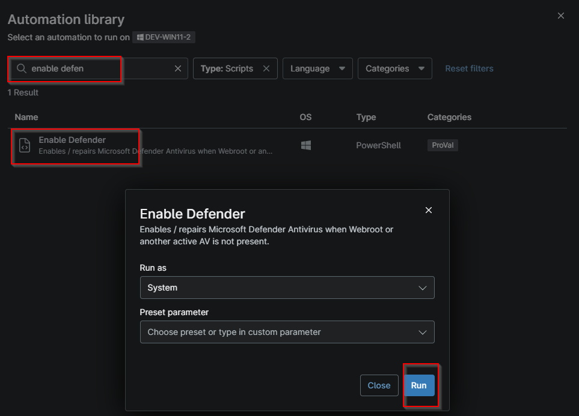
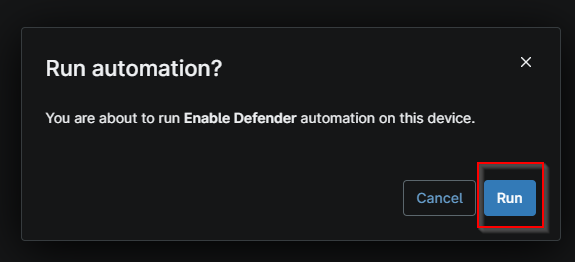

## Overview

Enables / repairs Microsoft Defender Antivirus when Webroot or another active AV is not present.

## Sample Run

- Navigate to Automation > Script
- Search for `Enable Defender`
- Click the `Enable Defender` after search result
- Click Run
  

- Click Run again to execute the script

## Dependencies

- [Solution - Enable Defender](/docs/265e1888-ce5f-4d44-a5c4-6a64d578eb98)

## Custom Fields

| Field Name | Type | Mandatory | Scope | Description |
| ---------- | ---- | --------- | ----- | ----------- |
| [cPVAL Enable Defender Only](/docs/0f8717c5-1ceb-4941-a73e-6e00efdb8cae) | Drop-down | false | `Organization`, `Location`, `Device` | This custom field is required to be set to enable defender only without ticket creation on failure. |
| [cPVAL Enable Defender With Ticket On Failure](/docs/79e87b45-f26b-4a49-b5be-da58c743dccd) | Drop-down | false | `Organization`, `Location`, `Device` | This custom field requires enabling Defender with ticket creation on failure. |
| [cPVAL Defender Enable Status](/docs/56b73bb4-bc25-4335-9d99-c4f3dfe0509d) | Text | true | `Device` | This custom field stores the success or failure of the Enable Defender automation. |

## Automation Setup/Import

[Automation Configuration](https://github.com/ProVal-Tech/ninjarmm/blob/main/scripts/enable-defender.ps1)

## Output

- Activity Details  
- Custom Field

## Changelog

### 2026-10-12

- Initial version of the document