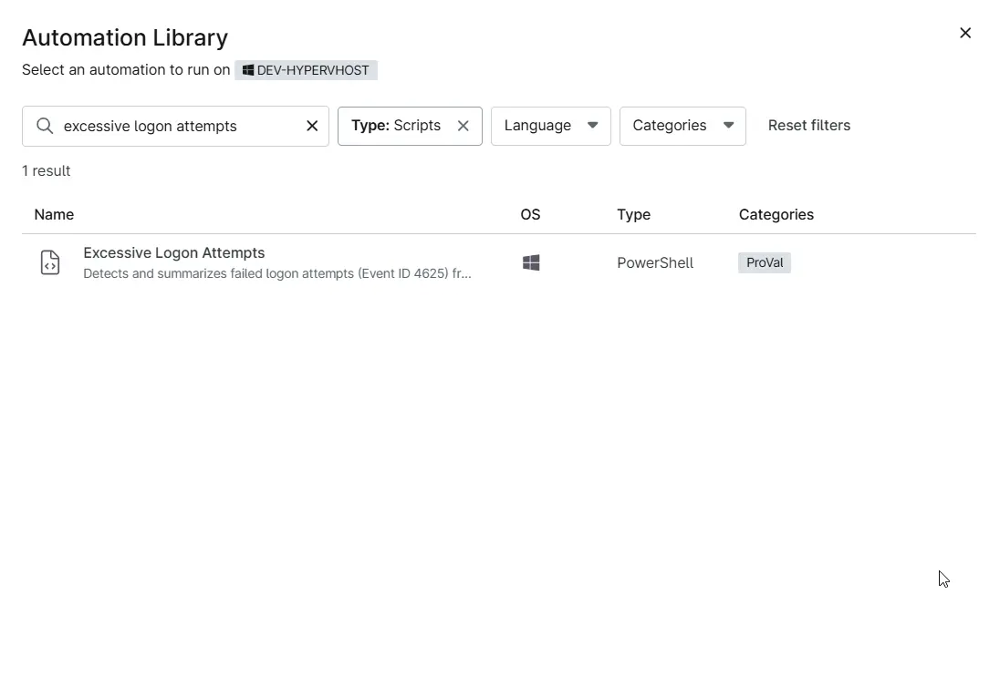

## Overview

Counts the failed logon attempts (Security event ID 4625) recorded since the last run and raises an alert when the count reaches the threshold, which can indicate a brute-force or password-spraying attack. The count is a total for the device across all users, taken after the configured exclusions. Batch and service logons, and a computer account failing from its own workstation, are never counted.

Whenever any failed logons are counted, the activity details list them grouped by user, domain and source IP address, along with the workstation, logon type, failure status and logon process. The script saves the time each run started in [cPVAL Excessive Logon LastRunTime](/docs/1e9de0b4-cf50-419a-95b5-bd1e1fbf3599), so the next run starts where this one ended. It does not change anything else on the device.

The automation is the evaluation script of the `Monitor - Excessive Logon Attempts` compound condition in the [Excessive Logon Attempts](/docs/e99ec890-ae05-4ad5-bdbc-6b0599be67e9) solution.

:::note  
The first run, and any run where `cPVAL Excessive Logon LastRunTime` is empty or invalid, checks the last 60 minutes.  
:::

## Requirements

- Windows. The compound condition runs it only on domain controllers whose [cPVAL Roles Detected](/docs/e9ec73dd-98b1-4436-a027-4ee8906f7cba) field contains `Infrastructure Master`.
- Run As: `System`
- PowerShell 5.1
- Logon failure auditing enabled, so Windows records event ID 4625. Windows Server enables it by default.

## Sample Run

## Parameters

Every parameter is optional. A parameter left empty uses the matching custom field, so leave them empty in the compound condition and set the values in the custom fields at the organization, location or device level. A value entered in a parameter replaces the custom field value for that run rather than adding to it.

List entries can be separated by commas or semicolons. Matching is not case-sensitive, and every entry accepts the wildcards `*` (any number of characters) and `?` (exactly one character).

| Name | Example | Accepted Values | Required | Default | Type | Description |
| ---- | ------- | --------------- | -------- | ------- | ---- | ----------- |
| Threshold | `20` | A whole number greater than `0` | False | Empty, which uses [cPVAL Excessive Logon Threshold](/docs/59804ada-96af-48b6-ab50-e975b531351e), or `10` when that is empty too | String | Number of failed logons since the last run that raises the alert. The alert is raised when the count is equal to or greater than this value. The count is a total across all users, after exclusions. `0`, a negative number or text that is not a number uses `10`. |
| ExcludeUsers | `scanner; svc_*; *$` | Usernames | False | Empty, which uses [cPVAL Excessive Logon ExcludeUsers](/docs/655756eb-8031-443a-8483-9509009523a1) | String | Usernames to ignore on every computer and in every domain. `*$` ignores all computer (machine) accounts. |
| ExcludeByComputer | `FRONTDESK-01/reception; LAB-PC07/*` | `COMPUTER/account` entries. A backslash also works. | False | Empty, which uses [cPVAL Excessive Logon ExcludeByComputer](/docs/ab58f702-6829-4c77-b155-9da7e916d24b) | String | Accounts to ignore when the computer in the entry is the `Domain` or the `WorkstationName` of the failed logon. `*` as the account matches every account. |
| ExcludeByDomain | `CONTOSO/svc_scan; FABRIKAM/*` | `DOMAIN/account` entries. A backslash also works. | False | Empty, which uses [cPVAL Excessive Logon ExcludeByDomain](/docs/a0bac62e-ca7d-47e4-9b40-0ef534b99260) | String | Accounts to ignore only when they belong to the domain in the entry. For a local account, the domain is the computer name. `*` as the account matches every account. |
| ExcludeByWorkstation | `COPIER-2F/scan2folder; TRAINING-*/*` | `WORKSTATION/account` entries. A backslash also works. | False | Empty, which uses [cPVAL Excessive Logon ExcludeByWorkstation](/docs/75819933-6303-4b48-b3e6-c0c26e125142) | String | Accounts to ignore only when the attempt comes from the workstation in the entry. `*` as the account matches every account. |
| ExcludeLogonProcess | `CHAP; Advapi; Seclogo` | Logon process names, such as `CHAP`, `Advapi`, `Seclogo` or `Kerberos` | False | Empty, which uses [cPVAL Excessive Logon ExcludeLogonProcess](/docs/5e936fa9-8345-47e2-826d-7a74144c1787) | String | Logon process names to ignore everywhere. Avoid `NtLmSsp` and `User32`, which would hide most password-guessing attacks. |

## Custom Fields

| Custom Field | Scope | Type | Description |
| ------------ | ----- | ---- | ----------- |
| [cPVAL Enable Excessive Logon Detection](/docs/57a80bea-ffac-4925-bc95-c51bf6db01f1) | Organization, Location, Device | Drop-down | Read by the compound condition, not by the script. `Disable` stops the condition from running the automation on the device. Empty works like `Enable`. |
| [cPVAL Excessive Logon Threshold](/docs/59804ada-96af-48b6-ab50-e975b531351e) | Organization, Location, Device | Text | Number of failed logons that raises the alert. Used when the `Threshold` parameter is empty. Empty uses `10`. |
| [cPVAL Excessive Logon ExcludeUsers](/docs/655756eb-8031-443a-8483-9509009523a1) | Organization, Location, Device | Multi-line | Usernames to ignore everywhere. Used when the `ExcludeUsers` parameter is empty. |
| [cPVAL Excessive Logon ExcludeByComputer](/docs/ab58f702-6829-4c77-b155-9da7e916d24b) | Organization, Location, Device | Multi-line | `COMPUTER\account` entries to ignore on or from one computer. Used when the `ExcludeByComputer` parameter is empty. |
| [cPVAL Excessive Logon ExcludeByDomain](/docs/a0bac62e-ca7d-47e4-9b40-0ef534b99260) | Organization, Location, Device | Multi-line | `DOMAIN\account` entries to ignore in one domain. Used when the `ExcludeByDomain` parameter is empty. |
| [cPVAL Excessive Logon ExcludeByWorkstation](/docs/75819933-6303-4b48-b3e6-c0c26e125142) | Organization, Location, Device | Multi-line | `WORKSTATION\account` entries to ignore from one workstation. Used when the `ExcludeByWorkstation` parameter is empty. |
| [cPVAL Excessive Logon ExcludeLogonProcess](/docs/5e936fa9-8345-47e2-826d-7a74144c1787) | Organization, Location, Device | Text | Logon process names to ignore everywhere. Used when the `ExcludeLogonProcess` parameter is empty. |
| [cPVAL Excessive Logon LastRunTime](/docs/1e9de0b4-cf50-419a-95b5-bd1e1fbf3599) | Device | Text | Time the script last ran, read and written by the script on every run that reads the Security log. The next run counts failed logons from this time onward. Does not need to be filled in manually. |

## Dependencies

* [Solution: Excessive Logon Attempts](/docs/e99ec890-ae05-4ad5-bdbc-6b0599be67e9)
* [Condition: Excessive Logon Attempts](/docs/d8ab94a8-8b00-401b-b1a4-48b7fd2713ae)
* [CW Manage Ticket Template: Excessive Logon Attempts](/docs/87e8cc64-8a82-4d83-9a91-dcd82c63ffea)
* [Custom Field: cPVAL Roles Detected](/docs/e9ec73dd-98b1-4436-a027-4ee8906f7cba)
* [Custom Field: cPVAL Enable Excessive Logon Detection](/docs/57a80bea-ffac-4925-bc95-c51bf6db01f1)
* [Custom Field: cPVAL Excessive Logon Threshold](/docs/59804ada-96af-48b6-ab50-e975b531351e)
* [Custom Field: cPVAL Excessive Logon ExcludeUsers](/docs/655756eb-8031-443a-8483-9509009523a1)
* [Custom Field: cPVAL Excessive Logon ExcludeByComputer](/docs/ab58f702-6829-4c77-b155-9da7e916d24b)
* [Custom Field: cPVAL Excessive Logon ExcludeByDomain](/docs/a0bac62e-ca7d-47e4-9b40-0ef534b99260)
* [Custom Field: cPVAL Excessive Logon ExcludeByWorkstation](/docs/75819933-6303-4b48-b3e6-c0c26e125142)
* [Custom Field: cPVAL Excessive Logon ExcludeLogonProcess](/docs/5e936fa9-8345-47e2-826d-7a74144c1787)
* [Custom Field: cPVAL Excessive Logon LastRunTime](/docs/1e9de0b4-cf50-419a-95b5-bd1e1fbf3599)

## Automation Setup/Import

[Automation Configuration](https://github.com/ProVal-Tech/ninjarmm/blob/main/scripts/excessive-logon-attempts.ps1)

## Output

- Activity Details
- Custom Field: [cPVAL Excessive Logon LastRunTime](/docs/1e9de0b4-cf50-419a-95b5-bd1e1fbf3599)

## Changelog

### 2026-11-11

- Updated the document to the current automation documentation standard.
- Removed the `Minutes` parameter. The script now counts the failed logons recorded since its last run, saved in cPVAL Excessive Logon LastRunTime, and checks the last 60 minutes when no last run time is saved.
- Made `Threshold` optional. When it is empty, the script uses cPVAL Excessive Logon Threshold, or `10` when that is empty too.
- Added the `ExcludeUsers`, `ExcludeByComputer`, `ExcludeByDomain`, `ExcludeByWorkstation` and `ExcludeLogonProcess` parameters and their custom fields.

### 2025-08-14

- Fixed the bug in the script that triggered the alert only after 2 Failed Logon attempts

### 2025-07-07

- Initial version of the document
