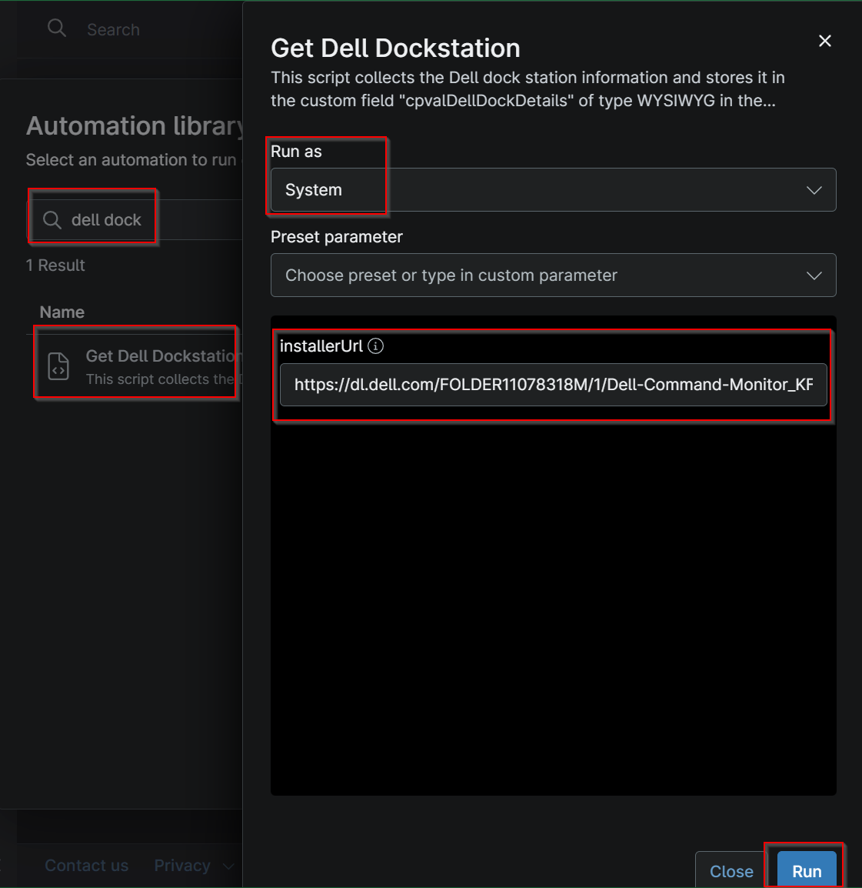
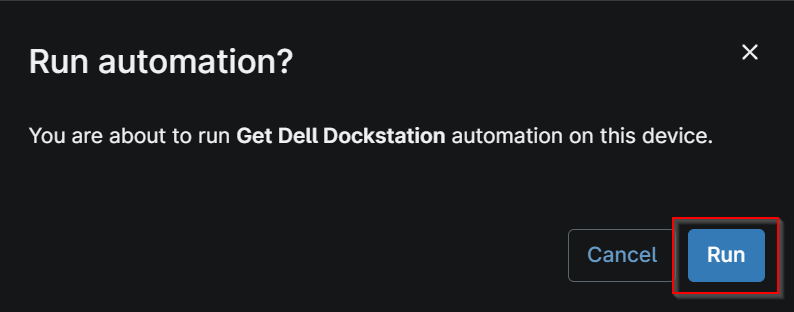

## Overview

This script collects the Dell dock station information and stores it in the custom field "cpvalDellDockDetails" of type WYSIWYG in the tabular format.

## Sample Run

- Click on Automation -> Script
- Search for `Get Dell Dockstation`
- Click on `Get Dell Dockstation`
- Provide the URL to download the installer link (By default it is set to https://dl.dell.com/FOLDER11078318M/1/Dell-Command-Monitor_KF06N_WIN_10.10.1.13_A00.EXE)
- Click Run

- Click Run again
- 

## Dependencies

[Solution - Get Dell Dockstation](/docs/8a8440f2-4451-4aa5-ada1-1187a22b26a4)

## Parameters

| Name | Example | Accepted Values | Required | Default | Type | Description |
| ---- | ------- | --------------- | -------- | ------- | ---- | ----------- |
| InstallerURL | https://dl.dell.com/FOLDER11078318M/1/Dell-Command-Monitor_KF06N_WIN_10.10.1.13_A00.EXE | Direct download link | true | https://dl.dell.com/FOLDER11078318M/1/Dell-Command-Monitor_KF06N_WIN_10.10.1.13_A00.EXE | Text | URL to directly download DCM.exe. |

## Custom Fields

| Field Name | Type | Mandatory | Scope | Description |
| ---------- | ---- | --------- | ----- | ----------- |
| cpvalDellDockDetails | WYSIWYG | true | `Device` | This custom field stores the information of the Dell dockstation fetched by the script Get-DellDockstation. |

## Automation Setup/Import

[Automation Configuration](https://github.com/ProVal-Tech/ninjarmm/blob/main/scripts/get-dell-dockstation.ps1)

## Output

- Activity Details  
- Custom Field

## Changelog

### 2026-10-12

- Initial version of the document