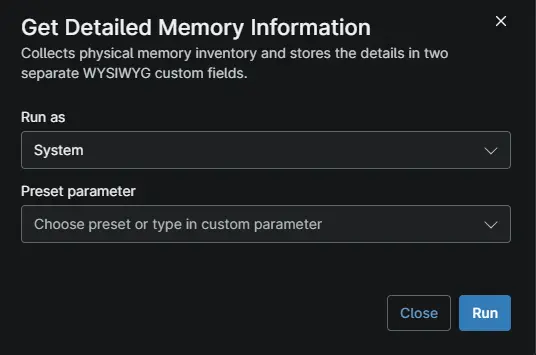

## Overview

Collects physical memory information from Windows endpoints, including installed RAM, memory type, speed, slot usage, maximum supported capacity, and upgrade options. Stores the consolidated memory summary in the `cPVAL Memory Summary` WYSIWYG custom field and the individual module details in `cPVAL Memory Modules`. Use this automation to audit memory inventory and support hardware upgrade planning.

:::note
Configure both WYSIWYG custom fields in NinjaOne before running the automation. Run it as System on Windows devices. Virtual machines are identified separately, and their assigned RAM is reported without physical module enumeration. The script reports a failure if no physical memory modules are found or the memory query fails.
:::

## Requirements

- Run As: `System`
- PowerShell 5.1

## Sample Run

## Custom Fields

| Custom Field | Scope | Type | Description |
| ------------ | ----- | ---- | ----------- |
| [cPVAL Memory Summary](/docs/ca470e3b-6664-46ed-b2f8-31e281db0e2f) | Device | WYSIWYG | Collects and displays a summary of physical memory information from Windows endpoints. |
| [cPVAL Memory Modules](/docs/861c715f-e228-4342-b9f8-6f663917c902) | Device | WYSIWYG | Collects detailed physical memory module information from Windows endpoints |

## Dependencies

- [Custom Field: cPVAL Get Memory Details](/docs/639be1ed-c056-4006-ba62-cf5083e39fd0)
- [Custom Field: cPVAL Memory Summary](/docs/ca470e3b-6664-46ed-b2f8-31e281db0e2f)
- [Custom Field: cPVAL Memory Modules](/docs/861c715f-e228-4342-b9f8-6f663917c902)
- [Audit Report: Memory Summary Report](/docs/b4d40cab-a530-45d5-b4db-337b87003868)
- [Audit Report: Memory Modules Report](/docs/fecd8d67-3944-4d87-9468-6ab2d3e62ee5)
- [Solution: Get Detailed Memory Information - NinjaOne](/docs/fd8c41d3-ecf7-4eb8-95f5-4317a787a579)

## Automation Setup/Import

[Automation Configuration](https://github.com/ProVal-Tech/ninjarmm/blob/main/scripts/get-detailed-memory-report.ps1)

## Output

- Activity Details
- [Custom Field: cPVAL Memory Summary](/docs/ca470e3b-6664-46ed-b2f8-31e281db0e2f)
- [Custom Field: cPVAL Memory Modules](/docs/861c715f-e228-4342-b9f8-6f663917c902)

## Changelog

### 2026-10-23

- Initial version of the document
