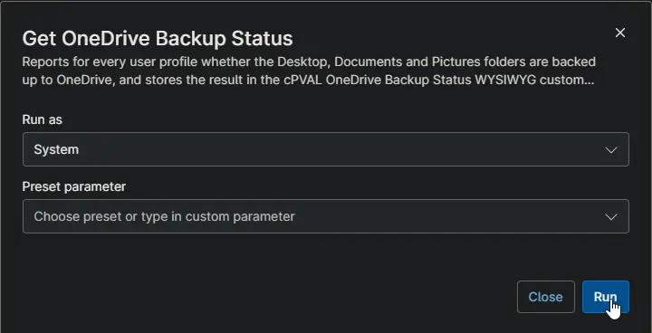

## Overview

Checks every user profile on the device and records whether the Desktop, Documents and Pictures folders are backed up to OneDrive. The results are stored in [cPVAL OneDrive Backup Status](/docs/ba25e98b-3fed-432b-96a5-147a5ac1f321). Use it to find users whose files would be lost if the device failed.

:::note  
Users do not need to be signed in. The automation reads every user profile on the device.  
:::

## Requirements

- Windows workstation
- Run As: `System`
- PowerShell 5.1
- Internet access to download the Strapper PowerShell module.

## Sample Run

## Custom Fields

| Custom Field | Scope | Type | Description |
| ------------ | ----- | ---- | ----------- |
| [cPVAL OneDrive Backup Status](/docs/ba25e98b-3fed-432b-96a5-147a5ac1f321) | Device | WYSIWYG | Stores the OneDrive backup status of every user profile on the device. |

## Dependencies

* [Custom Field: cPVAL OneDrive Backup Status](/docs/ba25e98b-3fed-432b-96a5-147a5ac1f321)
* [Audit Report: OneDrive Backup Status](/docs/a15225e6-a949-475d-9e26-8b527d9db505)
* [Solution: Get OneDrive Backup Status](/docs/67648c92-1636-419d-a541-e5a7f496fc85)

## Automation Setup/Import

[Automation Configuration](https://github.com/ProVal-Tech/ninjarmm/blob/main/scripts/get-onedrive-backup-status.ps1)

## Output

- Activity Details
- Custom Field: [cPVAL OneDrive Backup Status](/docs/ba25e98b-3fed-432b-96a5-147a5ac1f321)

## Changelog

### 2026-10-14

- Initial version of the document
