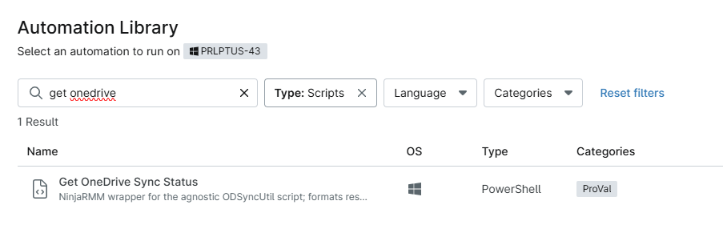
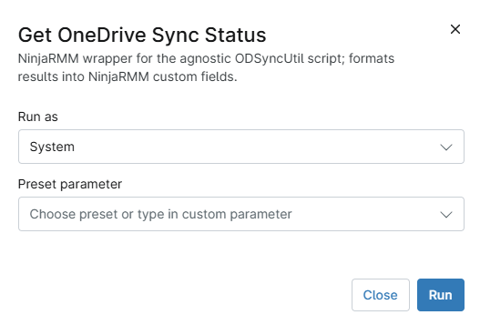
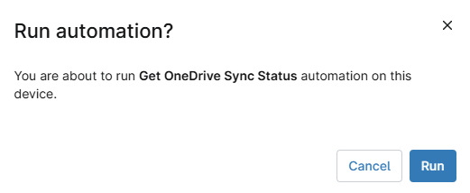

## Overview

Retrieves the OneDrive sync status and storage quota of the signed-in user with the [ODSyncUtil](https://github.com/rodneyviana/ODSyncUtil/tree/master/ODSyncUtil) tool, and stores them in [cPVAL OneDrive Sync Status](/docs/03102a1f-7b86-4528-be18-c30333e6742f). The check runs silently in the user session, so the user sees no window. Use it to find users whose files are not syncing or whose OneDrive is nearly full.

:::note  
A user must be signed in and OneDrive must be running. Otherwise the run ends with a warning and the custom field is not changed.  
:::

## Requirements

- Windows workstation with a signed-in user and OneDrive running
- Run As: `System`
- PowerShell 5.1
- Internet access to GitHub, to download ODSyncUtil, and to `contentrepo.net`, to download SilentLauncher.

## Sample Run

`Play Button` > `Run Automation` > `Script`

Search and select `Get OneDrive Sync Status`.

Set the options below and click `Run`.

- **Run As:** `System`
- **Preset Parameter:** `<Leave it Blank>`

**Run Automation:** `Yes`

## Custom Fields

| Custom Field | Scope | Type | Description |
| ------------ | ----- | ---- | ----------- |
| [cPVAL OneDrive Sync Status](/docs/03102a1f-7b86-4528-be18-c30333e6742f) | Device | WYSIWYG | Stores the OneDrive sync status and storage quota of the signed-in user. |
| [cPVAL OneDrive Sync Status Audit](/docs/cec3c5c0-10cc-4767-aea2-659f72b5bd56) | Device | String | Stores the sync status for grouping and filtering. |

## Dependencies

* [External Script: Get-ODStatus](https://github.com/rodneyviana/ODSyncUtil/blob/master/ODSyncUtil/Get-ODStatus.ps1)
* [Custom Field: cPVAL OneDrive Sync Status](/docs/03102a1f-7b86-4528-be18-c30333e6742f)
* [Custom Field: cPVAL OneDrive Sync Status Audit](/docs/cec3c5c0-10cc-4767-aea2-659f72b5bd56)
* [Audit Report: OneDrive Sync Status](/docs/497eb371-29a6-4049-b96d-6d19f3e5cb09)
* [Solution: Get OneDrive Sync Status](/docs/22d8abe0-2ea4-48e9-8b02-6108cd2de889)

## Automation Setup/Import

[Automation Configuration](https://github.com/ProVal-Tech/ninjarmm/blob/main/scripts/get-onedrive-sync-status.ps1)

## Output

- Activity Details
- Custom Field: [cPVAL OneDrive Sync Status](/docs/03102a1f-7b86-4528-be18-c30333e6742f)

## Changelog

### 2026-10-14

- The check now starts silently through SilentLauncher instead of VBScript and CMD files, so no window appears for the user.
- The helper script that runs in the user session is now signed.
- SilentLauncher is verified against its published SHA256 hash before it is used.
- The working folder now gives the local Users group Modify access instead of Everyone Full Control.
- Added the [OneDrive Sync Status](/docs/497eb371-29a6-4049-b96d-6d19f3e5cb09) report to the dependencies.

### 2026-06-08

- Updated powershell to update custom field "cPVAL OneDrive Sync Status Audit" if OneDrive process is not running.

### 2026-04-08

- Added [cPVAL OneDrive Sync Status Audit](/docs/cec3c5c0-10cc-4767-aea2-659f72b5bd56) custom field so that it can be used to store the Sync status of OneDrive, which can be further used to apply a filter to audit failed sync status machines.

### 2026-02-19

- Initial version of the document
